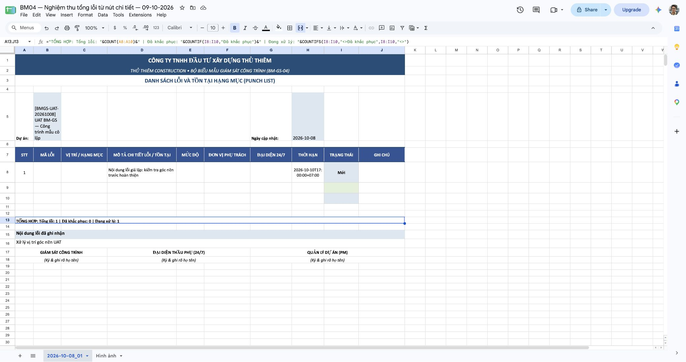

# BM-GS-04 — sửa và nghiệm thu tổng lỗi

**Kết quả: lỗi đếm thiếu đã được sửa và qua nghiệm thu Google Sheets cho cả hai file tải từ nút thật.** Phạm vi là UAT tổng hợp, một lỗi chưa có mã ở mỗi file. BM03/BM08 vẫn còn khoảng thiếu dữ liệu chưa được duyệt sửa; các mẫu còn lại chưa được nghiệm thu Google đầy đủ. Microsoft Excel, in thực tế và dữ liệu công trình thật chưa chạy.

## Thay đổi đã duyệt

Ngày 09-10-2026, `Duyệt kế hoạch trên.` xác nhận review package BM04 trong báo cáo nghiệm thu native. GPT-6.1 Sol Medium triển khai; GPT-6.1 Sol High review độc lập.

`bm_gs_workbook.go:317` đổi riêng tổng số lỗi từ `COUNTA(B8:B<end>)` sang `COUNT(A8:A<end>)`. Cột A là STT số được sinh cho từng dòng xuất. Cột B là mã lỗi optional, giữ trống đúng nguồn. End row vẫn theo bảng đã mở rộng; vị trí footer và hai công thức trạng thái giữ nguyên. Không đổi UI, route, quyền, dữ liệu, migration hoặc ảnh BM07.

## Bằng chứng tải thực tế và Google tính lại

Đăng nhập tài khoản Admin UAT tổng hợp qua UI. Mở Thi công → Cần xử lý của project `4ce66435-2632-45fe-abef-309513530b1b`, queue `open`, tìm kiếm `Xử lý vị trí góc nền UAT`. Danh sách có một dòng. Bấm `Xuất báo cáo`, rồi mở chi tiết dòng đó và bấm `Xuất báo cáo` trước Mô tả hiện trạng. Cả hai thao tác hiển thị `Đã tải biểu mẫu Excel`.

| Nguồn nút | File thực tế | Bytes | SHA256 |
|---|---|---:|---|
| Danh sách đang lọc | `danh-sach-can-xu-ly-BM-GS-04 (1).xlsx` | 14506 | `1132c30c31d46dba7e9e34e2d46d34e60e369c43c71f2d1d0f693fcef5fc0a99` |
| Chi tiết việc xử lý | `BM-GS-04 (1).xlsx` | 14507 | `6f027ab2c7b8b99f95762db3472d74c5fc5a4dafe795c62e912a99d6fbff2adc` |

Đường dẫn được lấy từ sự kiện download của chính lần bấm, không tìm file theo tên đoán. Import trực tiếp hai file đó, không sửa workbook, thay công thức hoặc xử lý ảnh sau tải. Connector xác nhận native conversion và MIME `application/vnd.google-apps.spreadsheet`. Chia sẻ vẫn Private.

1. [Google Sheets từ nút danh sách](https://docs.google.com/spreadsheets/d/1fSmgCgoDHF817aj1ufThkQAQJ9f06NByHIbfzutmcPw/edit?gid=942974765).
2. [Google Sheets từ nút chi tiết](https://docs.google.com/spreadsheets/d/1CriW5NVIc0HBr2YFkJZBQ2ZFj9piiQeA_fW4v4stT6U/edit?gid=1412500197).

Cả hai có `A8=1`, `B8` trống, mô tả ở D8, `I8=Mới`. Google đọc lại A13 trả cả effectiveValue và formattedValue: **`TỔNG HỢP: Tổng lỗi: 1 | Đã khắc phục: 0 | Đang xử lý: 1`**. Không có effective error trong vùng báo cáo A1:J19 và caption ảnh A1:C8 đã đọc. Edge đăng nhập hiển thị kết quả A13 ở 100%; phụ lục `Hình ảnh` hiển thị ảnh và caption của đúng nguồn. Không có lỗi/đè nội dung ở vùng tổng đã sửa.

## Kiểm thử và review

- Regression mở lại bytes XLSX bằng Excelize rồi `CalcCellValue`, kiểm tra kết quả thay vì chỉ so chuỗi công thức. Trước sửa: một mã trống tổng 0 thay vì 1; ba mã trống tổng 0 thay vì 3; năm dòng mã hỗn hợp tổng 3 thay vì 5. Sau sửa: cả bốn trường hợp PASS, gồm bảng rỗng ở cấp renderer. Trường hợp năm dòng xác nhận footer A15 và phạm vi mở rộng; số đã khắc phục/đang xử lý đúng.
- `go test ./internal/core -run '^TestBMGS04SummaryCountsExportedActions$' -count=1 -v`: trước sửa FAIL; sau sửa PASS, 0.461s.
- `go test ./internal/core -run '^TestBMGS' -count=1 -v`: PASS, 1.773s. `TestBMGSQAFixtures` SKIP vì biến opt-in `BMGS_QA_DIR` không đặt.
- Reviewer High chạy độc lập `go test ./internal/core -run '^TestBMGS' -count=1`: PASS, 1.570s; không có finding cần sửa trong diff hai file. Native service vẫn từ chối danh sách rỗng, UI khóa xuất khi không có dòng; test bảng rỗng không thay contract đó.
- `go vet ./internal/core`: exit0. `go build -mod=readonly ... ./cmd/server` và build guarded launcher `./server`: exit0 trước nghiệm thu, lúc khoảng 10:06 ICT. Không chạy frontend build lại vì toàn bộ source frontend giữ nguyên so với manifest đã build trước đó. Không chạy integration DB hoặc toàn bộ backend suite trong lượt sửa công thức.

## Source và môi trường

- Branch `main`, HEAD `75dc44707785d399ed2408959bf784928a544e96`; working tree chưa commit. So với manifest BM07 trước đó, chỉ hai application files thay đổi: renderer và renderer tests. Hai file đã tồn tại untracked; đối chiếu với bản sao baseline trước sửa, không dựa riêng vào Git diff.
- Renderer SHA256 `1580fcd4e86e066023bf7eca5fd65aac32983f0db6967db75d676b02c20ede46`; test SHA256 `e6412fce7e785312e646dab0f8e74ab305655e4e7d3fe8b5f501dc0119f4157a`.
- 100-file combined fingerprint `a1be411139d822735b49ad2418a5bad4811c8a9dc27be05067f0e247d2098ced`. Manifest có hash từng file và hai binary; kiểm tra lại sau nghiệm thu để phát hiện source drift.
- macOS arm64; UI Vite6.4.3 tại `127.0.0.1:15174`; guarded Go/Fiber API tại `127.0.0.1:18082/api`, khởi động 10:06:59 ICT. Dùng routes, JWT, RBAC và storage thật, không chạy production workers. Browser nguồn Codex IAB; Google Sheets trong Edge đăng nhập, zoom100%.
- PostgreSQL16 tại loopback55532, DB riêng `bmgs_native_browser_20261008`, 156 migration/maxV156. Đã đọc lại trạng thái; không chạy migration hoặc thêm/sửa lỗi nguồn để phục vụ nghiệm thu.
- Nghiệm thu chỉ xác nhận một lỗi tổng hợp chưa có mã qua mỗi nút. Mã hỗn hợp, trạng thái đã xong và bảng dài được tính bằng regression XLSX, chưa tạo thêm dữ liệu và nghiệm thu các trạng thái đó trên Google.

## Bằng chứng và trạng thái còn lại

`docs/acceptance-evidence/bm-gs-native-2026-10-09/bm04-formula/` giữ source manifest, download manifest, bản sao nguyên bytes, inspection, connector readback, ảnh UI/Google và kết quả tests/review. Mapping central/backend/triage/Construction Operations/Reporting được cập nhật. Frontend mapping không đổi vì nút, trang, source/filter và API contract giữ nguyên.

BM04: **IMPLEMENTED / TECHNICALLY VERIFIED / BOUNDED SYNTHETIC GOOGLE ACCEPTANCE PASS**. Toàn bộ tám mẫu: **NOT UX ACCEPTED**. BM03 còn thiếu số biên bản và kết luận; BM08 còn thiếu giai đoạn bàn giao và kết luận như đã báo trước, ngoài phê duyệt sửa BM04. Không commit, push, deploy hoặc đóng plan.
