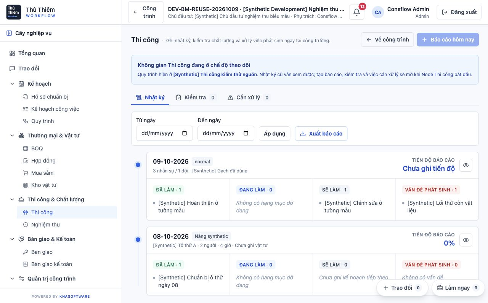
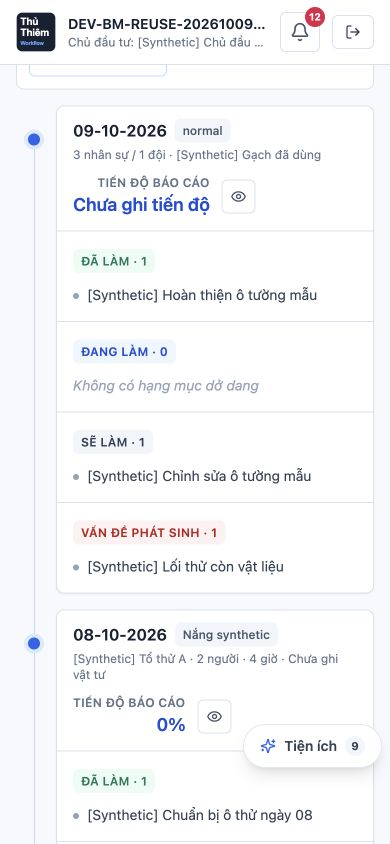

# Thẻ Nhật ký — Đồng nhất tiến độ, 12-10-2026

**Mục đích chính:** phân biệt chưa ghi tiến độ với0% thực đã lưu trên thẻ Nhật ký, cùng nguồn/logic với chi tiết và BM02.

**Kết quả:** đã sửa và kiểm chứng trên development. Ngày09 của công trình thử hiện `Chưa ghi tiến độ`; ngày08 giữ0%. Cả hai khớp với chi tiết ở desktop/mobile và với ô D10 trong file tải từ nút xuất. Nhật ký toàn hệ thống cũng hiển thị đúng. Không thêm field.

**Nghiệm thu:** UX ACCEPTED. Anh xác nhận `Đã review và Chốt nghiệm thu.` sau khi review ảnh desktop/mobile; nghiệm thu áp dụng cho bản sửa thẻ Nhật ký đã duyệt trên development.

**Giới hạn kiểm chứng:** Browser dùng hai nguồn thử hiện có, không tạo nguồn phần trăm dương; các giá trị dương/legacy/invalid được kiểm tra bằng regression render thật. Google Sheets không chạy lại vì không sửa backend/renderer/export; lượt trước đã kiểm chứng riêng. Không tuyên bố nghiệm thu toàn bộ BM/luồng thi công, Excel/print hoặc môi trường production.

## Bản sửa và source reuse

- Chỉ đổi biểu thức ở `frontend/src/modules/operations/OperationsPage.tsx::DailyTimeline` sang `groups.hasProgress ? groups.progressPercent + '%' : 'Chưa ghi tiến độ'`. `groups` đã được tính bằng `constructionReportViewModel(row)` trong cùng vòng render. Giữ helper, layout, fields, API và dữ liệu nguồn.
- Nguyên nhân cũ: thẻ đọc `Number(row.progress_percent??0)` trực tiếp nên dùng header mặc định của báo cáo từ workflow như một quan sát đã nhập. Chi tiết đã dùng `hasProgress` đúng từ trước. Cả project/global journal cùng dùng DailyTimeline.
- Tái sử dụng DailyTimeline, constructionReportViewModel, LoadingSpinner/EmptyState và ConstructionReportDetailDialog. Không tạo component, modal hoặc trải nghiệm nhập/xuất mới.
- Maps đã cập nhật: central/frontend/triage và Construction Operations domain. First searches `Tiến độ báo cáo|hasProgress|progressPercent|progress_percent`.

## Source, build và môi trường

- HEAD `75dc44707785d399ed2408959bf784928a544e96`, working tree hiện có được giữ nguyên. So với snapshot BM02 trước đó, chỉ đổi OperationsPage và thêm `frontend/tests/constructionDailyTimelineProgress.test.ts`. Manifest962 file, SHA256 `1529289ef6e24d4cfce6fefdf681a0e83725870c1118a62c72d15d717f9ba219`; hash không đổi sau build/browser.
- GPT-6.1 Sol Medium triển khai; GPT-6.1 Sol High review độc lập. Reviewer không tìm thấy P0–P2 trong delta. Regression render component DailyTimeline thật qua export riêng trong bundle bộ nhớ, không thêm app export để phục vụ test.
- Trước sửa, ba trong năm test fail; sau sửa, card/detail/historical focused suite17/17 pass (root282ms). High chạy riêng card suite5/5 pass. Có coverage missing/null/blank/invalid/default-header conflict, captured0/decimal/string/legacy wrapper, manual authority, không sửa input, loading/error/empty và đúng nguồn của nút Xem báo cáo.
- `npm run build` trên nguồn cuối exit0, Vite4.66s; `git diff --check` exit0. Build đầu trước chỉnh whitespace được thay bằng build cuối; chỉ dùng build cuối làm bằng chứng.
- `make restart ENV_FILE=/private/tmp/consflow-bm02-development-20261012.env` hoàn tất down→build→run, giữ cấu hình lượt development trước: UI5173/API8081. Cổng8080 thuộc ứng dụng khác; `.env` repo không đổi. Container tạo `2026-10-12T02:41:09Z`. Backend image `sha256:30537ea8444f792226d69074c8b2207a9d9805324a7f82e225e781df5e132949`; admin image `sha256:a5b9de8273c63be8d8a351451f1cdc5eb9f4942cf3c7cb19bdf06a6d5722ee28`.
- UI, `/api/health`, `/api/ready` HTTP200. Database consflow giữ157 migrations/maxV157, năm projects/20forms. Hash hai báo cáo thử và phiếu nguồn giống hoàn toàn trước/sau. Chỉ đọc hồ sơ; không sửa hoặc tạo dữ liệu nghiệp vụ. Auth login/session có chạy để nghiệm thu.

## Nghiệm thu browser và file thật

| Kịch bản | Kết quả |
|---|---|
| Project journal desktop1280px | Ngày09 Chưa ghi tiến độ, ngày08 0% |
| Detail ngày09/ngày08 desktop | Khớp với từng thẻ |
| Project journal mobile390×844 | Cả hai nhãn vừa vùng hiển thị; documentWidth=clientWidth390 |
| Detail ngày09/ngày08 mobile | Khớp với từng thẻ; mở/đóng qua dialog hiện có |
| Global journal, chọn đúng công trình thử | Cùng hai giá trị; không còn default0 ở ngày09 |
| Nút Xuất báo cáo của project journal | Tải thật `bao-cao-BM-GS-02 (13).xlsx`; bản sao nguyên byte20927bytes |
| XLSX đọc lại | D10 ngày09 ghi thiếu nguồn tiến độ; D10 ngày08 là0%; không có stored error cells |

File gốc SHA256 `deaa79f70c64673f986f52b53b1ba556ea154039a46fa5500179b6553a729428`. [Bản sao XLSX nguyên trạng](acceptance-evidence/journal-progress-development-2026-10-12/exports/bm02-journal.xlsx). Không chỉnh XLSX sau tải. Source fixture: project `DEV-BM-REUSE-20261009`; ngày09 `bd131f5c-ccf0-4c3f-b862-7d2dfc551eb4`, ngày08 `ded0bb8b-39dd-4757-9cef-3c2f87692b1f`; form `35416810-63ab-4175-8340-5be6e13bb51b`.

## Ảnh review và bằng chứng

Tám screenshot thực, browser-verification, source manifest, database before/after và xlsx-verification nằm trong `docs/acceptance-evidence/journal-progress-development-2026-10-12/`. Viewport đã được trả về mặc định sau kiểm tra mobile.

Audit bằng chứng cuối của High kiểm tra độc lập962 source hashes, database snapshots, log test/build/restart và nguyên byte XLSX so với Downloads; tất cả khớp. Reviewer đã xem ảnh01/05, xác nhận hai nhãn vừa vùng hiển thị. Không phát hiện kết luận mâu thuẫn hoặc P0–P2 trong phạm vi này; các giới hạn ở đầu báo cáo vẫn áp dụng.

**Trạng thái chốt:** anh đã nghiệm thu hiển thị; không còn việc sửa hoặc review cho phạm vi thẻ Nhật ký này. Development tiếp tục chạy. Chưa có yêu cầu commit/push hoặc đóng plan.
