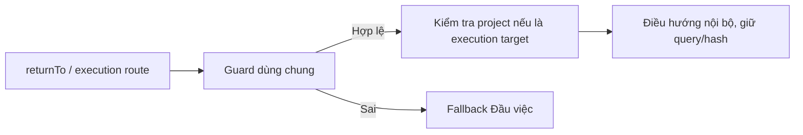

# [Closed] Nâng runtime dependencies và sửa guard — 17-11-2026

Khiêm xác nhận: “Nghiệm thu gói nâng thư viện và sửa guard. Commit, push và tạo PR đúng phạm vi, giữ các thay đổi ngoài phạm vi. Chưa merge, tạo tag hoặc deploy production.” Plan này đã được loại khỏi `docs/current-states.md`; review phát hành production và các plan khác tiếp tục độc lập.

## Phạm vi đã nghiệm thu

- Pin react-router-dom7.18.3/router7.18.3, Zod4.6.7/resolver5.2.2; giữ các dependencies khác ngoài transitive mới `@standard-schema/utils`0.3.0.
- Dùng chung safeReturnPath, loại backslash/C0/DEL và canonical path bắt đầu `//`; project check sau chuẩn hóa, giữ query/hash/fallback và Wordless contracts.
- Thêm15tests hành vi navigation/schema/resolver/RHF submit và cập nhật mapping central/frontend/triage/admin-governance. Không đổi schema policy hoặc bố cục UI.
- Không thay backend/API/RBAC/migration V161, Zoho G1, settings hoặc secrets. Không đưa AGENTS/sample artifacts/production-release review vào delivery này.

## Bằng chứng và giới hạn

Base `d98c6cf9c77edf8f6aaf30a31044a7abbd9ff6dc` + patch được duyệt;486 frontend source/config/test/public files có SHA256 `58cab61155ef058a91e52c646a058d08441abf61c7f7597511f5f1bcd6ef7d52`. Fullsuite661/661 PASS trên macOS Node23.11.0 và Linux/amd64 Node22.23.5; npm ci/typecheck/Vite/bundle budget PASS. Final Docker admin amd64/arm64 và Caddy validate/HTTP smoke local PASS: deep route200, gateway204, header/meta noindex. Runtime audit0; fullaudit còn7 dev/build package findings (5high/2moderate), ngoài phạm vi.

Chi tiết: [review và bàn giao](../proposals/RUNTIME-DEPENDENCY-REMEDIATION-REVIEW-2026-11-17.md), §7. Evidence nằm trong `output/acceptance-evidence/runtime-dependency-remediation-2026-11-17/`, localignored, không có trong Git clone và cần backup riêng. Browser/UAT NOT_RUN; sự nghiệm thu của Khiêm không biến thành bằng chứng browser đã chạy. Backend/DB/SMTP không retest do không thay source/contracts. Không merge/tag/deploy; quyền Git giới hạn commit/push/PR.

Sơ đồ dựa trên source bàn giao, không phải bằng chứng browser. Trạng thái: IMPLEMENTED, TECHNICALLY VERIFIED local, được Khiêm nghiệm thu gói; chưa phát hành.

| Tên | Mục đích | Vị trí | Trạng thái | Lý do chưa làm/bỏ qua |
|---|---|---|---|---|
| Dependencies/guard/tests/mapping | Khắc phục runtime findings và input guard | Frontend và mapping | Đã nghiệm thu | — |
| Git delivery | Review thay đổi đúng scope | Branch/PR riêng vào main | Được phép commit/push/PR | Không cho phép merge |
| Production | Phát hành | Release workflow riêng | NOT_RUN | Chưa được phép |

| Skill | Nguồn | Đóng góp thực tế | Tỷ lệ đóng góp ước lượng |
|---|---|---|---|
| consflow-module-memory | Repo | Owner và mapping | 15% |
| consflow-impact-analysis | Repo | Biên phạm vi, va chạm và giới hạn | 20% |
| consflow-frontend-workflow | Repo | Implementation/tests/build | 25% |
| consflow-diagnose | Repo | Tái hiện và regression | 20% |
| git-workflow | Personal | Stage chọn lọc, commit/push/PR | 20% |

Tỷ lệ ước lượng giữa skills, không đo thời gian/hiệu quả. Bước tiếp theo: review PR và CI; chỉ merge/phát hành khi Khiêm giao quyền riêng. Tài liệu này là hồ sơ lịch sử, không phải tracker hiện hành mới.
