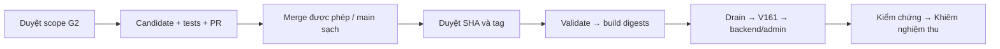
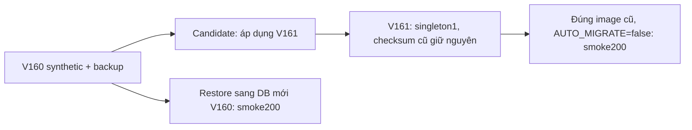

# Review package G2 — phát hành production sau nghiệm thu Zoho G1

Ngày lập: 16-11-2026. Kiểu bàn giao: Roadmap hiện hữu G1 → G2. Đây là snapshot review/đề xuất, không phải tracker; trạng thái hiện hành chỉ ở `docs/current-states.md`. Người dùng xác nhận đã nhận email và nghiệm thu G1; lượt này chỉ yêu cầu chuẩn bị review G2, chưa cho phép commit/push/deploy hoặc sửa code.

## 1. Mục tiêu, revision và ranh giới

Đề xuất phát hành toàn bộ application backlog đã có trên main cùng bản sửa preflight secret local đã được duyệt trước đó; bảo toàn SMTP G1 và noindex. Không gọi gói này là release chỉ Zoho.

- Production được SSH READ ONLY kiểm tra lại: `v2026-10-26.1`, revision `d0b36fa5b3c6ca97a27caf5dcd214f76dd91120a`; 160 migrations; chưa có bảng OTP V161; 1 Developer hợp lệ theo canonical predicate; admin có 2 bind mounts noindex.
- Local HEAD/main và origin/main tại chỗ: `b1ea48f8945049dfa362fee2b592fc092d97e87c`. GitHub connector fetch_commit(main) xác nhận cùng SHA. Revision phát hành cuối chưa tồn tại; phải là commit sạch sau khi các thay đổi được duyệt và merge theo workflow.
- Chênh lệch committed production → HEAD: 446 files, trong đó backend14 + frontend41 = 55 files (gồm tests và migration), thêm Makefile, docker-compose.zoho.local.yml, .gitignore = 58 files code/config; 10 mappings, AGENTS.md, 17 docs và 360 file output bị bỏ tracking trong commit đã có. 360 deletions thuộc cây Git output cũ, không phải lệnh xóa dữ liệu/VPS/storage.
- Không thay `docker-compose.prod.yml`, `.github/**`, `deploy/**`, backend/seed, dependency manifests hoặc permissions/migration cũ trong backlog đã kiểm tra.
- Chưa chạy test/build mới cho G2, chưa có UX acceptance cho release candidate. Kết quả G1 không chứng minh code candidate.

## 2. Ma trận tác động — dựa trên mapping và code

| Khu vực | Owner hiện hữu | Giao thoa/rủi ro | Kiểm tra bắt buộc | Kết quả pha review |
| --- | --- | --- | --- | --- |
| Auth/Developer | developer_bootstrap.go, routes.go, system_settings_store.go, activity_stream.go; DeveloperBootstrapGate/Page | Gate áp trước login/refresh và protected APIs; lỗi DB trả503; thiếu Developer trả423; SSE kiểm tra lại mỗi2s và trước event | Developer tồn tại/không tồn tại, DB lỗi, revoke, SMTP DB authority, OTP expiry/retry/race; theo dõi query load SSE | Có source/tests; hiệu năng và candidate runtime chưa xác minh |
| Workflow Forms | pipeline_form_batch_publish.go, repository_workflow_forms.go, PipelineBuilderPage, PipelineFormPublishDialog | Phát hành Form nháp theo phiên bản ghim; transaction/locks/hash/status, pipeline.edit; không tự publish Pipeline | 403, stale preview, rollback nguyên tử, dedup, inactive/empty/archived, không đổi run/history | Đã đọc source; cần chạy lại DB tests và validation candidate |
| Wordless UI | Wordless/LabelWithHelp/ContextHelp/Dialog, wordless.ts, các consumers | Mặc định on tại scope cho phép; wordless=0 quay về presentation legacy; nguồn task/returnTo không được trôi | Controls/validation/evidence viewers/permission/source identity giữ nguyên; URL/back navigation và responsive | Có render/parser tests; chưa browser G2 |
| Noindex | frontend/Caddyfile, index.html | Chuyển hotfix bind mount hiện tại sang image có header/meta tương ứng | HTTPS header/HTML mới; không mang mount hotfix vào release mới; không block crawler | Source chứa noindex; public image mới chưa build |
| Local secret | Makefile, check-local-secrets.py, test-local-secrets.py | Guard up/restart/run trước down; không chặn down/log/build; thêm Python3 cho local | 8 regression checks, override/env precedence, không lộ secret, giữ down→build→run | Đã có checks trước G2; phải rerun đúng candidate |
| Migration/deploy | V161, custom runner, deploy-production.sh | Drain ứng dụng, lock history, V161 không có trong old-image manifest; downtime | Rehearsal160→161 và restart idempotent; backup/restore; recovery không dùng migration runner cũ | 160 production checksums khớp; rehearsal chưa chạy |

Mapping đã dùng: module-keyword-map, backend-function-map, frontend-ui-utility-map, root-cause-triage-map; domain Admin Governance và Workflow Orchestration. Tìm kiếm đầu tiên theo map: `developerExists|bootstrapGate|developerBootstrapMailConfig`, `PublishPipelineForms|PipelineFormPublishDialog`, `wordlessScope|withWordless`, `X-Robots-Tag|name="robots"`, `check-startup-env|ZOHO_SMTP_PASSWORD_FILE`.

## 3. Code dự kiến phát hành

| Nhóm | Commit nguồn | Hành vi thay đổi |
| --- | --- | --- |
| Wordless | 8dc83e9 | Giảm mô tả tĩnh thành trợ giúp theo ngữ cảnh; mặc định bật tại Preparation/Planning/Pipeline, Settings/Statistics và banner được phép; không đổi nghiệp vụ/quyền |
| Noindex | 3f72533 | Header X-Robots-Tag và robots meta vào image chính thức, thay bản hotfix mount |
| Developer bootstrap | 6a47715 | Public status/OTP/complete trước gate; SMTP TLS độc lập recovery flag; Developer mất điều kiện làm ứng dụng khóa lại; tạo account/Staff/role/audit/consume OTP trong transaction |
| Phát hành Form hàng loạt | e076984 | Thêm GET publish-preview và POST publish dưới pipeline-templates/:id/workflow-forms; yêu cầu pipeline.edit, chỉ Pipeline draft; không tự publish Pipeline |
| Agent workflow/docs | 8c2f537 và các commits docs đã có | Planning/handoff và mappings; không phải runtime app |
| Sửa local đã duyệt | Working tree, chưa commit | Preflight secret trước up/restart/run, hai Python scripts, runbook/mapping và biên bản G1/G2 |

Manifest đầy đủ của 58 code/config files đã commit, đối chiếu `d0b36fa5..b1ea48f` (A=thêm, M=sửa):

```text
M	.gitignore
M	Makefile
M	backend/internal/core/activity_stream.go
A	backend/internal/core/developer_bootstrap.go
A	backend/internal/core/developer_bootstrap_test.go
M	backend/internal/core/handlers_workflow_definitions.go
A	backend/internal/core/pipeline_form_batch_publish.go
A	backend/internal/core/pipeline_form_batch_publish_test.go
M	backend/internal/core/repository_workflow_forms.go
M	backend/internal/core/routes.go
M	backend/internal/core/routes_workflow.go
M	backend/internal/core/service.go
M	backend/internal/core/service_workflow_definitions.go
M	backend/internal/core/system_settings_store.go
A	backend/internal/shared/mailer/smtp_integration_test.go
A	backend/migrations/V161__developer_bootstrap_otp.sql
A	docker-compose.zoho.local.yml
M	frontend/Caddyfile
M	frontend/index.html
M	frontend/src/app/router.tsx
M	frontend/src/components/ContextHelp.tsx
M	frontend/src/components/Dialog.tsx
A	frontend/src/components/LabelWithHelp.tsx
A	frontend/src/components/Wordless.tsx
M	frontend/src/layouts/AppShell.tsx
A	frontend/src/lib/utils/wordless.ts
M	frontend/src/main.tsx
M	frontend/src/modules/acceptance/AcceptanceEditor.tsx
A	frontend/src/modules/auth/DeveloperBootstrapGate.tsx
A	frontend/src/modules/auth/DeveloperBootstrapPage.tsx
M	frontend/src/modules/operations/ConstructionActionDialogs.tsx
M	frontend/src/modules/operations/ConstructionCheckDialogs.tsx
A	frontend/src/modules/operations/SourceReportContextBanner.tsx
M	frontend/src/modules/pipeline-builder/PipelineBuilderPage.tsx
M	frontend/src/modules/pipeline-builder/components/PipelineBuilderShell.tsx
A	frontend/src/modules/pipeline-builder/components/PipelineFormPublishDialog.tsx
M	frontend/src/modules/planning/ConstructionHandoffPanel.tsx
M	frontend/src/modules/planning/PlanningPage.tsx
M	frontend/src/modules/planning/PreparationPage.tsx
M	frontend/src/modules/projects/ProjectDetailPage.tsx
M	frontend/src/modules/projects/ProjectTaskContext.tsx
M	frontend/src/modules/projects/ProjectWorkspaceLayout.tsx
M	frontend/src/modules/reports/ReportsPage.tsx
M	frontend/src/modules/settings/SettingsBackupPanel.tsx
M	frontend/src/modules/settings/SettingsPage.tsx
M	frontend/src/modules/work-items/DesignReleasePanel.tsx
M	frontend/src/modules/work-items/DiscussionWorkflowActionCard.tsx
M	frontend/src/modules/work-items/WorkItemDetailDialog.tsx
M	frontend/src/modules/work-items/WorkItemDetailPage.tsx
M	frontend/src/modules/work-items/WorkItemPrimarySurface.tsx
M	frontend/src/modules/work-items/WorkflowFormPanel.tsx
M	frontend/src/modules/work-items/workItemExecutionTarget.ts
A	frontend/tests/developerBootstrap.test.ts
M	frontend/tests/pipelineStageNavigation.test.ts
M	frontend/tests/preparationWorkspaceResponsive.test.ts
M	frontend/tests/uiTextRefactor.test.ts
A	frontend/tests/wordless.test.ts
A	frontend/tests/wordlessPresentation.test.ts
```

## 4. Phần chưa commit: include/exclude

**Include đề xuất, chỉ hunk thuộc task này:**
- Makefile; scripts/check-local-secrets.py; scripts/test-local-secrets.py.
- docs/operations/developer-bootstrap.md; docs/operations/vps-production-deploy.md.
- Mục Local Zoho secret mount trong module-keyword-map và root-cause-triage-map.
- Mục Zoho production/local secret/G2 trong docs/current-states.md; chính review package này.
- Đây là stage theo allowlist/hunk; không `git add .`.

**Exclude khỏi commit G2 này, giữ nguyên local:** hunk AGENTS.md về local sample/output, hunk mapping Local sample artifacts, note đóng plan local sample và các hunk Nhà chị Quyên/dọn tài liệu không thuộc Zoho. Các changes đã ở main trước G2 vẫn đi theo release main và được thống kê riêng bên trên; exclude local không có nghĩa loại bỏ lịch sử đã commit.

**Luôn exclude:** .env*, deploy/config/production.env, SSH material, mọi ASP/token/backup private; output/** mới (Git-ignored), file sample và dữ liệu local. Không publish sample/project/Form qua API; release code không tự phát hành Form nháp.

## 5. Migration duy nhất: V161

File `backend/migrations/V161__developer_bootstrap_otp.sql`:
- Tạo `developer_bootstrap_otp` mới với `singleton BOOLEAN PRIMARY KEY DEFAULT true CHECK(singleton)`.
- Các cột `code_mac BYTEA`, `expires_at/sent_at TIMESTAMPTZ`, `attempts INTEGER DEFAULT0 CHECK(attempts>=0)`, `delivery_pending BOOLEAN DEFAULT false`.
- Chèn đúng1 dòng singleton. Không tạo account, role, quyền hoặc backfill giao dịch; không đổi các bảng nghiệp vụ/historical snapshots.
- Đã đối chiếu SHA256 của toàn bộ160 migrations production với files hiện tại:0 mismatch,0 missing. Chỉ version161 pending.
- Custom runner dùng advisory lock và transaction từng migration; khóa EXCLUSIVE trên schema_migrations, thực thi DDL/INSERT/history cùng transaction. Không sửa applied SQL, không dùng Flyway. Không hứa không downtime/không lock.
- Nếu fails trước commit, transaction migration rollback. Nếu V161 đã commit, ưu tiên roll-forward. Old image manifest chỉ tới160 sẽ từ chối history161; không chạy lại deploy script cũ để rollback.
- Phương án phục hồi image giữ DB161 phải được diễn tập trên DB tách biệt với AUTO_MIGRATE=false trước khi tuyên bố dùng được. Không drop table hoặc xóa schema_migrations để ép rollback. DB restore từ backup chỉ dùng phương án sự cố đã phê duyệt, có mất các ghi sau backup; cần dừng ghi và xác nhận riêng.

## 6. Mockup as Text — mô tả candidate đã có, không đề xuất thiết kế mới

**Mục đích chính — Wordless:** ưu tiên dữ liệu và thao tác, mở giải thích khi cần.
```text
[Tiêu đề màn hình] [? trợ giúp]
[Trạng thái / dữ liệu / cảnh báo trực tiếp]
[Điều khiển nghiệp vụ hiện hữu]       [CTA hiện hữu]
[?] → lời giải thích; Escape/click ngoài để đóng
URL ?wordless=0 → presentation legacy
```
Giữ empty/loading/error/invalid controls trực tiếp; prefix label được wrap, đuôi và trigger đi cùng nhau. Mobile dùng layout consumers hiện hữu; vị trí tooltip/touch là điểm kiểm chứng, chưa được chứng minh bằng build.

**Mục đích chính — Dialog Form:** xem và xác nhận đúng Form nháp của Pipeline.
```text
+ Phát hành biểu mẫu liên quan ---------------- [x] +
| Pipeline: <tên>                                   |
| N phiên bản nháp / M Gói công việc                |
| Biểu mẫu | Phiên bản | Gói sử dụng | Trạng thái    |
| <từng phiên bản, chỉ hiển thị một lần>             |
| Cảnh báo nếu có Form không đủ điều kiện            |
| Không phát hành Pipeline                          |
|                      [Hủy] [Phát hành N biểu mẫu] |
+--------------------------------------------------+
```
Loading dùng LoadingSpinner; lỗi có Thử lại; empty/blocked khóa CTA; pending khóa đóng/confirm. Table có scroll ngang trên mobile.

**Mục đích chính — Bootstrap:** xác minh email và tạo Developer khi hệ thống chưa có Developer hợp lệ.
```text
+ Thiết lập tài khoản Developer ------------------+
| Email Developer [khiemnd777@gmail.com] chỉ đọc   |
| Bước1: [Gửi mã xác minh]                         |
| Bước2: [Mã8số] [Gửi lại sau60s]                 |
|        [Họ tên] [Mật khẩu] [Xác nhận mật khẩu]    |
|        [Hoàn tất thiết lập]                      |
|        <lỗi trực tiếp / inline invalid>          |
+-------------------------------------------------+
```
AuthCard giới hạn max-width; loading gate dùng Spinner, lỗi status có Thử lại. Production đang có Developer hợp lệ nên không mong đợi màn hình này sau release; không gửi OTP thật để thử trên production.

Interaction → standard component → entrypoints:
- Giải thích/label → ContextHelp + LabelWithHelp/WordlessLabel → scoped pages/banners/WorkflowForm controls.
- Dialog phát hành → Dialog + LoadingSpinner + ToastProvider + API client → PipelineBuilderPage/PipelineFormPublishDialog.
- Bootstrap → AuthCard + PasswordInput + ToastProvider + API client → DeveloperBootstrapGate/Page.
- Evidence viewing/upload không có owner mới trong candidate; kiểm tra consumers không bypass viewer/uploader hiện hữu.

## 7. Kế hoạch triển khai sau khi được duyệt

1. Chốt scope full-main + allowlist local ở trên, xác nhận nguồn main chưa drift; không tự cherry-pick/loại feature để gọi là Zoho-only.
2. Tạo branch task theo workflow Git; giữ nguyên unrelated working changes, stage đúng hunk. Không cần worktree mặc định; nếu thực sự cần checkout sạch phải thông báo/được phép theo quy định trước khi tạo. Không reset/stash/force-push.
3. Chạy checks trên chính candidate sẽ commit. Chuẩn bị PR và push branch khi được duyệt; không tự merge PR. User merge hoặc cấp quyền merge riêng.
4. Chuẩn bị candidate sạch tại main=origin/main sau merge. Dirty worktree hiện tại không đạt điều kiện release-tag.sh; không vượt guard. Chốt SHA cuối, tag hợp lệ theo ngày thực tế, chưa đặt tag trước.
5. Trước tag production: backup DB bằng quy trình vận hành có kiểm tra đọc/restore ở môi trường tách biệt; lưu release.env/images và shared env/secret mounts. Không gửi private backup qua Git.
6. Tag workflow validate → build/push immutable GHCR digests → deploy với drain → migrate → bootstrap-admin → backend/admin. Đây có downtime single-host; giữ shared SMTP/secret G1, không full provisioning/render để ghi đè identity.
7. Sau release: đối chiếu OCI SHA/digest, gateway204/health200/ready200, DB161 và singleton1row, bootstrap/status required=false, login/phiên Developer hiện hữu, SMTP config/mount giữ nguyên, header/meta noindex có trong image mới không dùng mounts hotfix. Không tự gửi email thử thứ2, không publish Form/Pipeline, không ghi dữ liệu nghiệp vụ để smoke.
8. Bàn giao cho Khiêm nghiệm thu release. Bất kỳ scope/code fix ngoài release đã duyệt phải trình lại; không giảm gates để xanh.

## 8. Gates kiểm chứng (đều TARGET/NOT_RUN cho candidate G2)

- Format: gofmt -l đúng paths như CI; không format diện rộng ngoài diff.
- Migrations: backend make migrate-check; rehearsal160→161 trên DB disposable, đối chiếu160hash cũ/singleton, rerun skip161; diễn tập phục hồi image giữDB161.
- Backend: go test -timeout 30m -p 1 ./... với PostgreSQL/Redis disposable theo .github/workflows/validate.yml. Focus DeveloperBootstrap*, PublishPipelineFormsIsAtomicAndUsesDistinctVersions, WorkflowFormVersionGovernance*, SMTPDeliverWithVerifiedTLS. Kiểm tra fail-closed/RBAC/OTP expiry/retry/concurrency/history.
- Frontend: npm ci, npm test, npm run build, npm run check:bundle-budget; production Caddy image validation như CI.
- Tooling: bash scripts/test-release-tag.sh; bash deploy/scripts/test-production-tooling.sh; PYTHONDONTWRITEBYTECODE=1 python3 scripts/test-local-secrets.py; git diff --check.
- Browser G2 NOT_RUN và không được chạy trong lượt lập review. G2 cần scope browser được duyệt riêng/đi kèm triển khai rõ: Wordless on/off/tooltip responsive, Pipeline Form dialog trên fixture không production, bootstrap trên fixture không có Developer; production chỉ smoke không ghi nghiệp vụ. Nếu không được phép browser, ghi NOT UX ACCEPTED và bàn giao giới hạn thay vì tự coi usability pass.
- Rủi ro SSE: bootstrapCheck thêm DB lookup mỗi2s mỗi stream và trước event/heartbeat. Chưa đo tải; kiểm tra query budget trên môi trường đại diện trước khi kết luận hiệu năng đủ.
- Không dùng G1 SMTP accepted/user-received làm bằng chứng OTP hoặc tất cả luồng email của code G2.

## 9. WHAT và skills của pha review

| Tên | Mục đích | Vị trí | Trạng thái | Lý do chưa làm/bỏ qua |
| --- | --- | --- | --- | --- |
| G1 Zoho | Nền SMTP production | VPS/Settings | Người dùng nghiệm thu | — |
| Inventory G2 | Chốt code/migration và exclude local | Package này | Review đã lập | — |
| Verification candidate | Chứng minh revision sẽ release | Local/CI/disposable DB | TARGET | Chờ duyệt G2 |
| Commit/push/PR | Đưa đúng scope lên Git | Task branch | Chưa làm | Chờ duyệt |
| Tag/deploy | Phát hành đúng SHA/digests và V161 | CI/VPS | Chưa làm | Chưa có candidate qua gates và quyền phát hành |

| Skill | Nguồn | Đóng góp thực tế | Tỷ lệ đóng góp ước lượng |
| --- | --- | --- | --- |
| consflow-module-memory | Repo | Định tuyến owners/maps | 10% |
| consflow-impact-analysis | Repo | Ma trận giao thoa và scope | 20% |
| consflow-admin-governance-domain | Repo | Developer/Settings/auth risks | 15% |
| consflow-workflow-orchestration-domain | Repo | Form publication/invariants | 15% |
| consflow-docker-ops | Repo | Release/image/noindex/shared secrets | 15% |
| git-workflow | Personal | Remote/main/staging/PR/tag boundaries | 10% |
| database-workflow | Personal | Migration/checksum/recovery evidence | 15% |

## 10. Điểm cần duyệt / bước tiếp theo

1. Khuyến nghị: duyệt scope phát hành full-main gồm Wordless, bootstrap+V161, Form publication, noindex và task-owned preflight/docs; cho phép validation/chuẩn bị commit+push+PR trong scope. Chưa tự merge/tag/deploy khi candidate chưa qua gates.
2. Sau khi có SHA/PR/checks và rehearsal cụ thể: duyệt bước tag/deploy production. Quyền merge và browser phải rõ nếu cần; không suy từ việc duyệt review này khi câu xác nhận chỉ nói chuẩn bị.
3. Nếu chỉ muốn release hẹp hơn: nêu nhóm loại khỏi release; cần thiết kế lại source/branch và migration plan, không âm thầm deploy main rồi nói chỉ Zoho.

Sơ đồ dưới đây là luồng đề xuất từ source pipeline, không phải bằng chứng đã phát hành:



## 11. Biên bản kiểm chứng candidate — 16-11-2026

Người dùng đã duyệt full-main, kiểm thử/rehearsal và commit/push/PR; chưa merge/Git tag/deploy production. Trạng thái Git/PR hiện hành tiếp tục chỉ ghi ở docs/current-states.md. Phần này ghi snapshot kỹ thuật, không thay tracker.

**Giới hạn trước kết quả:** browser/UAT G2 NOT_RUN, NOT UX ACCEPTED. Có 10 npm audit findings (7 high,3 moderate,0 critical); audit exit1. Package manifests không thay đổi so với production và không được nâng dependency tự động. Các finding cần được xem xét trước quyền phát hành; biên bản không tuyên bố candidate production-ready. Ba tests opt-in skip được liệt kê dưới đây. Rehearsal dùng dữ liệu synthetic/local tmpfs, không chứng minh S3/network hoặc mọi workflow production tương thích ngược.

**Source:** snapshot lấy từ b1ea48f cùng9 task-owned file/hunk; 1095 application/config/test files khớp working tree. Fingerprint SHA256 `50f0b2417ee24e5a3c426296022e8c5d75e9fe9777f3b4dff8a9afd4826c2902`. Snapshot không phải Git worktree; bỏ2 absolute symlink node_modules của tooling không liên quan, không bỏ application sources. Sau build chỉ cập nhật tài liệu/mapping; application fingerprint không đổi. Image build này là artifact rehearsal local, chưa phải GHCR release artifact.

| Kiểm tra | Môi trường/thời điểm UTC | Kết quả thực tế |
| --- | --- | --- |
| gofmt -l, migration -check | macOS/Go1.25 | Không file lệch format; manifest161 hợp lệ |
| go test -json -timeout 30m -p 1 ./... | Go1.25 macOS, PostgreSQL16/Redis7 disposable; 04:39:48–04:46:33 | Exit0;1140 test/subtest PASS,0 FAIL,3 SKIP |
| npm ci/test | Node23 macOS; 04:39:05–04:39:11 cho tests |646 PASS,0 FAIL,0 SKIP |
| npm ci/test | Linux amd64/Node22.23.5; 04:43:51–04:44:23 |646 PASS,0 FAIL,0 SKIP |
| npm run build | Node23 macOS; 04:39:05–04:39:31 | TypeScript/Vite PASS, VITE_API_URL=/api |
| npm run check:bundle-budget | Cùng build trên | PASS |
| Backend Docker image | Linux amd64, repository Go1.23 Dockerfile; 04:38:24–04:39:38 | PASS; local manifest/image ID d8d7e05edb5f73a5bdbf69b332f749ecda4e0207c29e58366f6c180f3ffbb7b7 |
| Admin Docker image/Caddy | Linux amd64, Node22/Caddy; 04:39:49–04:41:38 | PASS; local image ID fefc3abde120dd7eaac3948e8ed2a2a5c0cf6b03d2b320022e3990c93d37e25d; caddy validate PASS |
| HTTP smoke image admin | Docker local, không browser | /200, gateway204, X-Robots-Tag:noindex và robots meta đúng |
| Tooling | Disposable fixtures, không gọi production | release-tag validator PASS; production-tooling PASS;8 local-secret regression tests PASS |
| npm audit --json | Manifests không đổi, registry report hiện tại | FAIL/finding:10 (7 high,3 moderate), không auto-fix |
| git diff --check/source comparison | Task-owned snapshot | PASS trước commit |

Ba SKIP: TestActivityAttentionPerformanceBudget (10k opt-in), TestProjectProgressBoardPerformanceBudget (10k opt-in), TestBMGSQAFixtures (BMGS_QA_DIR không yêu cầu). Không coi những ca này hoặc SSE load budget là đã kiểm chứng. Các tests DeveloperBootstrap*, PublishPipelineFormsIsAtomicAndUsesDistinctVersions và SMTP TLS mock integration đã nằm trong suite pass.

Các npm findings theo package: baseline-browser-mapping, browserslist, nanoid, postcss, postcss-selector-parser, react-router, react-router-dom, source-map-js, vite, zod. Đây là kết quả dependency scanner, chưa phải xác nhận exploitability của mọi package trên bundle production. Không gộp audit exit1 thành all-checks-pass.

**Rehearsal đã chạy:** lấy đúng image production sha256:71b99ac8559885e9107408ce83f6be72c664c9eb4c38bfaa1c2dd3479b7ff25e về local bằng docker save/load qua SSH chỉ đọc, không lấy production DB/secrets. PostgreSQL/Redis synthetic riêng ở15432/16380. Tạo baseline160 và Developer synthetic, health/ready/login200; pg_dump backup. Candidate áp dụng1/skip160, tạo đúng1singleton, giữ160checksum/sentinel/số lượng user/global-role; chạy lại0/161. Candidate health/ready/login200 và bootstrap required=false. Runner cũ từ chối161 đúng dự kiến. Image production cũ recovery với AUTO_MIGRATE=false trên cùng DB161 cho health/ready/login200, các invariants đã chọn không đổi. Restore backup160 vào DB mới, kiểm tra selected snapshot và old-image health/ready/login200 thành công. Không thực hiện workflow ghi nghiệp vụ thật hoặc gửi email.



**Lỗi môi trường đã xử lý:** cache npm/Go mặc định bị sandbox chặn ghi → dùng cache tạm; lượt Node22 đầu mount thiếu backend/V20 → mount snapshot đầy đủ; fixture rehearsal ban đầu dùng STORAGE_PROVIDER=local không hợp lệ → sửa thành default và dựng lại DB synthetic từ đầu. Không sửa app source, assertion, migration hoặc tắt TLS/auth/gates để vượt các lỗi này.

**Bằng chứng:** output/acceptance-evidence/zoho-production-g2/ chứa receipt.json, source-manifest.json, rehearsal.json, script rehearsal, logs, npm-audit.json và dump synthetic. Đây là output local Git-ignored, không theo Git clone và cần backup riêng nếu muốn giữ. Các snapshots chứa dữ liệu thử, không chứa ASP production/JWT thật. Chỉ biên bản tóm tắt và runbook được đưa vào commit.

| Skill | Nguồn | Đóng góp thực tế pha kiểm chứng/Git | Tỷ lệ đóng góp ước lượng |
| --- | --- | --- | --- |
| consflow-module-memory | Repo | Owner routing và mapping secret/recovery |10%|
| consflow-docker-ops | Repo | Images, Caddy, isolated containers và runtime rehearsal |35%|
| database-workflow | Personal | Migration160→161, invariants, dump/restore |35%|
| git-workflow | Personal | Branch, selective hunks, commit/push/PR boundary |20%|

Bước tiếp theo: tạo PR đúng task-owned diff sau stage review; người dùng review PR và dependency findings. Chưa merge/Git tag/deploy production. Mọi quyền phát hành tiếp theo phải nêu rõ candidate SHA và kết quả còn thiếu.
