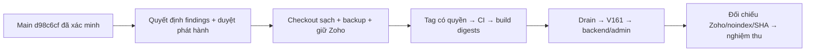

# Review package phát hành production — 17-11-2026

**Mục đích:** chốt candidate full-main sau PR #9, migration V161 và điều kiện bảo toàn Zoho đã nghiệm thu. Kiểu bàn giao: roadmap G1 Zoho → G2 source/kiểm chứng → review quyền phát hành. Tài liệu là snapshot review, không phải tracker; trạng thái hiện hành chỉ ở `docs/current-states.md`.

**Ranh giới:** lượt này chỉ chuẩn bị review, đọc source/GitHub/production và chạy dependency audit. Không commit/push, tạo Git tag, build release mới, chạy migration, restart/deploy hoặc gửi email. Bốn file chưa commit từ các task khác được giữ nguyên; các sửa tài liệu review local không thuộc candidate SHA dưới đây.

## 1. Giới hạn và quyết định còn mở

- Audit ngày17-11 vẫn exit1: 10 findings (7 high,3 moderate), gồm3 runtime findings (2 high,1 moderate). Chưa có đánh giá exploitability hay quyết định chấp nhận/xử lý rủi ro trước release; không tự nâng dependency hoặc coi CI xanh là security acceptance.
- Browser/UAT G2 NOT_RUN, NOT UX ACCEPTED. Ba tests backend opt-in chưa chạy: hai benchmark10k và BMGS QA fixtures. SSE query load/UX toàn candidate chưa được chứng minh bằng rehearsal.
- Working tree hiện không sạch, nên chưa đạt gate của `release-tag.sh`. Không stash/reset/commit các task khác để vượt gate. Khi có quyền phát hành, dùng checkout sạch đúng approved SHA; không tạo checkout/worktree trong lượt này.
- Chưa có release tag, GHCR digests hoặc deploy run cho candidate này. Không gọi image rehearsal ngày16-11 là image release đã phát hành. Thời điểm tag cần chốt lại branch/remote SHA; nếu main drift phải dừng và cập nhật review.

## 2. Candidate và bằng chứng source

| Nguồn | Revision/trạng thái đã xác minh |
| --- | --- |
| Candidate main | `d98c6cf9c77edf8f6aaf30a31044a7abbd9ff6dc` |
| Local main/origin/main | Cùng SHA candidate; GitHub fetch_commit(main) ngày17-11 xác nhận cùng SHA |
| PR #9 | Đã merged vào main; không merge lại |
| Head đã qua CI của PR #9 | `9758ac6948f193d09e9efb837a143cd1c1155583` |
| So sánh tree | `git diff 9758ac6 HEAD` rỗng; toàn tree merge candidate giống head đã test, không chỉ cùng tên file |
| CI | Run43813766981, SUCCESS trên head9758ac6; không gắn nhãn run này là CI trực tiếp của merge SHA d98c6cf |
| Fingerprint application/config/test | 1095 files: `50f0b2417ee24e5a3c426296022e8c5d75e9fe9777f3b4dff8a9afd4826c2902`, vẫn khớp working sources |
| Production hiện tại | `v2026-10-26.1`, revision `d0b36fa5b3c6ca97a27caf5dcd214f76dd91120a` |
| Image backend production | `sha256:71b99ac8559885e9107408ce83f6be72c664c9eb4c38bfaa1c2dd3479b7ff25e` |

CI: https://github.com/khiemnd777/ttcons/actions/runs/43813766981 ; PR: https://github.com/khiemnd777/ttcons/pull/9 .

**Phạm vi full-main đã duyệt, không phải release chỉ Zoho:** Wordless UI mặc định trong scopes được phép; bootstrap Developer qua OTP và gate auth/SSE; preview/publish hàng loạt Workflow Form nháp; noindex trong image; preflight secret local và tài liệu/mapping vận hành. So production có60 code/config files (55 backend/frontend gồm tests+V161, cộng Makefile/.gitignore/Zoho local override và2scripts). Toàn delta449 files còn có docs/mapping và360 output files bỏ tracking ở lịch sử main; đây không phải thao tác xóa DB/storage/VPS. Danh sách scope và Mockup as Text candidate đã có ở `G2-PRODUCTION-RELEASE-2026-11-16.md` §§3–6; không đề xuất UI mới trong lượt review này.

Không đổi dependency manifests/lockfiles, backend seed, `docker-compose.prod.yml`, `.github/**` hoặc `deploy/**` so production trong candidate đã kiểm tra. Local samples/output/secrets và các hunk AGENTS chưa commit không được đưa vào release artifact. Nếu có commit mới để sửa findings/tài liệu thì SHA ứng viên phải được đánh giá lại, không tiếp tục gọi là candidate d98c6cf.

## 3. Ma trận tác động và owner

| Khu vực | Owner/source | Rủi ro giao thoa | Kiểm tra / giới hạn |
| --- | --- | --- | --- |
| Auth/Developer | routes.go, developer_bootstrap.go, activity_stream.go | Gate trước login/protected API; Developer mất điều kiện sẽ khóa hệ thống; thêm query kiểm tra SSE | Hiện1 canonical Developer; sau deploy bootstrap/status phải required=false; không gửi OTP thật để smoke |
| Forms | pipeline_form_batch_publish.go, repository_workflow_forms.go, PipelineBuilderPage/Dialog | Transaction publish Form theo pin/hash/status/pipeline.edit | Chỉ phát hành code; không publish Form/Pipeline hoặc rewrite runtime/history trên production |
| Wordless | Wordless.tsx, wordless.ts, scoped consumers | Presentation/navigation mới; legacy qua wordless=0 | Tests đã qua; chưa browser/UAT release candidate |
| V161 | SQL mới và custom runner | Table OTP/singleton; history lock; image cũ thiếu manifest161 | Checksum160 khớp; rehearsal migration/recovery synthetic đã qua |
| Zoho G1 | system_settings_store.go, shared/.env.prod, file secret | Database authoritative; startup env không được ghi đè field đã lưu | Giữ nguyên values/versions/secret/key; không chạy bootstrap/render provisioning |
| Noindex | frontend/Caddyfile, index.html | Chuyển từ2 hotfix mounts của admin cũ sang nội dung trong image mới | Xác minh header+meta mới; không copy hotfix mounts vào release mới |
| Release | release-tag.sh, release.yml, deploy-production.sh | Push tag có thể tự deploy sau CI; có drain/downtime single-host | Chỉ thực hiện khi có quyền tag+deploy rõ; clean main=origin/main=approved SHA |

Mapping đã nạp: module-keyword-map, backend-function-map, root-cause-triage-map và domain Admin Governance. Đối chiếu scope G2 đã được map ở review trước. Tìm kiếm đầu tiên: `developerExists|bootstrapGate|developerBootstrapMailConfig`, `schema_migrations|checksum_sha256|validateAppliedManifest`, `SMTP_PASSWORD_FILE|SMTP_HOST|render_value`, `RELEASE_TAG|clean main|stop -t`. Không sửa mapping vì lượt này chỉ lập review/vận hành READ ONLY, không thay code/contracts/owners.

## 4. Migration V161 — duy nhất pending

- File: `backend/migrations/V161__developer_bootstrap_otp.sql`.
- SHA256: `22729120392eadf589c1af202ff5ff89625ff41853adf9a6fb180d08e8729173`.
- Tạo bảng `developer_bootstrap_otp`: singleton BOOLEAN PK/CHECK, code_mac BYTEA, expires_at/sent_at TIMESTAMPTZ, attempts INTEGER>=0, delivery_pending BOOLEAN; chèn1 singleton row.
- Không tạo/sửa account, Staff, role, permission; không backfill/đổi bảng nghiệp vụ hoặc snapshots. Không sửa V1–V160 đã applied.
- SSH/SQL `BEGIN READ ONLY` ngày17-11: production160 versions,0checksum mismatch/0missing so local; chưa có bảng OTP; pending đúng161.
- Custom runner giữ advisory lock, transaction từng migration và EXCLUSIVE lock trên schema_migrations; DDL/row/history commit cùng nhau. Expected deploy log:1 applied/160 skipped; rerun0/161 nếu source/data không drift.
- Rehearsal ngày16-11: đúng old production image trên syntheticDB160, candidate migration1/160, singleton1,160checksums/sentinel/identity counts giữ; rerun0/161; health/readiness/login và bootstrap required=false PASS. Không áp dụng migration production trong lượt này.

## 5. Bảo toàn Zoho G1 — baseline READ ONLY ngày17-11

G1 đã được Khiêm xác nhận nhận email và nghiệm thu ngày16-11. Lượt17-11 không gửi thêm email và không tái kiểm tra ASP bằng AUTH; kiểm tra metadata/readability không chứng minh Zoho vẫn chấp nhận AUTH tại mọi thời điểm.

| Thành phần | Baseline hiện tại cần giữ |
| --- | --- |
| SMTP host/port/TLS, DB và startup env | smtp.zoho.com /465 /tls |
| Username/from | khiem@knasoftware.com |
| SMTP_PASSWORD trong DB | Đã có ciphertext/nonce, version2; không đọc plaintext |
| Host file secret | /opt/consflow/shared/secrets/smtp_password_zoho_production |
| Mount | /run/secrets/smtp_password; backend đọc được/không rỗng |
| Quyền file |0600, UID10001; backend10001:10001 |
| Tên người gửi trong DB | **Thủ Thiêm – Dương Nhật Hưng – Workflow**, version2 |
| Timeout trong DB |10s, version1 |
| Các field SMTP identity/port/TLS/password | version2 |
| AUTH_RECOVERY_ENABLED |false ở DB và môi trường; không tự bật |
| AUTO_MIGRATE backend |false; dùng migration job riêng |

Tên người gửi là giá trị hiện tại trong DB, khác tên Consflow của thời điểm G1 ban đầu. Giữ giá trị hiện tại; không khôi phục cứng từ snapshot cũ. Không suy tên đang được process áp dụng chỉ từ DB hoặc startup env khi chưa kiểm tra trạng thái pending-restart.

Trước tag/deploy được phép: backup DB có kiểm tra restore và bảo vệ shared env/secret/settings encryption key, chốt baseline field values/versions và file metadata riêng tư. Không đưa secret vào Git/GitHub/CI log; không xoay ASP, JWT hoặc SETTINGS_ENCRYPTION_KEY. Không chạy production-bootstrap/provision/render: renderer có thể phát sinh SMTP identity trống và ghi đè cấu hình operator. Pipeline release hiện dùng shared/.env.prod và file mount, không cần thêm service/provider.

Sau deploy được phép: đối chiếu values/versions/secret presence với baseline; xác nhận process mới load database settings, mount đọc được, logs cấu hình không có lỗi secret/decrypt. Configured/ready chỉ chứng minh cấu hình/sẵn sàng; không gọi là đã gửi/nhận thư. Không tự gửi email thứ2 hoặc OTP nếu không có yêu cầu riêng.

## 6. Dependency findings còn mở — audit mới ngày17-11

| Package | Severity | Trong npm audit --omit=dev |
| --- | --- | --- |
| baseline-browser-mapping |moderate|Không|
| browserslist |high|Không|
| nanoid |high|Không|
| postcss |high|Không|
| postcss-selector-parser |moderate|Không|
| react-router |high|Có|
| react-router-dom |moderate|Có|
| source-map-js |high|Không|
| vite |high|Không|
| zod |high|Có|

`npm audit --json`: exit1,total10(7high/3moderate),0critical. `npm audit --omit=dev --json`: exit1,total3(2high/1moderate). Registry báo fixAvailable cho các packages này nhưng chưa chứng minh mọi fix tương thích; không chạy npm audit fix/force hoặc đổi lockfile trong phạm vi review. Không có manifest/lockfile diff so production, không đồng nghĩa các findings được chấp nhận hoặc không gây rủi ro.

**Unknown:** khả năng khai thác cụ thể trong đường đi ứng dụng/browser build và tác động tương thích khi nâng phiên bản. **Khuyến nghị:** ưu tiên phân tích3 runtime findings và lập scope xử lý trước tag/deploy. Nếu chọn phát hành với findings còn mở, cần quyết định chấp nhận rủi ro rõ ràng của người dùng, có phạm vi/giới hạn và kế hoạch xử lý; không suy từ việc PR đã merge hay CI pass. Sửa dependency tạo candidate SHA mới và phải chạy lại checks phù hợp.

## 7. Bằng chứng kiểm chứng có thể kế thừa

- CI43813766981 SUCCESS trên9758ac6; merge tree d98c6cf giống hệt nên không có source drift. Không có CI merge riêng được xác minh và chưa có tag build/deploy.
- Local full backend:1140 pass,0fail,3opt-in skip; frontend646pass trên Node23/macOS và Node22.23.5/Linux amd64. Format, migration-check161, bundle budget,8 secret tests, release/production tooling PASS.
- Backend Docker amd64 build16-11 04:38:24–04:39:38UTC; admin build04:39:49–04:41:38UTC; Caddy validate và HTTP noindex smoke PASS. Đây là image local rehearsal, không phải digests release mới.
- Rehearsal đúng old production image trên DB161 với AUTO_MIGRATE=false: health/readiness/login synthetic200; restore backup160 sang DBmới cũng PASS. Chỉ local tmpfs storage/dữ liệu synthetic; không chứng minh mọi workflow/S3 production.
- READ ONLY public HTTPS ngày17-11: /200,gateway204,health200,ready200; noindex header/meta hiện có. Không dùng browser lượt này.
- Không rerun toàn bộ build/test chỉ để lặp bằng chứng khi tree không đổi; audit được chạy mới vì dữ liệu registry có thể thay đổi theo ngày. Tests skips/performance/UX vẫn còn giới hạn.

Evidence ngày17-11: `output/acceptance-evidence/production-release-review-2026-11-17/{production-readonly.json,public-https-readonly.json,dependency-summary.json,npm-audit-all.json,npm-audit-runtime.json}`. Evidence16-11 ở `output/acceptance-evidence/zoho-production-g2/`. Các output local Git-ignored, không theo Git clone, cần backup riêng nếu giữ. Không ghi ASP/token/key plaintext vào evidence. Biên bản G2 đã commit ở `G2-PRODUCTION-RELEASE-2026-11-16.md` §11.

## 8. Trình tự đề xuất khi có quyền phát hành

1. Chốt quyết định dependency/UX limitations và SHA; nếu main hoặc scope đổi, dừng và lập delta review. Không tạo tag động vào main mới chưa duyệt.
2. Dùng checkout sạch của main đúng d98c6cf, recheck origin/main==approved SHA. Không làm sạch bằng reset/stash hoặc gộp các local changes đang có. Tài liệu review local mới này không nằm trong candidate SHA.
3. Lấy backup DB production qua quy trình được phép, kiểm tra đọc/restore trong môi trường tách biệt; lưu release.env/current image digests, old noindex Compose, shared env/secret baseline. Chưa có backup production mới cho lần release này trong lượt review.
4. Preflight Compose và các secret mount, nhất là SMTP (script deploy hiện không liệt kê test SMTP trong nhóm preflight secrets); xác nhận Developer vẫn hợp lệ. Giữ database settings và shared secrets.
5. Chỉ sau quyền tag+deploy rõ mới tạo/push tag hợp lệ theo ngày thực thi; push tag kích hoạt pipeline có thể tự deploy sau checks. Không đặt/tạo tag ở lượt này.
6. Workflow validate → build/push digests → deploy: dependency up → preflight → drain admin/backend → migrate161 → bootstrap-admin → backend → admin. Có downtime single-host; không gọi đây là rolling/zero-downtime.
7. Kiểm tra exact SHA/digests, DB161/singleton1, Developer/bootstrap required=false, health/readiness/gateway, SMTP baseline, noindex mới trong image; không mang2 hotfix mounts cũ vào release mới. Không publish Form/Pipeline, tạo user hoặc gửi email để smoke.
8. Bàn giao evidence để Khiêm nghiệm thu. Nếu fail, bảo toàn logs đã redact; ưu tiên roll-forward hoặc recovery image theo giới hạn dưới đây, không tuyên bố rollback DB tự động.

## 9. Recovery và điểm dừng

- Runner image cũ chỉ có manifest160 sẽ từ chối DB161. Không chạy lại full deploy script/migration cũ, không xóa history161 hoặc drop table để vượt guard.
- Recovery đã rehearsal: đúng old image, AUTO_MIGRATE=false, giữ DB161, chỉ recreate image dưới old release.env/Compose với shared secrets, không migrate/bootstrap. Cần drain, kiểm tra health/auth/luồng bị ảnh hưởng và giữ noindex hotfix ở image cũ. Rehearsal synthetic không thay thế kiểm tra thực tế.
- DB restore từ backup có thể mất ghi sau backup; là thao tác sự cố cần duyệt riêng và kế hoạch dừng ghi. V161 additive không đồng nghĩa có thể tùy tiện down-migrate.
- Điểm dừng hiện tại: review đã chuẩn bị; chưa có quyền tạo tag/deploy hoặc quyết định xử lý/chấp nhận dependency findings. Không mở rộng sang sửa dependency/source ở lượt này.

Sơ đồ là Proposed, dựa trên source pipeline; không chứng minh tag/deploy đã chạy.

## 10. WHAT và Skills pha chuẩn bị review

| Tên | Mục đích | Vị trí | Trạng thái | Lý do chưa làm/bỏ qua |
| --- | --- | --- | --- | --- |
| SHA/candidate | Chốt main mới nhất | GitHub/local | Verified d98c6cf | — |
| V161 | Chốt pending/checksum/recovery | SQL/runner/production READ ONLY | Verified pending161 | Chưa được phép migrate |
| Zoho G1 | Bảo toàn cấu hình đã nghiệm thu | DB/env/secret metadata | Verified baseline hiện tại | Không gửi email/AUTH lại |
| Dependency findings | Cập nhật rủi ro theo ngày | npm audit | OPEN10/3runtime | Chưa phân tích/sửa/chấp nhận rủi ro |
| Tag/deploy | Phát hành candidate | GitHub/VPS | NOT_RUN | Chưa được phép; working tree không sạch |

| Skill | Nguồn | Đóng góp thực tế | Tỷ lệ đóng góp ước lượng |
| --- | --- | --- | --- |
| consflow-module-memory | Repo | Owner routing và source/mapping references |10%|
| consflow-impact-analysis | Repo | Giao thoa release/Zoho/auth/rollback |20%|
| consflow-docker-ops | Repo | Baseline runtime, pipeline và secret mounts |30%|
| git-workflow | Personal | Main/PR tree/CI/clean-checkout boundaries |15%|
| database-workflow | Personal | Checksum160, pending161 và bảo toàn Settings |25%|

**Bước tiếp theo đề xuất:**
1. Khuyến nghị: duyệt phân tích3 runtime findings và scope khắc phục trước quyết định phát hành; nếu đổi source sẽ chốt SHA mới.
2. Sau quyết định findings/giới hạn: chốt quyền tạo tag+deploy cho SHA đã duyệt cùng backup/downtime/recovery; review này không cấp quyền thực thi.
