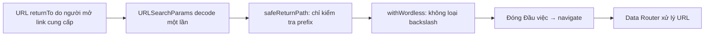
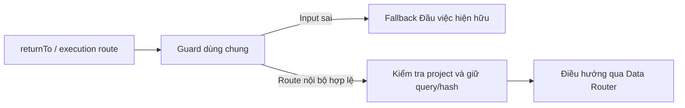

# Review khắc phục ba runtime dependency findings — 17-11-2026

**Snapshot review trước duyệt:** phần §1–6 ghi phân tích và đề xuất tại thời điểm chưa sửa code. Khiêm sau đó duyệt nâng thư viện, sửa guard và kiểm thử; kết quả implementation ở §7. Không commit/push/tag/deploy, browser, restart production hoặc gửi email.

**Revision:** main `d98c6cf9c77edf8f6aaf30a31044a7abbd9ff6dc`. Kiểu bàn giao: một lần bàn giao phân tích và review package. Roadmap cha: G1 Zoho đã nghiệm thu → G2 đã merge → review phát hành production. Mục đích: xử lý findings theo điều kiện khai thác thật, bảo toàn hợp đồng validation và điều hướng, rồi đánh giá lại release bằng SHA mới sau khi được phép sửa.

## 1. Ma trận ảnh hưởng

| Khu vực | Owner hiện hữu | Va chạm có thể xảy ra | Kiểm tra bắt buộc | Kết quả phân tích |
|---|---|---|---|---|
| SPA/router | `src/main.tsx`, `src/app/router.tsx`, `frontend/Caddyfile` | Nhầm finding server với runtime SPA | createRoot/createBrowserRouter, framework/server/RSC imports, cách phục vụ production | Data Mode SPA; Caddy phục vụ static, Go sở hữu API; không có React server/RSC/SSR |
| Điều hướng Đầu việc | `workItemNavigation.ts`, `workItemExecutionTarget.ts`, `WorkItemDetailPage.tsx` | `returnTo` hoặc route từ execution target đi qua guard chỉ kiểm tra prefix | Payload backslash/control character; project-prefix boundary; fallback | Guard nhận input không hợp lệ; chưa chứng minh external redirect ở đường Data Router đã thử |
| Notifications | `notificationPresentation.tsx::safeNotificationHref` | Tạo thêm guard khác nhau | Đối chiếu owner và consumers | Owner đã chặn backslash, URL khác origin; giữ hành vi |
| Auth/Profile | bốn trang auth, `ProfilePage.tsx`, `lib/security/password.ts` | Đổi major Zod làm mất field errors hoặc đổi password/email policy | Schema parsing, resolver, invalid-submit, type/build | Zod4 + resolver3 ném ZodError; resolver5.2.2 trả field error trong probe |
| Backend/dữ liệu/SMTP | Go API, V161, shared Zoho G1 | Nâng dependency vô tình thành scope vận hành | Diff allowlist, không đổi API/RBAC/settings/migration | Không cần thay đổi trong gói đề xuất |

Mapping đã dùng: module-keyword-map; frontend-ui-utility-map (Work Item navigation/execution, auth/profile/password); root-cause-triage-map; admin-governance domain-map. Feature khớp: điều hướng Đầu việc và xác thực/hồ sơ người dùng. Tìm kiếm đầu tiên theo mapping: `safeReturnPath|safeInternalRoute|executionTargetPath|returnTo|safeNotificationHref`, `zod|zodResolver|passwordValueSchema`, `createBrowserRouter|RouterProvider|hydrateRoot|RSC|loader:|action:`. Mapping được kiểm tra lại với source; không dùng mapping để suy ra runtime đã khai thác.

## 2. Ba package findings không phải ba lỗi độc lập

Nguồn số liệu: `npm audit --omit=dev --json` trong release review ngày 17-11, exit 1: 3 package findings (2 high, 1 moderate). Lockfile: react-router-dom/react-router **7.17.0**, zod **3.25.76**, resolver **3.10.0**, react-hook-form **7.78.0**. `react-router-dom` là meta finding kế thừa react-router. Không cộng thành một lỗ hổng mới.

| Advisory | Điều kiện ảnh hưởng | Đối chiếu Consflow hiện tại | Kết luận |
|---|---|---|---|
| [GHSA-wrjc-x8rr-h8h6](https://github.com/advisories/GHSA-wrjc-x8rr-h8h6), moderate, router <7.18.0 | Path do attacker kiểm soát vào Link/useNavigate với slash/backslash | `returnTo` từ URL đi đến navigate; guard nhận `/\attacker.invalid`. Notification có guard riêng tốt hơn | Có bề mặt input cần harden. Probe Data Router không chuyển ra ngoài; không kết luận đã exploit |
| [GHSA-h8fp-f39c-q6mh](https://github.com/advisories/GHSA-h8fp-f39c-q6mh), moderate | RSCErrorHandler trong unstable RSC | Không RSC server | Thiếu điều kiện khai thác trong kiến trúc hiện tại |
| [GHSA-337j-9hxr-rhxg](https://github.com/advisories/GHSA-337j-9hxr-rhxg), moderate | SSR error deserialization/hydration | createRoot; không SSR/manual hydration | Thiếu điều kiện khai thác hiện tại |
| [GHSA-chx6-hx7r-mcp5](https://github.com/advisories/GHSA-chx6-hx7r-mcp5), high | Framework Mode route-manifest endpoint, route matching DoS | createBrowserRouter Data Mode SPA; không Framework server/manifest endpoint | Không có endpoint bị mô tả; không suy ra Go API DoS |
| [GHSA-qwww-vcr4-c8h2](https://github.com/advisories/GHSA-qwww-vcr4-c8h2), high | unstable RSC CSRF; router 7.x <7.18.2 | Không RSC handlers/server functions | Thiếu điều kiện khai thác hiện tại |
| [GHSA-mrhx-c7xc-m3w5](https://github.com/advisories/GHSA-mrhx-c7xc-m3w5), high, Zod <4.6.6 | Tích lũy validation issues khi parse collection lớn | App chỉ dùng object/string schema cho form auth/profile; không z.array/set/map/record trong ứng dụng; backend Go không dùng Zod | Không tìm được đường parse collection do attacker cung cấp trong app. Package vẫn nằm trong affected range |

Phân loại theo điều kiện khai thác không xóa findings và không gọi package an toàn. Không chứng minh token bị lộ, auth bypass, XSS hoặc server OOM trong Consflow.

## 3. Tái hiện và nguyên nhân

### Điều hướng

Nguồn: `workItemNavigation.ts:101` và guard riêng `workItemExecutionTarget.ts:73,79` chỉ yêu cầu bắt đầu `/`, không bắt đầu `//`. `WorkItemDetailPage.tsx:12–18` decode query bằng URLSearchParams, gọi safeReturnPath, withWordless rồi navigate khi đóng workspace. withWordless trả nguyên input chứa backslash; đây không phải security guard.

Sơ đồ Verified từ source d98c6cf, không phải bằng chứng browser. Probe Node dùng public createBrowserRouter, fromRouteId, fake History với kiểm tra same-origin; không mở browser, không gọi network navigation. Với `/my-work`, cả bản baseline và patched đến đúng đường nội bộ. Với `/\attacker.invalid` và `/\t/attacker.invalid` (tab thực trong probe), guard đều nhận input; baseline7.17.0 đến `/`, không gọi location.assign ra ngoài; patched7.18.3 ném `External navigation is not allowed`. Đây là pass/fail signal cho lỗi guard và rủi ro exception khi nâng thư viện; chưa phải tái hiện open redirect ở UI thực.

Các giả thuyết đã kiểm tra:

1. Finding high đến từ React server đang hoạt động → bị loại bởi source/deploy topology.
2. Guard ứng dụng loại mọi path có thể đổi origin → sai, guard nhận backslash/control character.
3. Hai payload trên thực sự điều hướng ra ngoài trong Data Router → không tái hiện trong probe; browser/network-navigation thực NOT_RUN.
4. Nâng Zod riêng không ảnh hưởng form → bị bác bỏ bởi resolver probe.

### Zod và resolver

Tám schema trong năm màn hình; helper password dùng Unicode code points tối thiểu8 và tối đa72 UTF-8 bytes, xác nhận mật khẩu, yêu cầu mật khẩu hiện tại khi đổi email. Sáu source files sử dụng Zod: LoginPage, ForgotPasswordPage, ResetPasswordPage, InitialPasswordChangePage, ProfilePage, password.ts. Không có collection schema do người dùng gửi hàng loạt.

- Probe bounded `z.array(z.string()).max(2)` với 2.000 số: Zod3 trả2.001 issues; Zod4.6.7 trả1 issue. Chỉ minh họa cơ chế thư viện; không gây OOM và không phải data flow hiện hữu trong app.
- Nâng riêng Zod4 với resolver3.10.0: invalid email ném `ZodError`; nguyên nhân resolver cũ dựa vào `error.errors`, Zod4 dùng `issues`.
- Zod4.6.7 + resolver5.2.2: invalid email trả lỗi field tiếng Việt, không throw. Peer react-hook-form ^7.55.0 được lock7.78.0 đáp ứng, không cần nâng React/RHF.
- 48 phép so sánh parse (8schema ×6input), path/message/success tương đương giữa baseline và patched. Một số input không liên quan đến từng schema nên đây không phải48 nhánh nghiệp vụ khác nhau. Corpus9 email không tìm khác biệt; chưa chứng minh mọi email/validation boundary tương đương.

Nguồn chính thức: [Zod migration guide](https://zod.dev/v4/changelog), [resolver Zod integration](https://github.com/react-hook-form/resolvers#zod). Major upgrade vẫn cần type/build và integration tests; probe không thay thế chúng.

## 4. Phạm vi đề xuất để xin duyệt

**Hành vi mong đợi:** chỉ điều hướng về route nội bộ hợp lệ; input bị từ chối dùng fallback đang có. Form giữ lỗi inline tiếng Việt, invalid-submit không gọi API, password/email contracts hiện hành được bảo toàn.

1. Nâng `react-router-dom` lên **7.18.3**, react-router transitive cùng7.18.3. Không thêm react-router thành direct dependency. Tối thiểu7.18.2 giải quyết5advisories; chọn7.18.3 vì có thêm client navigation validation, cần guard xử lý trước exception. [Release7.18.3](https://github.com/remix-run/react-router/releases/tag/react-router@7.18.3).
2. Nâng **zod4.6.7 + @hookform/resolvers5.2.2** cùng nhau. Giữ React18/RHF7.78 locked hiện tại; không chạy audit fix --force. Chọn version cụ thể và khóa dependency graph trong package-lock, không kéo latest ngoài phạm vi.
3. Harden `safeReturnPath` hiện hữu; dùng chung trong execution-target guards, giữ kiểm tra project path hiện tại. Loại backslash, C0/DEL controls, scheme-relative/external URL; kiểm tra URL đã chuẩn hóa cùng origin bằng base cố định để unit test không cần window. Không decode lặp query; giữ route/query/hash hợp lệ và Wordless/fallback contracts. Giữ notification owner hiện hữu; chỉ dùng làm regression đối chiếu, không refactor diện rộng.
4. Thêm regression cho returnTo và resolver/schema. Chỉ chỉnh schema/types trong sáu owner files khi cần tương thích v4; không tự thay policy email/password, thông báo hoặc bố cục. Nếu cần đổi policy đáng kể phải quay lại review. Không đổi layout/controls, vì vậy không có UI mockup mới trong gói này.

**Files dự kiến:**

| Nhóm | Phạm vi |
|---|---|
| Dependency graph | `frontend/package.json`, `frontend/package-lock.json` |
| Guard | `frontend/src/modules/work-items/workItemNavigation.ts`, `workItemExecutionTarget.ts`; WorkItemDetailPage chỉ khi cần nối fallback, ưu tiên giữ caller |
| Compatibility nếu cần | `frontend/src/lib/security/password.ts`; bốn trang trong `frontend/src/modules/auth/`; `frontend/src/modules/profile/ProfilePage.tsx` |
| Tests | `frontend/tests/workItemExecutionTarget.test.ts`, regression navigation mới ở cùng test directory; `passwordPolicy.test.ts`, regression schema/resolver bằng hành vi thực |
| Tài liệu/mapping | frontend-ui-utility-map, root-cause-triage-map; central map nếu ownership thay đổi; `docs/current-states.md`; kết quả trong review package |

Không thay backend/API/RBAC/session lifecycle, không migration mới hoặc sửa V161, không sửa Zoho G1/shared secrets/settings, không sửa bảy dev-only package findings trong gói này. Không tạo tag/deploy. Chưa có quyền commit/push/PR cho gói mới.

Standard reuse: điều hướng → owner safeReturnPath + execution target → WorkItemDetailPage/MyWork/project consumers; validation → zodResolver + passwordValueSchema → năm màn hình hiện hữu; field errors/toasts/dialog → giữ compositions hiện tại. Backend vẫn là nguồn phân quyền; URL guard không thay authorization.

## 5. Kế hoạch kiểm chứng sau khi được duyệt

1. Tạo dependency graph từ lockfile trong môi trường sạch/cô lập; xác minh exact resolved versions, npm ci không đổi lock; diff allowlist, không lấy node_modules workspace làm bằng chứng revision.
2. Guard tests: external/protocol-relative, raw và query-encoded backslash/tab/newline/DEL, nested returnTo không double decode; route hợp lệ có query/hash, Wordless, project prefix/foreign project, fallback khi input bị loại. Public Data Router probe phải không external navigation, không exception với output guard. Navigation bình thường giữ nguyên.
3. Validation tests: valid/invalid-submit mapping từng schema; 7/8 Unicode code points, 72/73 UTF-8bytes, whitespace, confirmation, current/new password khác nhau, thay email cần current password, recovery email, trim/phone/full_name; giữ path/message tiếng Việt. Kiểm tra không gọi API khi invalid. Corpus email trước/sau; khác biệt có ý nghĩa phải được giải quyết theo policy hiện hành hoặc báo cần duyệt.
4. Chạy `npm ci`, `npm test`, `npm run build:budget` từ frontend; xác minh cả Node22 Linux dùng cho build, Docker admin build/Caddy config nếu có điều kiện. Baseline646tests từ G2 là bằng chứng cũ, không thay cho lần chạy mới. TSC phải kiểm tra schema/resolver typing thực, không chỉ transpile probe.
5. `npm audit --omit=dev --json`: mục tiêu không còn ba package findings; chạy audit đầy đủ và báo riêng dev findings còn mở. Không miễn trừ alert hoặc gọi toàn bộ security PASS nếu còn finding. Recheck main/candidate SHA và cập nhật release review bằng revision mới sau delivery được phép.

**Tiêu chí nghiệm thu kỹ thuật đề xuất:** ba runtime package findings được xử lý trong lockfile mới; các tests/build trên PASS; invalid returnTo dùng fallback an toàn; validation/inline errors giữ hợp đồng; scope diff không chạm V161/Zoho. Browser/UAT cần quyền riêng trong lượt thực hiện; NOT UX ACCEPTED cho tới khi có bằng chứng/nghiệm thu phù hợp. Release production tiếp tục cần duyệt riêng.

## 6. Bằng chứng, giới hạn và bàn giao hiện tại

- Môi trường probe: macOS Node23.11.0, 17-11-2026 khoảng07:28UTC; baseline và patched dependencies cài riêng trong `/private/tmp/consflow-runtime-review-20261117/`, `--ignore-scripts`, không thay graph ứng dụng. Không DB; migration/build ứng dụng NOT_RUN trong lượt phân tích.
- Đã phát hiện node_modules workspace lệch lockfile (react-router-dom resolve7.18.3/RHF7.87.0 trong khi lock7.17.0/7.78.0). Vì vậy bỏ kết quả router thử ban đầu từ workspace và chạy lại với baseline exact riêng; chỉ kết quả cuối ở probes.json được dùng. Nguồn cài đặt khác biệt chưa xác định; không suy ra production dùng7.18.3 và không tự sửa node_modules.
- Lệnh probe: `node --experimental-strip-types --max-old-space-size=256 /private/tmp/consflow-runtime-review-20261117/probes.mjs`. Exit0; 48parse comparisons tương đương; resolver incompatibility tái hiện; guard weakness tái hiện; external redirect không tái hiện trong Data Router đã thử.
- Bằng chứng localignored: `output/acceptance-evidence/runtime-dependency-review-2026-11-17/{environment.json,probes.json,probes.mjs,metadata-*.json}`. Audit baseline ở `output/acceptance-evidence/production-release-review-2026-11-17/npm-audit-runtime.json`. Không có trong Git clone, cần backup riêng. Script lưu lại vẫn dùng đường dẫn sandbox trên; chạy lại cần dựng dependencies exact theo environment.json.
- Giới hạn: không browser/UAT, không production exploit/load test, không type/build với graph mới, không đánh giá toàn bộ input email có thể có. Không có release artifact mới. Phân tích TECHNICALLY VERIFIED trong phạm vi source + synthetic probes; khắc phục chưa IMPLEMENTED.
- Không cập nhật mapping trong pha này vì không đổi feature/function/contract/schema/agent workflow; mapping maintenance là phần bắt buộc của implementation được đề xuất.

| Tên | Mục đích | Vị trí | Trạng thái | Lý do chưa làm/bỏ qua |
|---|---|---|---|---|
| Phân tích runtime findings | Xác định điều kiện ảnh hưởng | §1–3 | Đã đối chiếu source/advisory | — |
| Probe compatibility/navigation | Tái hiện rủi ro có giới hạn | output localignored | Đã chạy cô lập | Không chứng minh browser/production |
| Khắc phục dependency và guard | Loại affected versions, giữ contracts | §4–5 | PROPOSED | Chờ duyệt trước sửa code |
| Tag/deploy | Phát hành production | Release workflow | NOT_RUN | Chưa được phép |

| Skill | Nguồn | Đóng góp thực tế | Tỷ lệ đóng góp ước lượng |
|---|---|---|---|
| consflow-module-memory | Repo | Xác định owner/navigation/auth và điểm tìm kiếm | 15% |
| consflow-impact-analysis | Repo | Phân biệt server/SPA, ma trận va chạm và biên scope | 25% |
| consflow-frontend-workflow | Repo | Contracts schema/resolver/router và kế hoạch build/test | 35% |
| consflow-diagnose | Repo | Probe tái hiện, loại giả thuyết và giới hạn bằng chứng | 25% |

Tỷ lệ chỉ ước lượng đóng góp giữa skills, không đo thời gian hoặc hiệu quả.

**Điểm cần duyệt:**

1. Duyệt gói code theo §4 và kiểm chứng §5: router7.18.3 + Zod4.6.7/resolver5.2.2 + guard, giữ policy hiện tại; chưa commit/push/tag/deploy.
2. Nếu cần bằng chứng UI thực, cấp thêm quyền browser cho lượt triển khai để kiểm tra đóng Đầu việc và form invalid/valid bằng dữ liệu thử; không tự gửi email hoặc ghi dữ liệu nghiệp vụ production.

Không bắt buộc chọn cả hai. Khuyến nghị điểm1 trước; báo kết quả kỹ thuật và giới hạn trước khi xin quyền Git/phát hành riêng.

## 7. Bàn giao implementation được duyệt — 17-11-2026

**Nghiệm thu và quyền Git:** Khiêm đã nghiệm thu gói và giao commit/push/tạo PR đúng phạm vi; giữ thay đổi ngoài phạm vi, chưa merge/tag/deploy. Plan đã đóng tại [biên bản](../plan-closed/2026-11-17__closed-runtime-dependency-remediation.md) và loại khỏi current-states; trạng thái chưa có quyền Git ở các snapshot trước được thay thế bởi xác nhận này. Browser/UAT vẫn NOT_RUN.

**Giới hạn:** browser/UAT NOT_RUN, NOT UX ACCEPTED; chưa commit/push/tag/deploy. Full dependency audit còn7 dev/build package findings (5high,2moderate); không gọi toàn bộ security PASS. Backend/DB/SMTP tests không chạy lại vì không thay backend, API, migration, settings hoặc session lifecycle; không vận hành DB/SMTP trong gói này.

**Source:** main d98c6cf9 + các thay đổi chưa commit được duyệt. 486 frontend source/config/test/public files khớp snapshot kiểm thử sạch, SHA256 `58cab61155ef058a91e52c646a058d08441abf61c7f7597511f5f1bcd6ef7d52`. Đây là fingerprint trạng thái source, không phải Git commit hoặc production image revision.

**Đã triển khai:**

- Pin exact router-dom7.18.3 (router transitive7.18.3), Zod4.6.7/resolver5.2.2 trong manifest và lockfile. Chỉ thêm transitive `@standard-schema/utils`0.3.0; giữ React18.3.1/RHF7.78.0 và set-cookie-parser2.7.2, không đổi các dependency khác.
- `safeReturnPath` loại backslash/C0/DEL trước trim/parse, chỉ nhận root-relative URL cùng origin cố định, loại cả pathname bắt đầu `//` sau chuẩn hóa dot segments. Không decode query lặp; giữ query/hash hợp lệ.
- Execution target dùng guard chung, kiểm tra project trên pathname đã chuẩn hóa; ghép returnTo bằng URLSearchParams và giữ destination hash. Xóa hai guard trùng và branch xử lý backslash đã không còn hợp lệ. Caller WorkItemDetailPage tiếp tục dùng project/global fallback hiện hữu.
- Không sửa bất kỳ schema/page Auth/Profile nào: Zod4 và resolver tương thích đáp ứng source hiện tại. Giữ inline field errors, toast/dialog/input owners đang có; không đổi bố cục hoặc component trải nghiệm.
- Thêm15tests:4 navigation/guard,8 schema resolver/handleSubmit,1 password boundary,1 profile policy,1 email corpus. Actual schema declarations được lấy từ source bằng TypeScript AST, không sao chép rules; real resolver và RHF createFormControl kiểm tra invalid-submit không gọi callback submit và valid-submit gọi callback (không thực hiện API thật). Cập nhật central/frontend/triage/domain mapping trong cùng gói.

Sơ đồ từ source đang bàn giao, không phải ảnh hoặc bằng chứng browser.

**Kiểm chứng cuối:** ngày17-11-2026 khoảng07:42–07:48UTC, npm ci từ lock trong snapshot macOS Node23.11.0 PASS;661/661 frontend tests PASS,0fail/0skip. Linux/amd64 Node22.23.5 với npm ci riêng:661/661 PASS,0fail/0skip,49,09giây. `npm run build:budget` gồm tsc/Vite/bundle budget PASS; Vite native9,91giây (không gồm tsc), entry/chunks trong giới hạn500kB raw/250KiB gzip. Runtime audit0findings; fullaudit7findings chỉdev/build: baseline-browser-mapping, browserslist, nanoid, postcss, postcss-selector-parser, source-map-js, vite. Build có warning annotation `@__PURE__` từ Zod, Rollup loại comment; không phải build failure.

Docker admin final build và Caddy validate PASS cho Linux/amd64 và arm64. Final amd64 build step tsc/Vite133,4giây, Vite19,66giây; image local `consflow-runtime-admin:20261117`, inspect ID `sha256:2b57581e3592221c9aadbd784b5a52c9bd46386d88f9f14947599265fe620b21`. Đây là artifact kiểm thử local, không phải registry push hoặc release tag. HTTP smoke trên từng architecture: local deep route200/staticHTML, gateway204, header/meta noindex đúng; asset entry `/assets/index-Dsw8YorT.js`. Containers smoke đã dừng/xóa; không khởi động lại stack đang dùng hoặc production. Không kiểm tra API backend qua image admin cô lập này.

**Phân biệt các lần chạy:** lỗi npm cache mặc định đã khắc phục bằng cache tmp; Docker buildx state dùng tmp vì HOME bị hạn chế ghi. Lần Linux đầu dùng macOS node_modules gây lỗi esbuild platform, đã bỏ kết quả và chạy npm ci riêng trong Linux. Lần test đầu còn fixture V20 thiếu trong snapshot và expectation Wordless của test mới sai với legacy/BOQ; đã cấp fixture thật, chỉnh expectation theo source hiện hữu, không đổi policy hoặc giảm assertion bảo mật. Source guard sau đó thêm case dot-segment; chỉ lần chạy cuối trên source fingerprint trên được dùng cho bàn giao.

**Bằng chứng local:** `output/acceptance-evidence/runtime-dependency-remediation-2026-11-17/` (ignored, không theo Git clone; cần backup riêng). Logs/source-state chứa revision/fingerprint và môi trường. Không lưu secrets hoặc dữ liệu production.

**Checklist:** [x] dependency versions đúng phạm vi; [x] guard và fallback regression; [x] schema/resolver/invalid-submit regression; [x] fullsuite native/Linux, build/budget/audit; [x] final Docker/Caddy/HTTP smoke local; [ ] browser/UAT và nghiệm thu người dùng; [ ] quyền Git/phát hành riêng. IMPLEMENTED và TECHNICALLY VERIFIED cho scope source + kiểm tra local nêu trên; không tự ghi UX ACCEPTED hoặc production acceptance.

| Tên | Mục đích | Vị trí | Trạng thái | Lý do chưa làm/bỏ qua |
|---|---|---|---|---|
| Dependency graph | Xử lý ba runtime findings | frontend manifest/lock | IMPLEMENTED; runtime audit0 | — |
| Guard dùng chung | Chặn input sai, giữ fallback/query/hash/project | Hai navigation owners | IMPLEMENTED, regression PASS | — |
| Kiểm thử frontend | Kiểm chứng compatibility và build | 661tests/native/Linux + Docker | TECHNICALLY VERIFIED local | Không chứng minh UX/production |
| Browser/UAT | Nghiệm thu thao tác thực | Chưa chạy | NOT UX ACCEPTED | Không có quyền browser lượt này |
| Git/phát hành | Commit/push/tag/deploy | Không thao tác | NOT_RUN | Chưa được phép |

Skills áp dụng trong implementation: consflow-module-memory15%, consflow-impact-analysis25%, consflow-frontend-workflow35%, consflow-diagnose25%; nguồn Repo, cùng đóng góp nêu trong bảng §6. Bước tiếp theo: (1) Khiêm review/nghiệm thu diff và cấp quyền Git nếu đồng ý; (2) tùy chọn cấp quyền browser ở lượt tiếp theo để kiểm chứng thao tác thực. Không lựa chọn nào tự cấp quyền triển khai production.
