# Lộ trình một công trình từ đầu đến bàn giao

**Thủ Thiêm Workflow · Tài liệu hướng dẫn sử dụng cho nhân sự công trình · 25/09/2026**

## Mục lục

| Cấp | Tiêu đề | Trang |
|---|---|---|
| Tiêu đề | Lộ trình một công trình từ đầu đến bàn giao | 1 |
| Chính | 1. Cách dùng tài liệu | 3 |
| Chính | 2. Đăng nhập và đổi mật khẩu lần đầu | 4 |
| Chính | 3. Tạo công trình mới - ba bước | 7 |
| Chính | 4. Đọc Quy trình trong chi tiết công trình | 10 |
| Phụ | 4.1. Ma trận điều phối theo Giai đoạn | 12 |
| Chính | 5. Trao đổi là bàn điều phối hằng ngày | 13 |
| Phụ | 5.1. Ví dụ đã ghi nhận trên công trình Rev9 tại màn Trao đổi | 16 |
| Phụ | 5.2. Nội dung trao đổi khi phát sinh việc ở các Giai đoạn tiếp theo | 44 |
| Chính | 6. Xử lý việc ưu tiên và lặp cho đến hết nhánh Quy trình | 44 |
| Phụ | 6.1. Các Gói công việc trong mẫu bản 9 | 48 |
| Phụ | 6.2. BOQ có thiết kế: bản vẽ, khối lượng và giá | 49 |
| Phụ | 6.3. Hợp đồng chủ đầu tư và hợp đồng đầu vào | 55 |
| Phụ | 6.4. Mua sắm: từ BOQ, báo giá tới hàng đã nhận | 68 |
| Phụ | 6.5. Lấy vật tư: kiểm kho trước, mua phần còn thiếu | 77 |
| Chính | 7. Rà soát lại và phê duyệt: nói đúng tầng quyết định | 81 |
| Chính | 8. Thi công: Nhật ký › Kiểm tra › Cần xử lý | 82 |
| Chính | 9. Nghiệm thu: từ kết quả hiện trường đến biên bản | 86 |
| Chính | 10. Bàn giao: xác nhận công trình đã đủ điều kiện | 88 |
| Chính | 11. Bàn giao kế toán: chuyển hồ sơ nguồn và xác nhận tiếp nhận | 90 |
| Chính | 12. Câu hỏi thường gặp | 93 |

*Số trang trong mục lục tương ứng với bản PDF in kèm tài liệu.*

<!-- page-break -->

## 1. Cách dùng tài liệu

Tài liệu giúp từng nhân sự xác định ở mỗi chặng: **ai đang làm**, **cần hoàn thành hồ sơ nào**, và **ai xác nhận để chuyển tiếp**. Công trình tham chiếu được tạo trên giao diện là `DEMO-R9-20260925` - **[DEMO] Lộ trình công trình bản 9**; người phụ trách là Nguyễn Minh PM. Mẫu đã chọn là **[Client] Workflow hoàn thiện công trình chính thức · revision 9**. Ảnh màn hình được chụp trực tiếp từ phần mềm. Riêng ảnh hiện trạng và PDF biên bản đưa vào công trình là **tài liệu mô phỏng có nhãn [DEMO]**, không phải hồ sơ hiện trường thật. Ảnh có giao dịch hoàn tất thuộc công trình mẫu khác được ghi rõ.

**Tên vai trò dùng trong bảng:** PM là Quản lý dự án; QS là Kỹ sư khối lượng; QA/QC là người phụ trách chất lượng; Bộ phận HĐ là Bộ phận Hợp đồng. Khi giao việc hoặc ghi ý kiến trên hồ sơ, dùng tên vai trò đầy đủ để tránh nhầm người chịu trách nhiệm.

| Điều cần phân biệt | Cách hiểu và áp dụng |
|---|---|
| Công trình mới | Đã tạo bằng ba bước trên giao diện, chọn **mẫu quy trình bản 9**, lưu 11 thành viên, đủ 8/8 vai trò quy trình, giao Nguyễn Minh PM và chọn **Bắt đầu quy trình**. Đã hoàn tất Giai đoạn 01, 02, 03, 04 và 06; PM chọn **Có thiết kế**, nên Giai đoạn 05 được bỏ qua. Tiến độ **7/20 Gói công việc**, đang ở **07 Hợp đồng chủ đầu tư**. |
| Ảnh tạo công trình, Tổng quan, Quy trình, Trao đổi, BOQ và Mua sắm | Chụp đúng công trình `DEMO-R9-20260925`. Trao đổi có tin PM, Giám đốc, Kế toán, Giám sát, Thiết kế, QS và Bộ phận HĐ xen với cập nhật hồ sơ thật trên phần mềm. BOQ, báo giá và yêu cầu mua là **dữ liệu mô phỏng có nhãn [DEMO]** trong chính công trình này; chưa có vật tư giao hoặc thanh toán thật. |
| Ảnh rà soát/phê duyệt | Ảnh mới của công trình Rev9 cho thấy **Giám sát Cao Nhất Hiệp duyệt Khảo sát** và **QS Trần Hà duyệt Họp báo cáo khảo sát**, mỗi lần đều có ý kiến ghi rõ điều kiện cần đối chiếu. PM chuyển Giai đoạn bằng thao tác riêng sau khi duyệt. Ảnh vùng quyết định Đầu việc mẫu ở phần sau vẫn thuộc công trình khác. |
| Ảnh Hợp đồng và các chặng sau | Ảnh Giai đoạn 07, hợp đồng nháp và trao đổi rà soát là của công trình Rev9. Ảnh **Hợp đồng đã ký/đang hiệu lực**, **Thi công**, **Nghiệm thu**, **Bàn giao**, **Bàn giao kế toán** lấy từ công trình mẫu `GOLDEN-REAL-001` để giải thích thao tác; **không phải kết quả đã làm trên công trình Rev9**. Hồ sơ hợp đồng cũ trên ảnh vẫn cảnh báo thiếu bản chụp đã ký theo điều kiện hiện hành. |
| 15 Giai đoạn, 21 Gói công việc | 21 là số gói được khai báo. Công trình này chọn **Có thiết kế**; Giai đoạn 05 BOQ không thiết kế và một gói tương ứng được bỏ qua, nên mẫu đang hiển thị **20 gói trong nhánh đã chọn**. |
| “Nhật ký” | Lịch sử thao tác được ghi từ hành động của người dùng. Không cần lập một nhật ký duyệt riêng cho Nghiệm thu, Bàn giao hay Bàn giao kế toán. Nhật ký thi công là hồ sơ hiện trường riêng. |

**Trước khi thao tác:** mở đúng công trình; chuẩn bị hồ sơ, ảnh và tài khoản cá nhân theo vai trò PM, Giám sát, QS, Thiết kế, Mua hàng, Bộ phận HĐ, QA/QC, Kế toán và người duyệt. Trên công trình tham chiếu `DEMO-R9-20260925`, PM đã chọn nhánh **Có thiết kế** trong biên bản họp. Việc tạo công trình dùng tài khoản Admin; các việc nghiệp vụ và phê duyệt phải thực hiện bằng đúng tài khoản được giao. Không chia sẻ mật khẩu hoặc ghi mật khẩu vào hồ sơ công trình.

**Thứ tự sử dụng:** (1) đăng nhập và tạo công trình; (2) xem Quy trình; (3) dùng Trao đổi để điều phối và xử lý việc; (4) lặp lại với mỗi Gói công việc, gắn câu hỏi vào đúng hồ sơ; (5) đối chiếu Hợp đồng, vật tư, Thi công, Nghiệm thu, Bàn giao và Bàn giao kế toán. Công trình tham chiếu hiện ở **Giai đoạn 07 Hợp đồng chủ đầu tư, 7/20 Gói công việc hoàn tất**. Các chặng sau Giai đoạn 07 là hướng dẫn và ảnh tham chiếu từ công trình mẫu, **chưa phải kết quả đã hoàn tất trên công trình Rev9**.

## 2. Đăng nhập và đổi mật khẩu lần đầu

1. Mỗi nhân sự nhận **tài khoản của chính mình** và mật khẩu ban đầu qua kênh cấp phát riêng. Tại màn hình Đăng nhập, nhập email và mật khẩu ban đầu, rồi chọn **Đăng nhập**.
2. Nếu hệ thống yêu cầu **Đổi mật khẩu ban đầu**, nhập mật khẩu đang dùng, mật khẩu mới và nhập lại mật khẩu mới. Mỗi người tự thao tác và giữ kín mật khẩu.
3. Chọn **Đổi mật khẩu và đăng nhập lại**; đăng nhập lại bằng mật khẩu mới. Nếu tài khoản đã qua lần đổi đầu, vào **Hồ sơ cá nhân › Bảo mật › Đổi mật khẩu**. Việc đổi mật khẩu đăng xuất các phiên hiện có.
4. Kiểm tra tên người đang đăng nhập trước khi làm hoặc duyệt việc. Khi chuyển vai trò, đăng xuất rồi đăng nhập đúng tài khoản nhân sự tiếp theo.

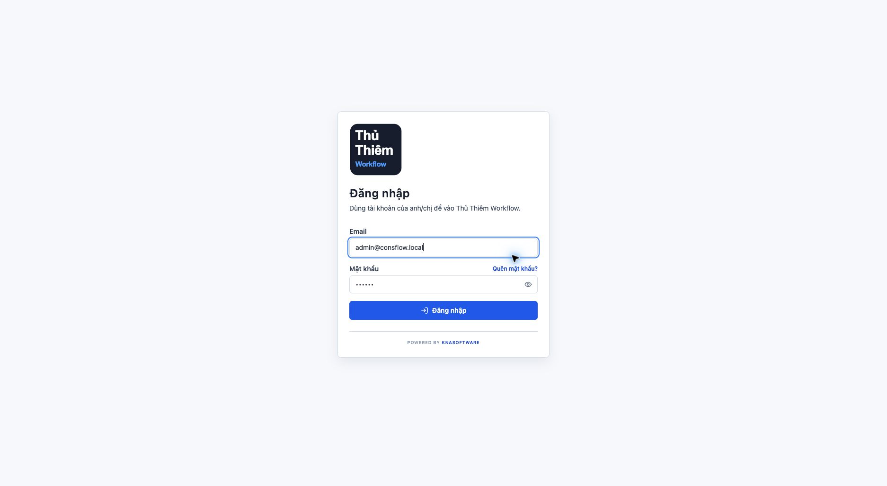

*Ảnh 1 · Màn hình Đăng nhập. Ảnh không chứa mật khẩu.*

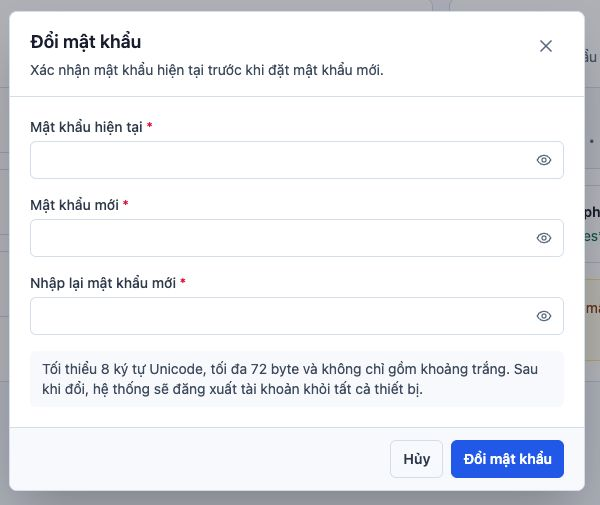

*Ảnh 2 · Cửa sổ Đổi mật khẩu trong Hồ sơ cá nhân; khi đăng nhập lần đầu, màn hình bắt buộc đổi có cùng ba nội dung cần nhập.*

## 3. Tạo công trình mới - ba bước

| Bước | Mục đích | Người thực hiện thao tác | Điều cần kiểm tra trước khi đi tiếp |
|---|---|---|---|
| 1. Thông tin | Xác định đúng công trình và mẫu quy trình | Vào **Công trình › Tạo công trình**; nhập tên, mã, chủ đầu tư, địa chỉ, thời gian và giá trị dự kiến; chọn mẫu quy trình bản 9; chọn **Tạo công trình & tiếp tục**. | Mã không trùng; tên chủ đầu tư đúng; giá trị là dự kiến; mẫu quy trình đã chọn đúng. |
| 2. Chọn nhân sự | Giao đúng người thực hiện | Tìm, chọn thành viên; gán vai trò vận hành và quyền tham gia công trình; chọn **Lưu nhân sự & tiếp tục**. | Có ít nhất một người đủ điều kiện PM; các vai trò của Gói công việc cần xử lý có người phụ trách. |
| 3. Thiết lập | Chốt người chịu trách nhiệm và điểm bắt đầu | Xem đội ngũ, độ phủ vai trò, người đủ vai trò cho bước đầu; chỉ định **PM phụ trách**; xử lý các điều kiện còn thiếu; chọn **Bắt đầu quy trình**. | Hệ thống báo sẵn sàng. Chính nút Bắt đầu mới tạo Đầu việc thực tế. Sau đó kiểm tra riêng ô người phụ trách của từng Đầu việc. |

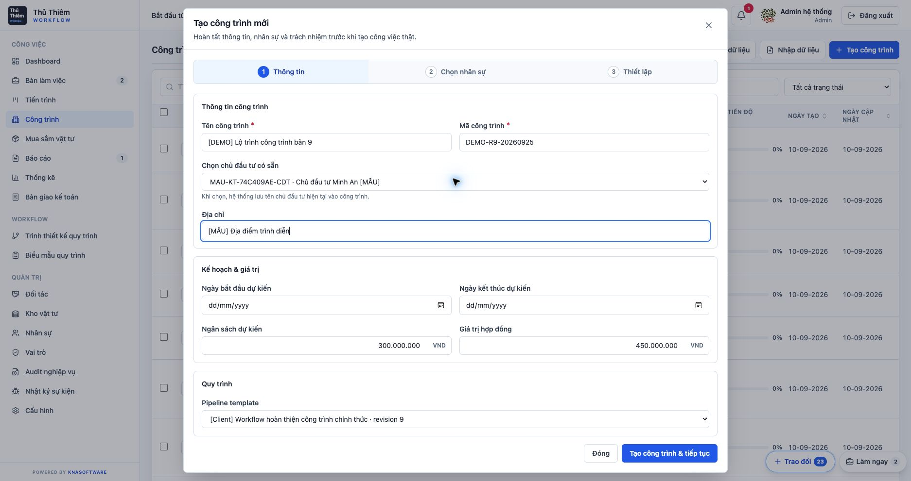

*Ảnh 3 · Bước 1 của chính công trình DEMO-R9-20260925: tên, mã, chủ đầu tư mẫu và mẫu quy trình revision 9. Các giá trị ngân sách/hợp đồng là số minh họa, chưa phải hợp đồng đã ký.*

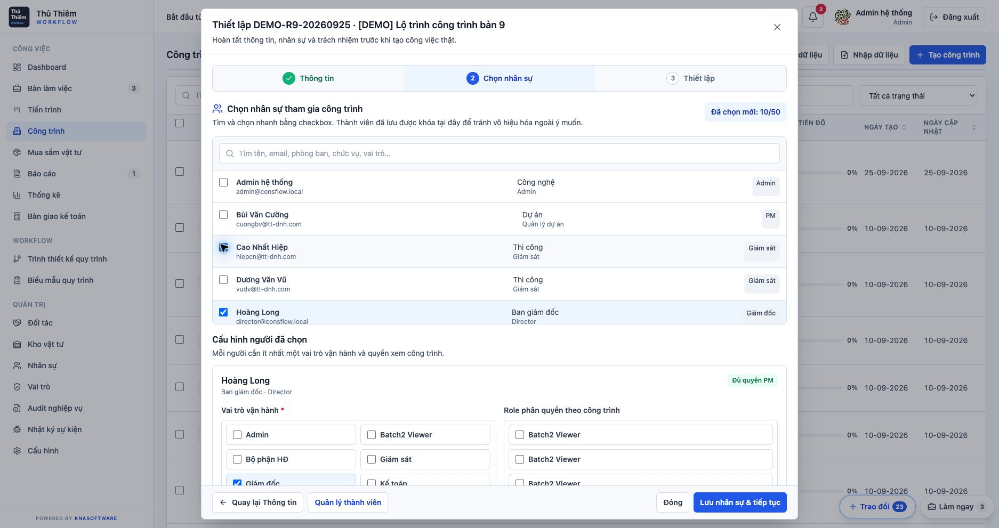

*Ảnh 4 · Bước 2 của cùng công trình: 10 nhân sự được chọn trong lượt đầu, sau đó bổ sung một người Thiết kế. Tổng cộng đã lưu 11 người.*

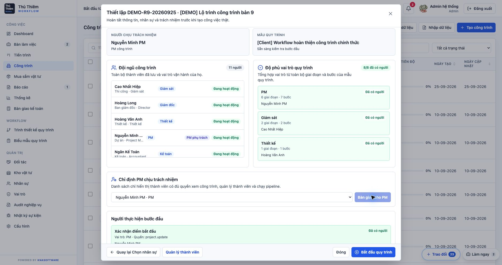

*Ảnh 5 · Bước 3 sau khi giao Nguyễn Minh PM: đội ngũ 11 người, đủ 8/8 vai trò, bước đầu có người đủ vai trò và nút Bắt đầu quy trình. Sau khi chọn nút, phần mềm tạo 21 Đầu việc theo mẫu bản 9; người đủ vai trò chưa đồng nghĩa Đầu việc đã được giao đích danh.*

**Nguyên tắc:** tạo hồ sơ công trình, chọn đúng người và trách nhiệm trước. Khi đủ người cho bước đầu, PM bắt đầu Quy trình. Sau đó kiểm tra người phụ trách cụ thể ở từng Đầu việc.

## 4. Đọc Quy trình trong chi tiết công trình

Vào công trình vừa tạo, chọn **Quy trình**. Cột trái liệt kê các **Giai đoạn**; giữa màn hình là **Gói công việc** của Giai đoạn đang xem; trên cùng là việc tiếp theo, tiến độ, việc cần xử lý, chờ duyệt và bị chặn. Chọn một Giai đoạn để xem việc của chặng đó; chọn **Mở** để vào nơi xử lý của từng Đầu việc. Số đếm chỉ là tình trạng hiện tại, không thay cho việc kiểm tra hồ sơ nguồn.

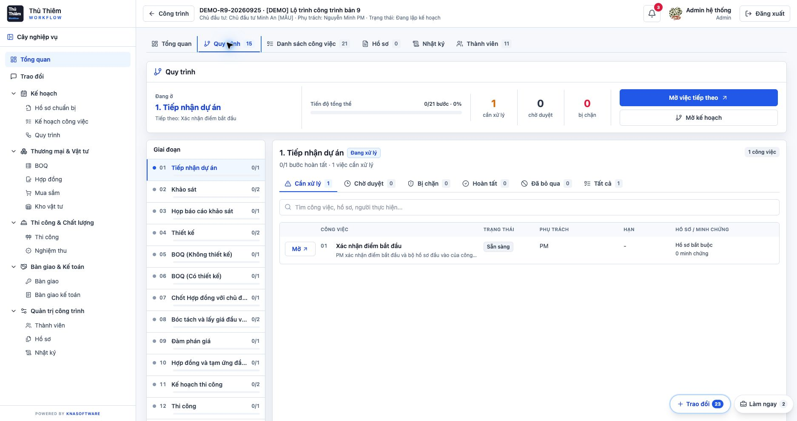

*Ảnh 6 · Ảnh chụp lúc công trình mới bắt đầu: 15 Giai đoạn, 21 Gói công việc được khai báo, 0/21 gói hoàn tất. Ảnh sau ở mục 5 cho thấy nhánh Có thiết kế được chọn, còn 20 gói trong nhánh thực hiện.*

### 4.1. Ma trận điều phối theo Giai đoạn

| Giai đoạn | Mục đích và kết quả cần thấy | Vai trò làm chính | Vai trò cùng kiểm tra hoặc quyết định |
|---|---|---|---|
| 01 Tiếp nhận dự án | Chốt điểm bắt đầu, hồ sơ và nhân sự đầu vào | PM | Người tạo công trình, QS và Giám sát đối chiếu thông tin liên quan |
| 02 Khảo sát | Ghi hiện trạng, ảnh, yêu cầu và biên bản khảo sát | Giám sát; PM chốt biên bản | QS tham gia khối lượng sơ bộ; PM kiểm tra hồ sơ |
| 03 Họp báo cáo khảo sát | Chọn nhánh Có thiết kế hoặc Không thiết kế | PM | Người có quyền duyệt Giai đoạn: PM, QS hoặc Giám sát, **khác người gửi yêu cầu duyệt** |
| 04 Thiết kế | Phát hành gói thiết kế và bàn giao đúng bản cho QS | Thiết kế; PM bàn giao | PM rà bản phát hành; QS tiếp nhận căn cứ lập BOQ |
| 05 BOQ không thiết kế | Phát hành khối lượng/báo giá theo nhánh không thiết kế | QS | Người duyệt BOQ tại hồ sơ BOQ, chủ đầu tư xác nhận qua hồ sơ |
| 06 BOQ có thiết kế | Phát hành BOQ theo bản thiết kế đã chốt | QS | Thiết kế/PM đối chiếu bản vẽ; người duyệt BOQ tại hồ sơ BOQ |
| 07 Hợp đồng chủ đầu tư | Hoàn tất phiên bản, ký và hồ sơ gửi nhận | Bộ phận HĐ | Người được phân quyền rà soát, duyệt và ký phiên bản; PM theo dõi hồ sơ với chủ đầu tư |
| 08 Bóc tách và lấy giá đầu vào | Chốt khối lượng mua và báo giá nhà cung cấp | QS; Mua hàng | PM kiểm tra phù hợp kế hoạch và hồ sơ nguồn |
| 09 Đàm phán giá | Chọn báo giá đầu vào sau đàm phán | Mua hàng | QS/PM đối chiếu giá và điều kiện lựa chọn |
| 10 Hợp đồng và tạm ứng đầu vào | Hoàn tất yêu cầu mua đã duyệt và hợp đồng đầu vào đủ điều kiện | Mua hàng | Bộ phận HĐ chuẩn bị hợp đồng; người có quyền duyệt/ký; Kế toán xem căn cứ tạm ứng |
| 11 Kế hoạch thi công | Chốt kế hoạch triển khai và bàn giao ra hiện trường | PM | Giám sát, QA/QC nhận phần việc và tiêu chí kiểm tra |
| 12 Thi công | Cập nhật Nhật ký, Kiểm tra, Cần xử lý | Giám sát | Đội thi công xử lý; PM/QA/QC kiểm tra và xác nhận kết quả phù hợp |
| 13 Nghiệm thu đầu vào | Nghiệm thu thầu phụ/khối lượng và vật tư | QS; QA/QC | Thủ kho nhận vật tư bằng phiếu kho riêng sau khi đạt |
| 14 Nghiệm thu đầu ra | Kết luận hồ sơ nghiệm thu cuối và đối chiếu chủ đầu tư | QA/QC | PM/Giám đốc theo thẩm quyền; đại diện chủ đầu tư xác nhận bằng hồ sơ |
| 15 Bàn giao công trình và hồ sơ kế toán | Hoàn tất bàn giao vật lý, sau đó Kế toán tiếp nhận hồ sơ nguồn | PM; Kế toán | Người có quyền duyệt Giai đoạn: Kế toán, PM hoặc Giám đốc, **khác người gửi yêu cầu duyệt** |

*Tên Giai đoạn cuối trong mẫu đang hiển thị có thể còn là “Kết thúc: Bàn giao + Tài chính công trình”. Khi giải thích nghiệp vụ, dùng “Bàn giao công trình và hồ sơ kế toán”; không hiểu đó là khóa sổ kế toán.*

## 5. Trao đổi là bàn điều phối hằng ngày

**Mục đích chính:** nhìn thấy việc kế tiếp, giao tiếp quanh đúng công trình/Đầu việc và giữ quyết định có căn cứ. Vào **Trao đổi** sau khi bắt đầu Quy trình. Cột **Bước tiếp theo** chỉ việc ưu tiên của công trình; **Việc của tôi** là việc người đang đăng nhập cần làm; vùng giữa là Thảo luận/Quyết định/Nhật ký hệ thống; cột **Cần chú ý** gom chưa đọc, nhắc đến, câu hỏi, điểm chặn và việc đến hạn.

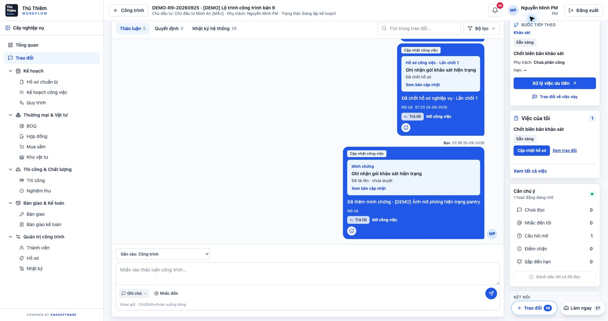

*Ảnh 7 · Trao đổi của chính công trình Rev9 sau khi xử lý việc: tin PM nằm cạnh các thẻ chốt hồ sơ và minh chứng khảo sát. Đây là dòng hoạt động thật trên phần mềm, không phải màn trống để minh họa lời thoại dự kiến.*

| Khi cần | Thao tác | Kết quả cần hiểu |
|---|---|---|
| Hỏi chung về công trình | **Gắn vào: Công trình**, nhập nội dung, chọn loại phù hợp, nhắc đúng thành viên rồi gửi | “Thông tin chung ở một nơi; người được nhắc biết việc cần phản hồi.” |
| Trao đổi quanh một việc | **Gắn vào: Đầu việc** hoặc **Trao đổi về việc này** ở thẻ việc ưu tiên | “Câu hỏi và câu trả lời đi cùng đúng việc, không trôi khỏi hồ sơ.” |
| Phản ánh vướng mắc | Chọn loại trao đổi phù hợp và chỉ rõ người xử lý, hạn/căn cứ trong lời nhắn | “Điểm chặn được nêu rõ; phần xử lý chính thức vẫn làm tại Đầu việc hoặc hồ sơ nguồn.” |
| Xem thay đổi | Mở **Nhật ký hệ thống**, lọc theo việc/hồ sơ liên quan | “Hệ thống ghi lịch sử từ các hành động; tin trao đổi không tự biến thành phê duyệt.” |

### 5.1. Ví dụ đã ghi nhận trên công trình Rev9 tại màn Trao đổi

| Thứ tự đã thực hiện | Vai trò và mục đích | Thao tác tại Trao đổi | Kết quả nhìn thấy |
|---|---|---|---|
| 1 | **PM** hỏi Giám sát về hồ sơ đầu vào | Gửi Câu hỏi gắn Công trình, nhắc Cao Nhất Hiệp kiểm tra vị trí, kích thước và ảnh hiện trạng | Tin PM xuất hiện trong dòng Trao đổi; câu hỏi được đóng sau khi Giám sát phản hồi ở lượt 10 |
| 2 | **PM** xác nhận điểm bắt đầu | Chọn **Xử lý việc ưu tiên**, ghi nhánh “Khảo sát trước báo giá”, chốt hồ sơ và hoàn tất Đầu việc | Thẻ cập nhật “Xác nhận điểm bắt đầu” xuất hiện, Giai đoạn chuyển sang Khảo sát |
| 3 | **PM đã thao tác** trên gói có vai trò Giám sát của công trình mẫu | Mở gói “Ghi nhận gói khảo sát hiện trạng” ngay từ Trao đổi; ghi phạm vi, kích thước minh họa, rủi ro; tải ảnh **[DEMO]**; hoàn tất | Gói 1 của Khảo sát hoàn tất. Lịch sử ghi đúng người thao tác là Nguyễn Minh PM; **Giám sát Cao Nhất Hiệp không phải người lập hồ sơ này** |
| 4 | **PM** chốt biên bản | Mở việc ưu tiên kế tiếp, ghi thành phần và kết luận minh họa; chốt hồ sơ, tạo PDF, tải PDF minh chứng **[DEMO]**, hoàn tất | Gói 2 của Khảo sát hoàn tất; thẻ chốt hồ sơ và tải tài liệu hiện trong Trao đổi |
| 5 | **PM** điều phối sau khảo sát | Gửi Ghi chú: cần đối chiếu bản vẽ điện nước, đo lại kích thước trước khi chốt BOQ, chưa khoan cắt vùng ống âm tường | Tin nhắn PM nằm xen giữa các cập nhật công việc |
| 6 | **PM** gửi yêu cầu rà soát Giai đoạn | Từ Quy trình, chọn **Thao tác giai đoạn › Yêu cầu phê duyệt** cho Khảo sát đã 2/2 gói | Trạng thái **Chờ duyệt**, người đủ vai trò Giám sát cần quyết định; Đầu việc “Chốt nhánh xử lý” ở Trao đổi hiện **Chỉ xem** |
| 7 | **Giám đốc** hỏi PM | Đăng nhập tài khoản Giám đốc mẫu; gửi câu hỏi về nội dung biên bản, số liệu còn vướng và căn cứ chọn nhánh | Tin của Hoàng Long xuất hiện trong cùng dòng Trao đổi |
| 8 | **Kế toán** nhắc hồ sơ về sau | Đăng nhập tài khoản Kế toán mẫu; gửi danh mục hợp đồng, yêu cầu mua đã duyệt, nghiệm thu, phiếu nhập kho cần đối chiếu khi tới chặng tạm ứng/bàn giao | Tin của Ngân Kế Toán xuất hiện; đây là nhắc chuẩn bị, **chưa xác nhận thanh toán** |
| 9 | **Giám sát Cao Nhất Hiệp** duyệt Khảo sát | Đăng nhập tài khoản của mình, xem yêu cầu chờ duyệt, ghi ý kiến và chọn **Duyệt** | Yêu cầu duyệt biến khỏi hàng chờ của Giám sát. Ý kiến yêu cầu đo lại kích thước và đối chiếu tuyến điện nước; **duyệt chưa tự chuyển Giai đoạn** |
| 10 | **Giám sát Cao Nhất Hiệp** trả lời PM | Trả lời trực tiếp câu hỏi đầu dòng, nói rõ hồ sơ mô phỏng đã duyệt nhưng dữ liệu hiện trường còn phải xác nhận; đánh dấu **Đã trả lời** | Câu hỏi hiện **Đã xử lý**, bộ đếm Câu hỏi mở về 0 |
| 11 | **PM** chuyển Giai đoạn 02 và chốt nhánh | Tại Quy trình, chọn **Chuyển giai đoạn tiếp theo**; mở gói **Chốt nhánh xử lý**, ghi biên bản họp, chọn **Có thiết kế**, chốt hồ sơ, tạo PDF và hoàn tất | Giai đoạn 03 có 1/1 gói hoàn tất; PDF `chot-nhanh-xu-ly-rev-1.pdf` được tạo từ hồ sơ đã chốt |
| 12 | **PM** phản hồi Giám đốc, Kế toán và ghi quyết định | Trả lời đúng hai tin trước; tại Trao đổi gửi tin loại **Quyết định** về nhánh Có thiết kế | Các câu trả lời và quyết định xuất hiện trong dòng Trao đổi; nêu rõ chưa ký hợp đồng, chưa mua vật tư và chưa xác nhận thanh toán |
| 13 | **PM gửi, QS Trần Hà duyệt** Giai đoạn 03 | PM yêu cầu phê duyệt; QS đăng nhập, ghi ý kiến điều kiện kiểm tra khối lượng rồi chọn **Duyệt** | Hàng chờ QS về 0. PM thực hiện thao tác chuyển Giai đoạn riêng; Giai đoạn 04 Thiết kế mở, nhánh BOQ không thiết kế bị bỏ qua, tiến độ **4/20** |
| 14 | **Thiết kế Hoàng Văn Anh** phát hành bản thiết kế | Trong Đầu việc Thiết kế, đưa sơ đồ mô phỏng vào hồ sơ, phát hành `DEMO-TK-R01`, chốt biểu mẫu, tạo PDF và hoàn tất; báo PM/QS ở Trao đổi | Bản phát hành và tin của người Thiết kế xuất hiện thật. Tệp chỉ là sơ đồ [DEMO], chưa đo đạc và không dùng thi công |
| 15 | **PM** bàn giao bản cho QS | Xác nhận bàn giao đúng `DEMO-TK-R01`, chốt hồ sơ bàn giao, tạo PDF, hoàn tất Đầu việc; trả lời Thiết kế ngay trong Trao đổi | Giai đoạn 04 đạt 2/2, tiến độ 6/20. PM chuyển riêng sang Giai đoạn 06 BOQ có thiết kế |
| 16 | **QS Trần Hà** lập BOQ và hỏi PM | Nhập hai dòng BOQ 4 đèn LED và 24 m² tấm thạch cao, gửi duyệt, khóa định mức; gửi Câu hỏi gắn Đầu việc về số đo và nguồn kho | PM trả lời: đo hiện trường trước khi dùng thật; Thủ kho kiểm tồn; Mua hàng chỉ mua phần thiếu. Câu hỏi được đánh dấu đã xử lý |
| 17 | **PM** duyệt BOQ, lập báo giá mô phỏng | Duyệt hai dòng, ghi báo giá `DEMO-BG-R9-001` của nhà cung cấp giả lập, đánh giá có điều kiện và khóa giá cuối | Giá minh họa 7,4 triệu đồng. Không coi đây là đo bóc, báo giá hoặc lựa chọn nhà cung cấp có hiệu lực cho công trình thực tế |
| 18 | **PM** theo dõi yêu cầu mua | Thao tác tạo yêu cầu mua báo lỗi, nhưng Trao đổi và sổ Mua sắm cho thấy **một** yêu cầu `PR-95fd70ab-1790301536-01` đã được ghi. PM mở yêu cầu đó, duyệt, ghi `DEMO-PO-R9-001` và nhắn rõ cho Mua hàng, Thủ kho, QA/QC, Kế toán | Yêu cầu chuyển sang **Đang giao / nghiệm thu**; lượng đạt nghiệm thu và đã nhập kho đều bằng 0. Không bấm tạo lại để tránh trùng yêu cầu |
| 19 | **QS Trần Hà** chốt Gói BOQ | Trong Trao đổi mở việc ưu tiên, ghi rõ kênh gửi **nội bộ, chưa gửi ra ngoài**, chốt hồ sơ, tạo PDF không chữ ký, tải BOQ [DEMO] làm minh chứng, hoàn tất và báo PM | Giai đoạn 06 đạt 1/1, tiến độ 7/20. PM chuyển riêng sang Giai đoạn 07 Hợp đồng chủ đầu tư |
| 20 | **PM và Bộ phận HĐ Vũ An** báo điểm chặn Hợp đồng | PM giao lập bản nháp trong Trao đổi. Bộ phận HĐ mở Đầu việc, thấy bốn điều kiện nguồn còn thiếu; mở Tạo hợp đồng nhưng ô Đối tác chỉ có “Chọn”, rồi gửi tin loại **Điểm chặn** | Giai đoạn 07 vẫn 0/1. Tài khoản Bộ phận HĐ chưa tạo được bản nháp; không mô phỏng chữ ký, bản giấy đã ký hoặc kích hoạt |
| 21 | **PM** lập bản nháp để tiếp tục hướng dẫn | PM chọn đúng Chủ đầu tư Minh An [MẪU], tạo `DEMO-HD-CDT-R9-001`, lập V1 giá trị **0 đồng**, ghi rõ phạm vi còn thiếu căn cứ và gửi rà soát nội bộ; trả lời tin Điểm chặn | Hợp đồng **Đang rà soát**, V1 chưa được duyệt. Giá trị 0 đồng thể hiện chưa chốt giá, không phải giá hợp đồng thực tế |
| 22 | **Bộ phận HĐ Vũ An** xem V1 và yêu cầu bổ sung | Vũ An mở V1 trong sổ Hợp đồng, nêu thiếu số đo, đơn giá đầu ra và xác nhận chủ đầu tư; trả lời PM trong Trao đổi | Tin nhắn là **ý kiến điều phối**. Màn hình của tài khoản Bộ phận HĐ không có nút kết luận trả lại trên V1; trạng thái V1 vẫn **Đang rà soát**, chưa có quyết định duyệt/ký |

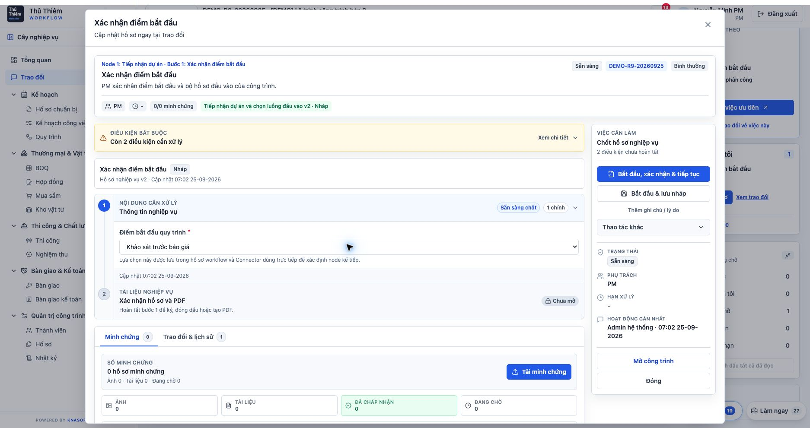

*Ảnh 7a · Mở Đầu việc đầu tiên tại Trao đổi, điền lựa chọn nhánh khảo sát và chốt hồ sơ.*

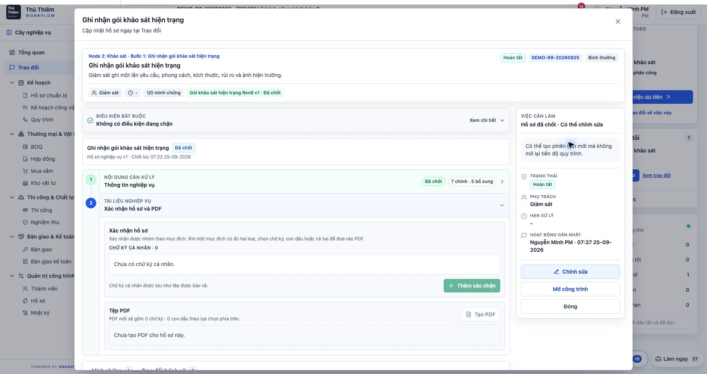

*Ảnh 7b · Gói khảo sát có ảnh minh chứng [DEMO] và trạng thái Hoàn tất; phần “Hoạt động gần nhất” ghi PM là người thao tác.*

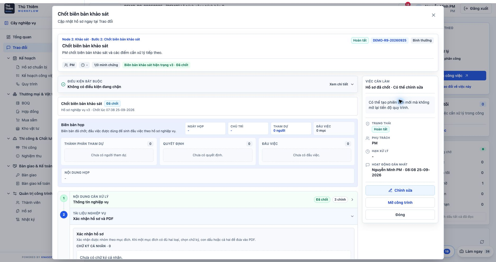

*Ảnh 7c · Biên bản khảo sát đã chốt, có PDF minh chứng [DEMO] gắn với đúng Đầu việc.*

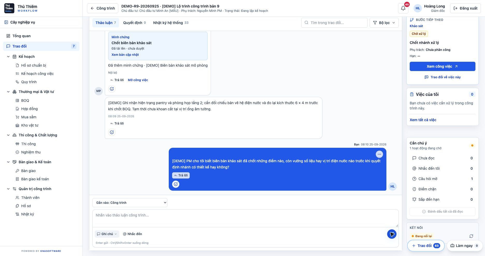

*Ảnh 7d · Giám đốc hỏi PM về điểm còn vướng ngay sau Khảo sát. Đây là tin đã gửi bằng tài khoản Giám đốc mẫu.*

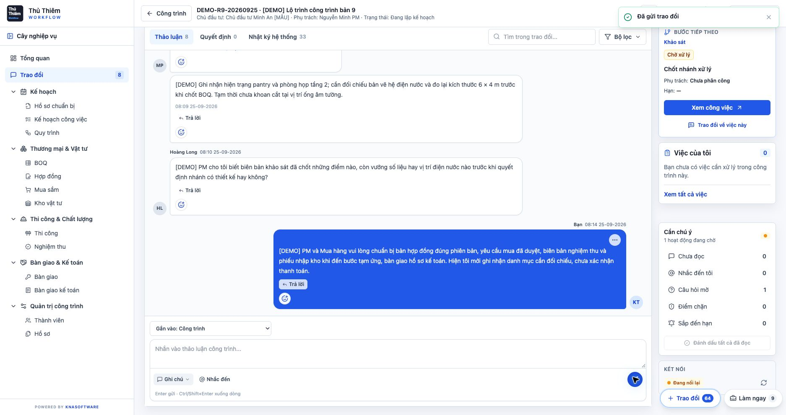

*Ảnh 7e · Kế toán nhắc trước các chứng từ phải đối chiếu khi đến tạm ứng và bàn giao hồ sơ kế toán. Tin đã gửi, chưa phát sinh thanh toán hay tiếp nhận hồ sơ.*

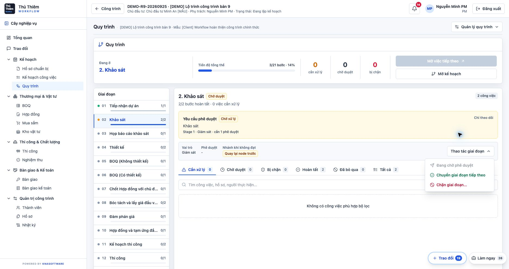

*Ảnh 7f · Khảo sát 2/2 gói hoàn tất và đang chờ phê duyệt Giai đoạn. Người đăng nhập Giám đốc và Admin chỉ thấy “Chỉ theo dõi”; quyền duyệt của lượt này thuộc vai trò Giám sát.*

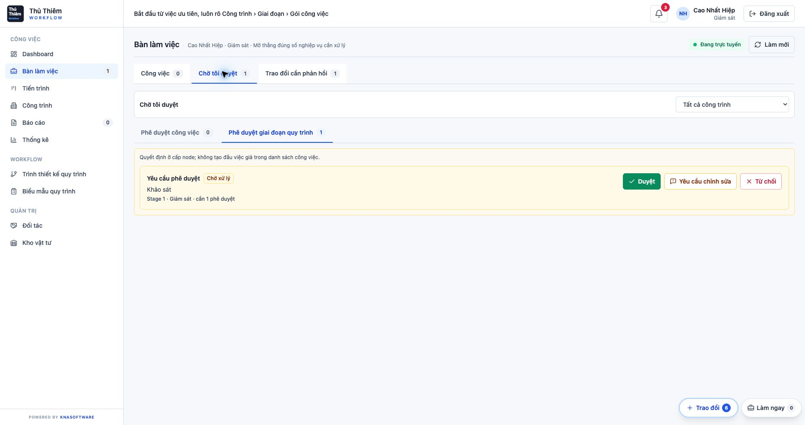

*Ảnh 7g · Giám sát Cao Nhất Hiệp nhìn thấy yêu cầu Khảo sát trong hàng Chờ tôi duyệt.*

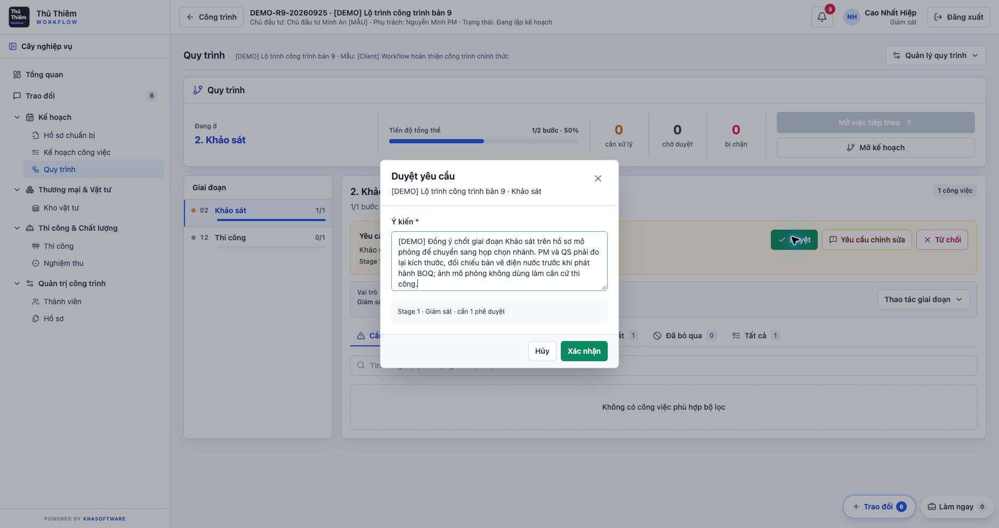

*Ảnh 7h · Ý kiến duyệt nêu điều kiện đo lại kích thước, đối chiếu tuyến điện nước; ảnh và hồ sơ khảo sát chỉ là dữ liệu mô phỏng.*

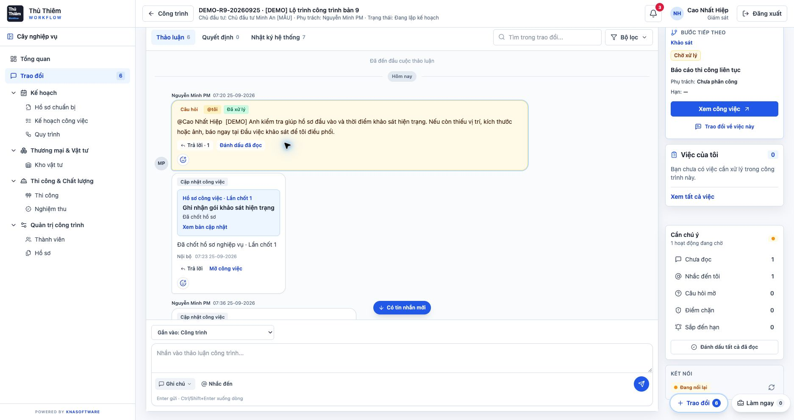

*Ảnh 7i · Giám sát trả lời trực tiếp câu hỏi PM và đánh dấu đã xử lý, thay vì để màn Trao đổi trống.*

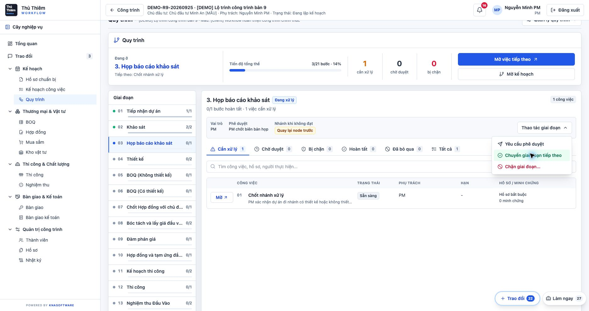

*Ảnh 7j · Sau khi Giám sát duyệt, PM chọn chuyển Giai đoạn; việc Chốt nhánh xử lý mở ở Giai đoạn 03.*

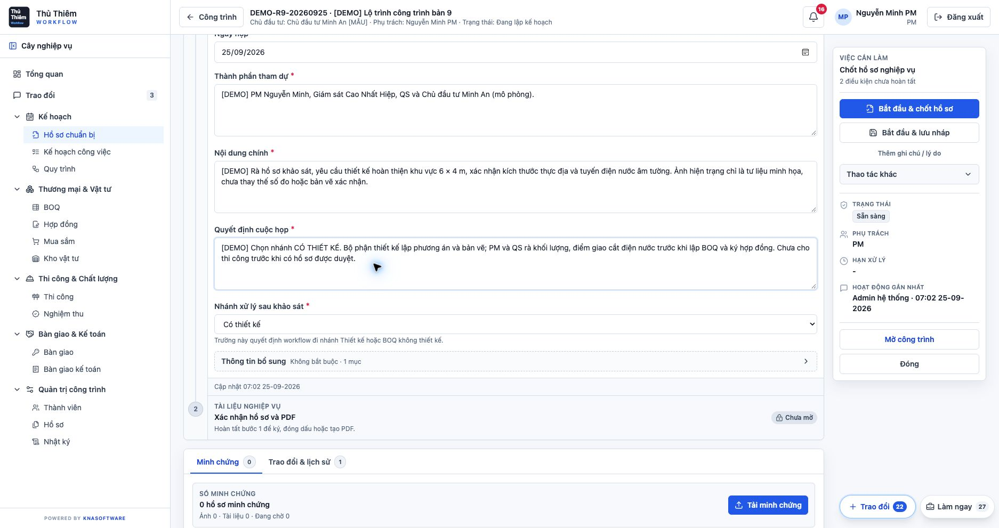

*Ảnh 7k · Biên bản họp ghi người tham dự, nội dung, quyết định và nhánh Có thiết kế trước khi chốt hồ sơ.*

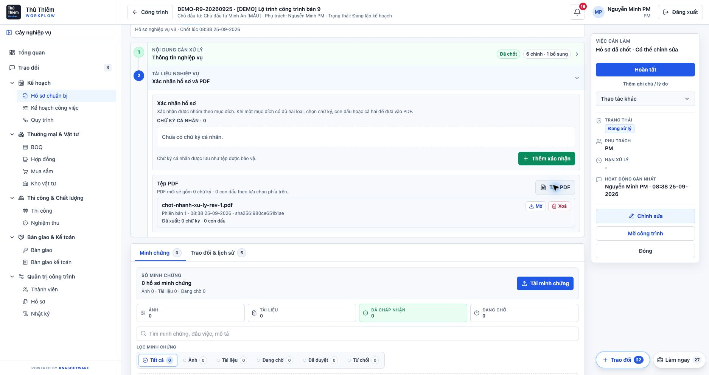

*Ảnh 7l · PDF được tạo từ hồ sơ đã chốt; trên ảnh ghi 0 chữ ký, 0 con dấu, vì lượt mô phỏng chưa có xác nhận ký/đóng dấu.*

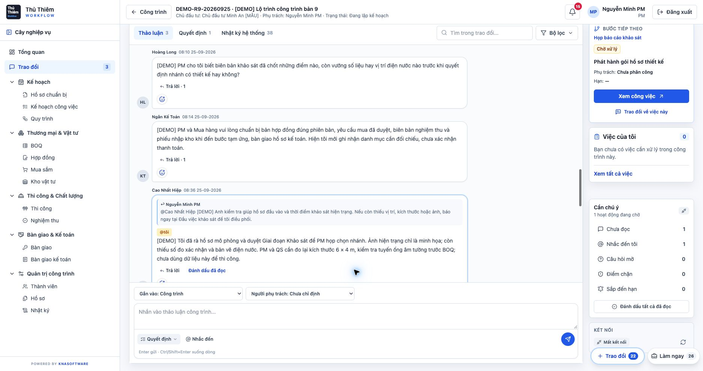

*Ảnh 7m · Cùng một dòng Trao đổi có câu hỏi của Giám đốc, yêu cầu hồ sơ của Kế toán và câu trả lời của Giám sát. PM đã trả lời hai câu hỏi và gửi một tin loại Quyết định về nhánh Có thiết kế; ảnh chụp này đang ở đoạn trước của dòng, chưa hiện ô quyết định.*

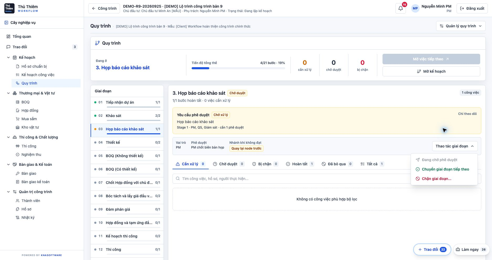

*Ảnh 7n · PM gửi yêu cầu phê duyệt sau khi gói họp 1/1 đã hoàn tất; PM nhìn thấy trạng thái Chỉ theo dõi.*

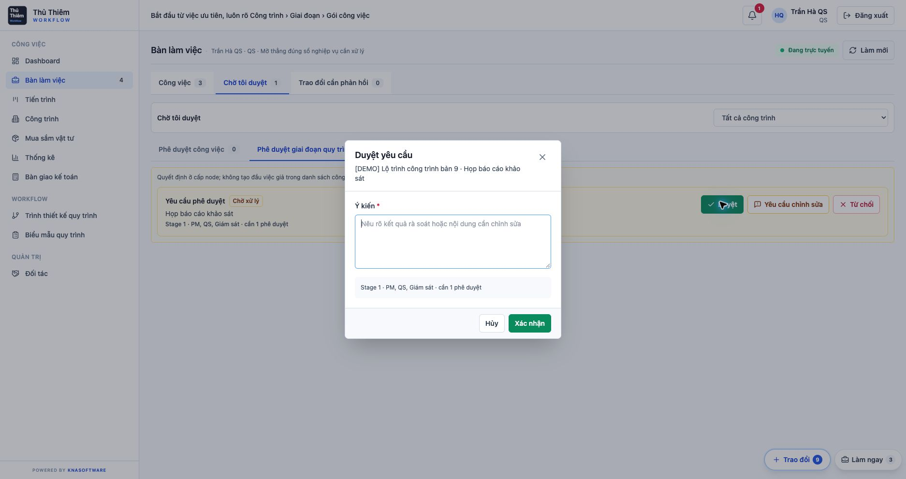

*Ảnh 7o · QS mở hộp duyệt biên bản họp từ hàng Chờ tôi duyệt. Sau ảnh này, QS đã ghi ý kiến về điều kiện kiểm tra kích thước và tuyến điện nước trước BOQ rồi xác nhận; hàng chờ về 0.*

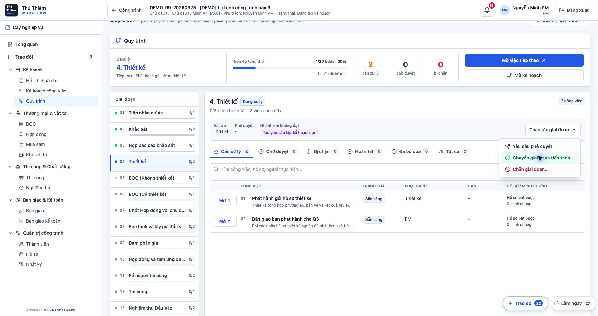

*Ảnh 7p · Giai đoạn 04 Thiết kế đang xử lý, BOQ không thiết kế đã bỏ qua; tiến độ hiển thị 4/20 gói trong nhánh đã chọn.*

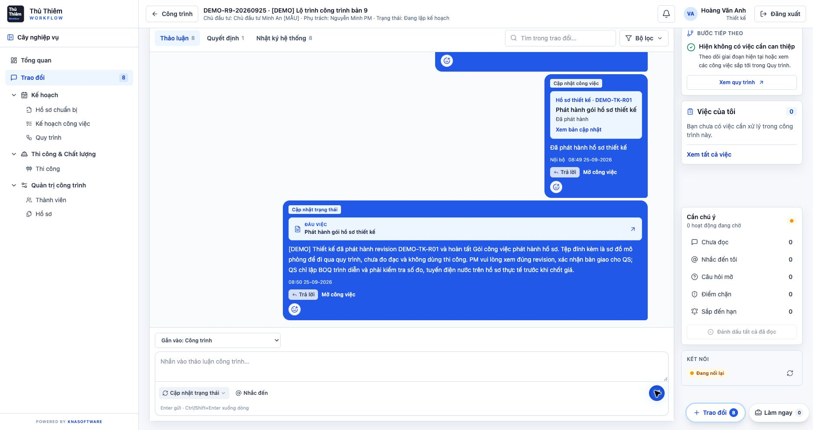

*Ảnh 7q · Hoàng Văn Anh dùng đúng tài khoản Thiết kế để báo bản `DEMO-TK-R01` đã phát hành, kèm giới hạn của sơ đồ mô phỏng.*

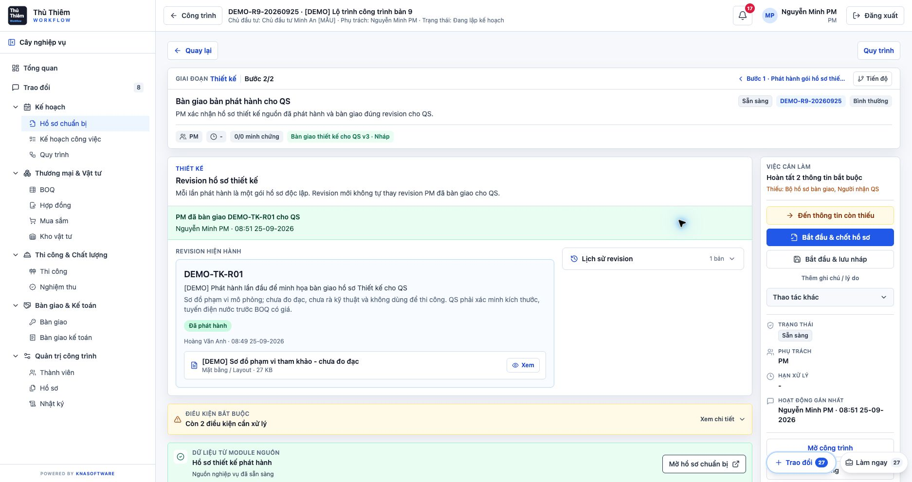

*Ảnh 7r · PM xác nhận bàn giao chính revision đã phát hành cho QS; bước này tách khỏi việc Thiết kế tự phát hành.*

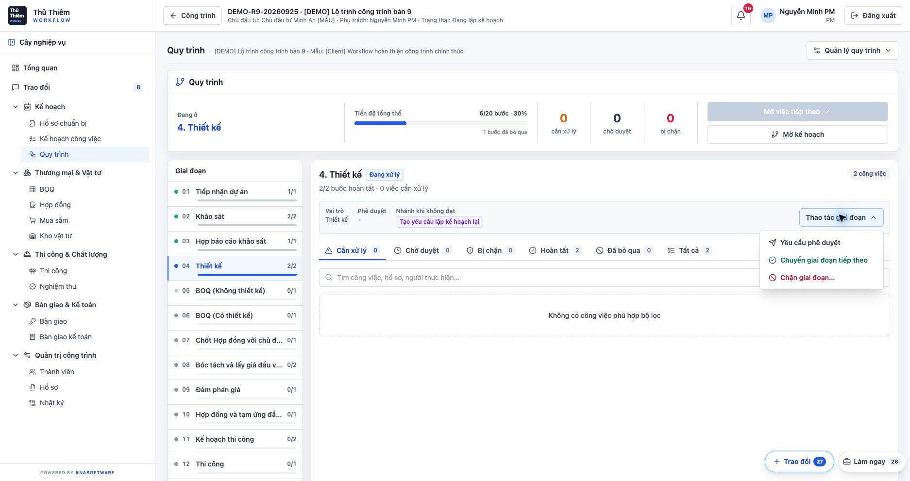

*Ảnh 7s · Giai đoạn 04 đạt 2/2, tiến độ 6/20 trước khi PM chuyển sang BOQ có thiết kế.*

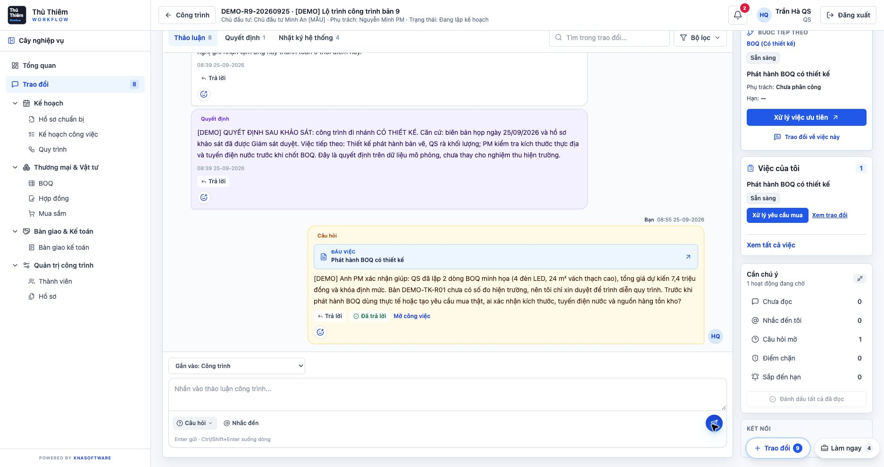

*Ảnh 7t · QS đặt câu hỏi gắn Đầu việc BOQ; PM trả lời trách nhiệm đo lại, phát hành thiết kế mới khi cần, kiểm tồn kho và mua phần thiếu.*

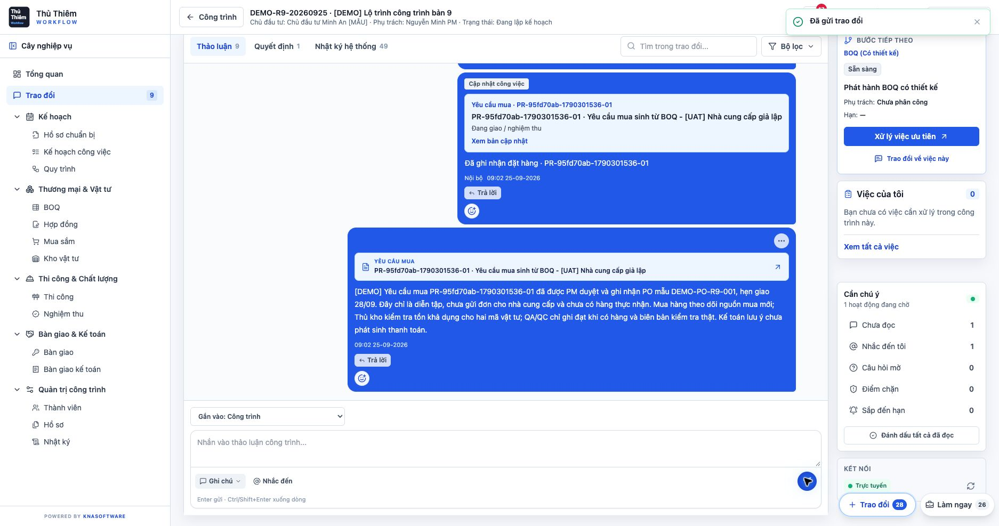

*Ảnh 7u · Yêu cầu mua và PO mô phỏng xuất hiện trong Trao đổi, cùng lời PM nêu rõ chưa có hàng thực nhận hoặc thanh toán.*

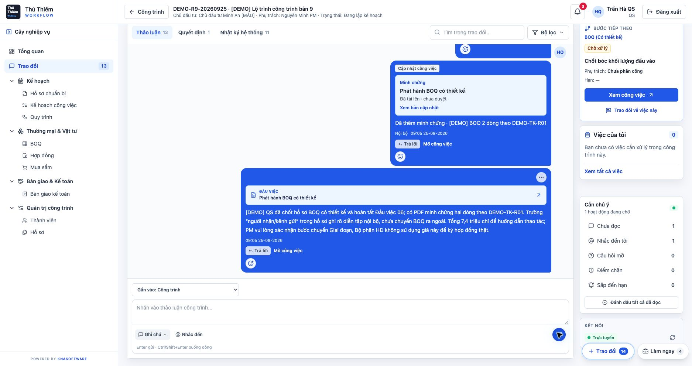

*Ảnh 7v · QS chốt Gói BOQ bằng hồ sơ, PDF và minh chứng [DEMO], sau đó báo PM chuyển Giai đoạn.*

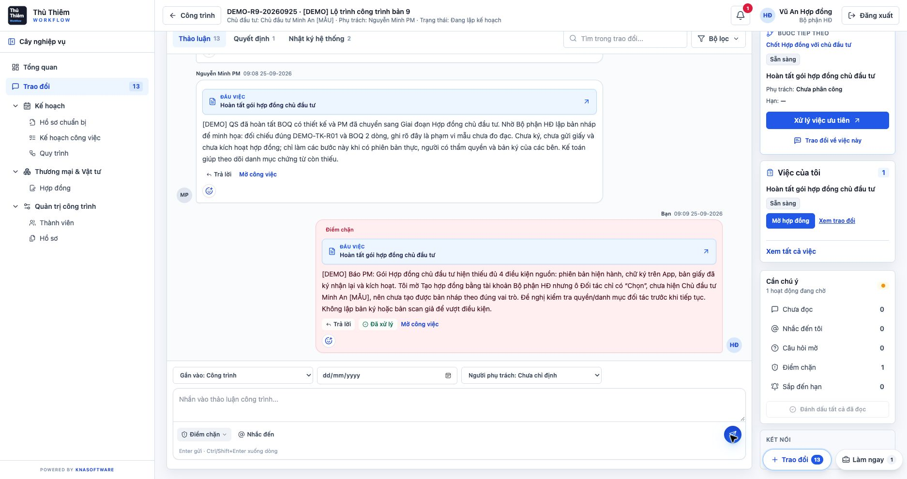

*Ảnh 7w · Bộ phận HĐ báo bốn điều kiện hợp đồng còn thiếu và việc biểu mẫu chưa hiển thị đối tác cho tài khoản này. Tin **Điểm chặn** là thông tin điều phối, không thay cho hợp đồng đã ký.*

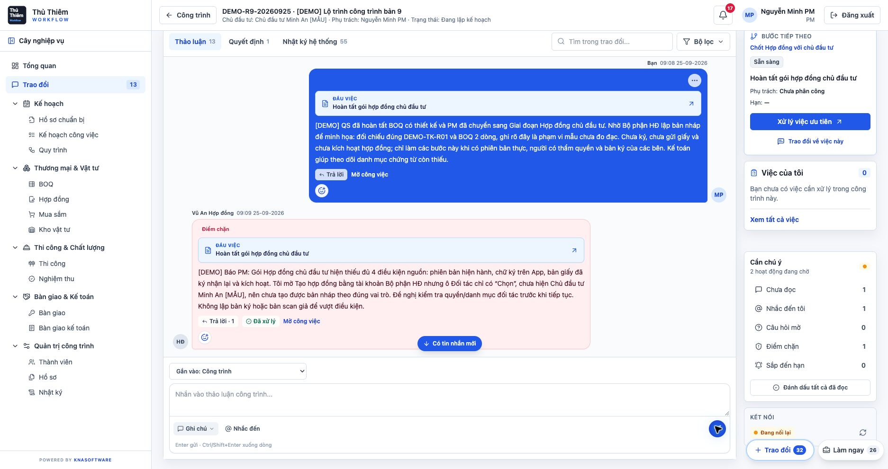

*Ảnh 7x · PM giải thích đã tạo bản nháp bằng quyền PM và nhờ Bộ phận HĐ yêu cầu bổ sung hồ sơ; không đề nghị duyệt hoặc ký V1.*

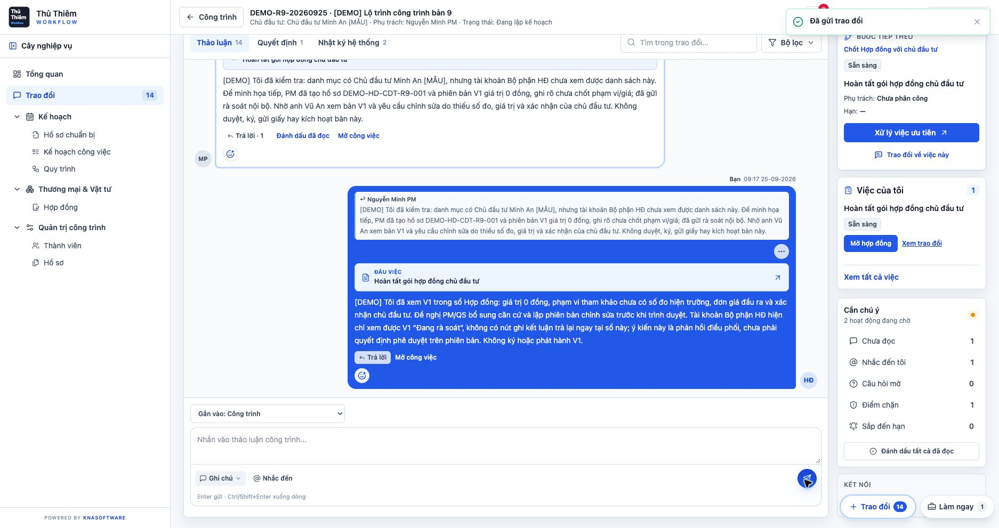

*Ảnh 7y · Bộ phận HĐ nêu ba căn cứ còn thiếu ngay trong chuỗi Trao đổi. Đây không phải nút trả lại chính thức trên phiên bản hợp đồng.*

**Trạng thái đã kiểm chứng:** công trình Rev9 hiện **7/20 Gói công việc hoàn tất, Giai đoạn 07 Hợp đồng chủ đầu tư đang xử lý**. V1 là bản nháp **Đang rà soát**, chưa được duyệt hoặc ký. Các Giai đoạn Thi công, Nghiệm thu và Bàn giao chưa phát sinh trên chính công trình này; ảnh thuộc công trình mẫu khác được ghi rõ để người đọc không hiểu là kết quả của `DEMO-R9-20260925`.

### 5.2. Nội dung trao đổi khi phát sinh việc ở các Giai đoạn tiếp theo

Sau Hợp đồng, PM quay lại Trao đổi sau mỗi gói, mở việc ưu tiên kế tiếp, gửi lời nhắn gắn đúng Đầu việc, rồi lặp đến cuối nhánh. Các câu sau là **mẫu nội dung chưa gửi**: Mua hàng hỏi báo giá và nguồn vật tư; Giám sát báo Kiểm tra và Cần xử lý; Kế toán hỏi chứng từ còn thiếu lúc bàn giao. QS đã hỏi căn cứ BOQ và Bộ phận HĐ đã báo điểm chặn trên công trình tham chiếu; không ghi các câu mẫu thành lịch sử đã xảy ra.

**Quy tắc xử lý:** lời nhắn giúp điều phối; việc đổi trạng thái, kết luận đạt/không đạt, phê duyệt và tiếp nhận phải làm tại đúng hồ sơ theo quyền của người đang đăng nhập.

## 6. Xử lý việc ưu tiên và lặp cho đến hết nhánh Quy trình

Từ **Tổng quan › Xử lý việc ưu tiên**, hoặc từ **Trao đổi › Bước tiếp theo › Xử lý việc ưu tiên**, mở cùng việc hiện tại. Kiểm tra tiêu đề, Giai đoạn/Gói công việc, vai trò phụ trách, hồ sơ bắt buộc, minh chứng, điều kiện cần làm và nút hành động bên phải.

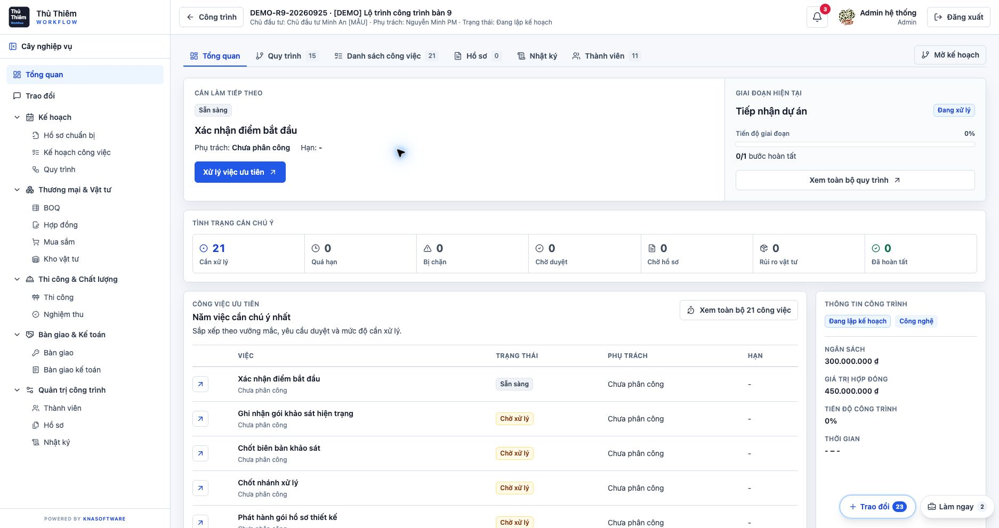

*Ảnh 8 · Tổng quan của công trình mới, mở việc tiếp theo bằng Xử lý việc ưu tiên.*

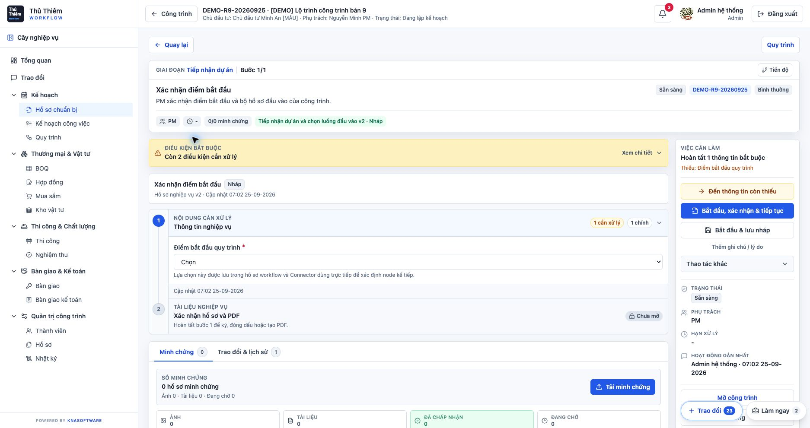

*Ảnh 9 · Đầu việc đầu tiên “Xác nhận điểm bắt đầu” còn thiếu lựa chọn bắt buộc; PM cần ghi căn cứ, kiểm tra điều kiện rồi mới xác nhận. Mở xem không tự hoàn tất việc.*

| Vòng lặp cho mỗi Gói công việc | Người đang làm | Dấu hiệu cần kiểm tra |
|---|---|---|
| 1. Mở việc ưu tiên hoặc chọn **Mở** ở Quy trình | Vai trò chính của gói | Đúng công trình, Giai đoạn và Đầu việc; việc đang được phép làm |
| 2. Ghi thông tin, ảnh, biên bản hoặc xử lý tại hồ sơ nguồn | Người thực hiện | Hồ sơ được lưu/gửi; số liệu và minh chứng thuộc đúng nguồn |
| 3. Trao đổi ngắn, nêu câu hỏi hoặc điểm chặn | PM, Giám sát, QS, Kế toán... theo tình huống | Tin được gắn đúng việc/hồ sơ; không xem lời nhắn là quyết định duyệt |
| 4. Mời rà soát/duyệt Giai đoạn khi phù hợp | Người gửi yêu cầu | Tại công trình Rev9, PM đã gửi yêu cầu ở Khảo sát 2/2 và Họp báo cáo khảo sát 1/1; mỗi yêu cầu được người khác có quyền xét duyệt |
| 5. Người có quyền kết luận hoặc yêu cầu bổ sung | Người duyệt/rà soát khác người gửi khi chính sách yêu cầu | Có ý kiến, trạng thái và lịch sử; nếu cần sửa thì quay lại bước 2 |
| 6. **Hoàn tất** Đầu việc; chuyển Giai đoạn khi đã đủ điều kiện | Người có quyền thao tác | Không còn hồ sơ nguồn, ảnh, phê duyệt hoặc việc mở đang chặn; mở **Quy trình › Thao tác giai đoạn › Chuyển giai đoạn tiếp theo** theo quyền, rồi quay về Trao đổi. Hai Đầu việc Khảo sát hoàn tất **không tự chuyển** Giai đoạn. |

**Trạng thái công trình tham chiếu trong ảnh:** 01 Tiếp nhận dự án, 02 Khảo sát, 03 Họp báo cáo khảo sát, 04 Thiết kế và 06 BOQ có thiết kế đã hoàn tất. Nhánh 05 không thiết kế đã bỏ qua, tiến độ **7/20**. Giai đoạn 07 đang xử lý hợp đồng; các ảnh Thi công, Nghiệm thu, Bàn giao, Bàn giao kế toán bên dưới thuộc công trình mẫu khác. Giám sát duyệt Khảo sát, QS duyệt biên bản họp, PM duyệt các dòng BOQ và yêu cầu mua; PM chuyển Giai đoạn bằng thao tác riêng. Người duyệt cần xem cả hồ sơ và minh chứng [DEMO] trước khi quyết định.

### 6.1. Các Gói công việc trong mẫu bản 9

| Giai đoạn | Gói công việc cần thực hiện | Mục đích / chức năng của người làm | Vai trò chính |
|---|---|---|---|
| 01 | Xác nhận điểm bắt đầu | PM xác nhận hồ sơ đầu vào và điểm bắt đầu | PM |
| 02 | Ghi nhận gói khảo sát hiện trạng | Ghi yêu cầu, kích thước, rủi ro, ảnh hiện trường | Giám sát |
| 02 | Chốt biên bản khảo sát | Tập hợp kết quả và các điểm cần xử lý tiếp | PM |
| 03 | Chốt nhánh xử lý | Chọn Có thiết kế hoặc Không thiết kế từ biên bản | PM |
| 04 | Phát hành gói hồ sơ thiết kế | Tổng hợp phương án, bản vẽ, kết quả rà soát | Thiết kế |
| 04 | Bàn giao bản phát hành cho QS | Xác nhận đúng bản đã phát hành để QS lập BOQ | PM |
| 05* | Phát hành BOQ không thiết kế | Chốt BOQ và căn cứ gửi chủ đầu tư | QS |
| 06* | Phát hành BOQ có thiết kế | Chốt BOQ theo thiết kế đã bàn giao | QS |
| 07 | Hoàn tất gói hợp đồng chủ đầu tư | Điều phối bản hợp đồng, ký và hồ sơ giấy | Bộ phận HĐ |
| 08 | Chốt bóc khối lượng đầu vào | Xác nhận BOQ dùng cho mua hàng | QS |
| 08 | Hoàn tất lấy giá nhà cung cấp | Tập hợp báo giá đủ điều kiện | Mua hàng |
| 09 | Chốt lựa chọn giá đầu vào | Lưu căn cứ đàm phán và chọn giá | Mua hàng |
| 10 | Hoàn tất gói hợp đồng đầu vào | Chốt yêu cầu mua được duyệt và hợp đồng liên quan | Mua hàng |
| 11 | Lập gói kế hoạch thi công | Biên bản triển khai, danh sách kiểm tra chất lượng | PM |
| 11 | Kích hoạt bàn giao thi công | Giao hạng mục, tiêu chí kiểm tra ra hiện trường | PM |
| 12 | Báo cáo thi công liên tục | Nhật ký, tiến độ, vấn đề, ảnh và minh chứng | Giám sát |
| 13 | Nghiệm thu gói thầu phụ và khối lượng | Đối chiếu danh mục kiểm tra, khối lượng thầu phụ | QS |
| 13 | Nghiệm thu vật tư đầu vào | Kết luận chất lượng vật tư trước nhập kho | QA/QC |
| 14 | Chốt gói nghiệm thu cuối | Đối chiếu chủ đầu tư và kết luận hồ sơ cuối | QA/QC |
| 15 | Hoàn tất bàn giao vật lý | Kiểm tra đủ hồ sơ, xử lý tồn tại và vật tư dư | PM |
| 15 | Xác nhận bàn giao hồ sơ kế toán | Kế toán tiếp nhận hồ sơ mua sắm và mốc thu đủ điều kiện | Kế toán |

*Hai dòng 05 và 06 là hai nhánh thay thế nhau. Trên công trình tham chiếu, Giai đoạn 02 và 03 có lượt duyệt riêng; Giai đoạn 15 cũng yêu cầu xác nhận theo vai trò khi đi đến cuối. Các gói khác vẫn có thể cần duyệt hồ sơ nghiệp vụ tại BOQ, Hợp đồng, Mua sắm, Nghiệm thu hoặc Bàn giao.*

### 6.2. BOQ có thiết kế: bản vẽ, khối lượng và giá

**Mục đích:** QS lập khối lượng theo đúng bản Thiết kế PM đã bàn giao; người duyệt quyết định trên từng dòng BOQ, sau đó mới khóa giá cuối và tạo yêu cầu mua cho phần cần mua mới. Công trình Rev9 đã thực hiện chặng này bằng **số liệu [DEMO]**.

| Mốc trong công trình Rev9 | Người thực hiện và chức năng | Kết quả đã quan sát |
|---|---|---|
| Căn cứ đầu vào | **Thiết kế** phát hành `DEMO-TK-R01`; **PM** bàn giao revision đó cho QS | QS có một bản phát hành cụ thể để tham chiếu; sơ đồ chưa có số đo hiện trường |
| Bóc khối lượng | **QS Trần Hà** nhập 4 đèn LED âm trần và 24 m² tấm thạch cao, gắn mã vật tư; gửi duyệt và khóa định mức | Hai dòng tổng 7,4 triệu đồng chỉ là ví dụ; không dùng để đặt hàng thật |
| Rà và duyệt | **PM Nguyễn Minh** xem hai dòng và chọn **Duyệt dự toán** | Hai dòng chuyển **Đã duyệt**; lúc này giá cuối vẫn chưa tự khóa |
| Lấy giá và chọn nguồn | **PM** tạo báo giá nhà cung cấp giả lập `DEMO-BG-R9-001`, đánh giá **có điều kiện** và chọn giá cho từng dòng | Cả hai giá cuối được khóa; cần đối chiếu số đo, điện nước và tồn kho trước nghiệp vụ thật |
| Phát hành Gói công việc | **QS** ghi người nhận/kênh gửi là **nội bộ, chưa gửi ra ngoài**, chốt hồ sơ, tạo PDF, tải BOQ [DEMO] vào sổ minh chứng rồi hoàn tất | Giai đoạn 06 đạt 1/1. PDF biểu mẫu ghi 0 chữ ký, 0 con dấu; PDF minh chứng cũng mang dấu DEMO |

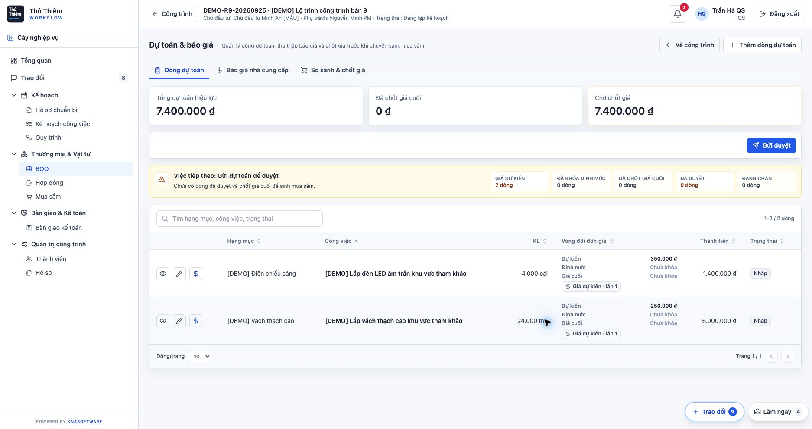

*Hai dòng BOQ có thiết kế được QS nhập từ bản DEMO-TK-R01. Khối lượng và đơn giá là số mô phỏng.*

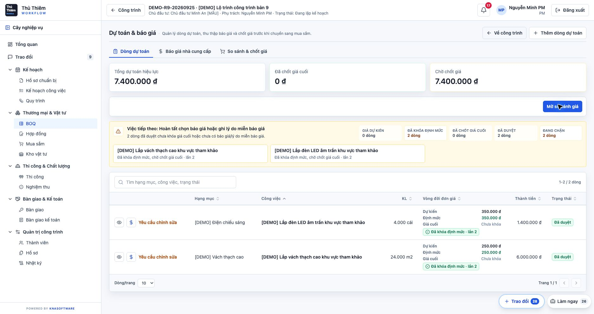

*PM đã duyệt khối lượng/đơn giá dự toán; màn hình còn cho thấy giá cuối là bước riêng.*

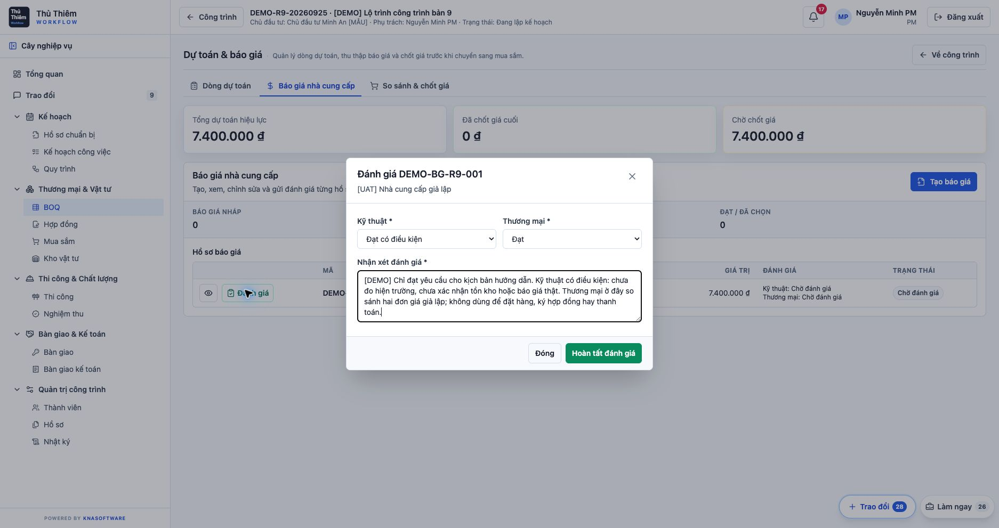

*Báo giá mẫu có điều kiện kỹ thuật; đánh giá này không thay hồ sơ khảo sát thực tế.*

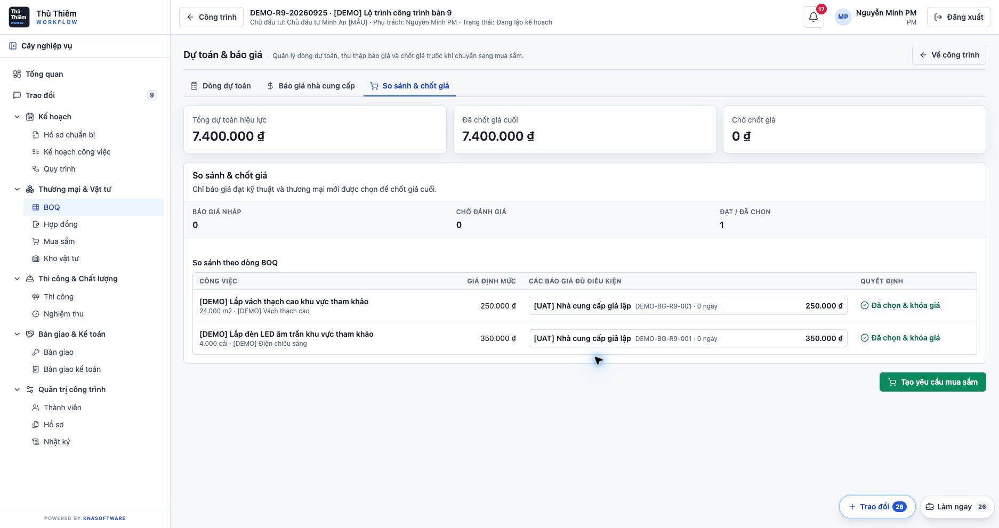

*Giá cuối hai dòng đã khóa theo báo giá mô phỏng. Mỗi dòng giữ liên kết về nhà cung cấp và căn cứ giá.*

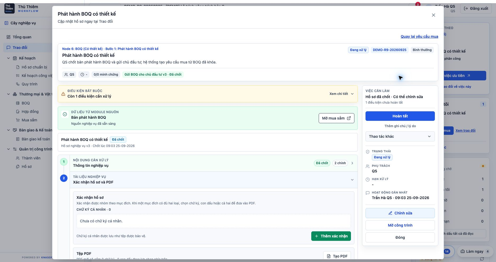

*Hồ sơ Đầu việc đã chốt; người nhận/kênh gửi ghi rõ chưa chuyển BOQ ra ngoài. QS còn phải bổ sung minh chứng mới hoàn tất được Đầu việc.*

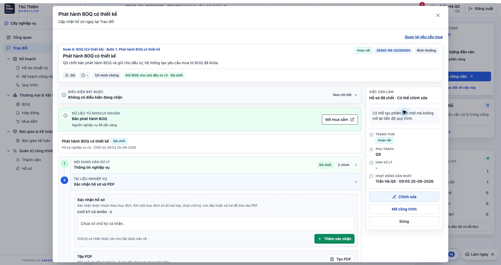

*Sổ minh chứng có PDF [DEMO]; Đầu việc đạt Hoàn tất và PM mới chuyển Giai đoạn.*

### 6.3. Hợp đồng chủ đầu tư và hợp đồng đầu vào

**Mục đích:** có đúng bản hợp đồng làm căn cứ thực hiện, biết ai rà nội dung, ai ký, và đã nhận lại hồ sơ giấy có chữ ký hay chưa. Từ **Quy trình**, mở Giai đoạn **07 Chốt Hợp đồng với chủ đầu tư** rồi chọn Đầu việc **Hoàn tất gói hợp đồng chủ đầu tư**; hồ sơ nguồn nằm tại **Hợp đồng**. Sau khi lấy giá đầu vào, Giai đoạn **10 Hợp đồng và tạm ứng đầu vào** kiểm tra cả yêu cầu mua đã duyệt và hợp đồng nhà cung cấp/thầu phụ phù hợp.

| Hồ sơ hoặc mốc | Mục đích | Vai trò làm chính và thao tác | Vai trò kiểm tra/quyết định |
|---|---|---|---|
| Hợp đồng chủ đầu tư (phải thu) | Chốt phạm vi, giá trị, mốc thu, bản phát hành | **Bộ phận HĐ** tạo hợp đồng nháp, lập phiên bản, đối chiếu BOQ đã chốt và hồ sơ chủ đầu tư | **PM** đối chiếu phạm vi; người có quyền rà soát/duyệt phiên bản kết luận trên hồ sơ |
| Rà soát, duyệt và ký phiên bản | Giữ đúng một bản được phép ký, truy lại ý kiến | Bộ phận HĐ gửi bản để rà/duyệt; người được giao quyền rà soát và duyệt ghi ý kiến, quyết định | Người có quyền **ký** ký trên phần mềm bằng tài khoản của chính mình |
| Hồ sơ giấy và bản chụp có chữ ký | Xác nhận việc gửi và nhận bản ký thực tế | Người có quyền gửi ghi người nhận, cách gửi, thời điểm; người có quyền quản lý hồ sơ tải lên bản giấy đã ký | Người có quyền kích hoạt kiểm tra đúng **phiên bản hiện hành** và đủ chữ ký, lần gửi, bản chụp |
| Hợp đồng đầu vào (phải trả) | Chốt điều kiện với nhà cung cấp hoặc thầu phụ | **Mua hàng** đưa căn cứ chọn nhà cung cấp, đơn hàng; **Bộ phận HĐ** lập và theo dõi phiên bản hợp đồng đầu vào | Người được cấp quyền rà/duyệt/ký; **Kế toán** xem căn cứ tạm ứng theo hồ sơ, không tự hiểu “hợp đồng” là đã chi tiền |

**Trình tự nên chỉ trực tiếp:** lập hợp đồng nháp › tạo phiên bản › gửi rà soát/duyệt › ký trên phần mềm › ghi nhận gửi giấy › tải bản chụp giấy đã ký › kích hoạt khi hệ thống cho phép. Hồ sơ cũ có thể mang nhãn **Đang hiệu lực** mà vẫn thiếu chứng từ theo điều kiện mới; cảnh báo màu vàng trên ảnh mẫu là ví dụ. Không nói “đủ điều kiện” chỉ dựa vào nhãn trạng thái.

**Điểm dừng trên công trình Rev9:** PM đã mở Giai đoạn 07, Bộ phận HĐ Vũ An đã mở Đầu việc. Ban đầu phần mềm nêu **0/4 điều kiện nguồn**. Khi Bộ phận HĐ chọn **Tạo hợp đồng**, ô **Đối tác** chỉ hiện “Chọn”, nên tài khoản này chưa lập được bản nháp. PM sau đó tạo `DEMO-HD-CDT-R9-001` với đúng chủ đầu tư mẫu, lập **V1 giá trị 0 đồng** để hướng dẫn và gửi rà soát. Bộ phận HĐ đọc được V1 nhưng không có nút kết luận trả lại tại sổ Hợp đồng, nên gửi ý kiến yêu cầu bổ sung trong Trao đổi. **V1 vẫn Đang rà soát**; chưa có hợp đồng được duyệt, chữ ký trên phần mềm, bản scan giấy đã ký hoặc kích hoạt. Không điền rằng đã gửi bản cứng và không chuyển tiếp Giai đoạn 07 khi thiếu căn cứ.

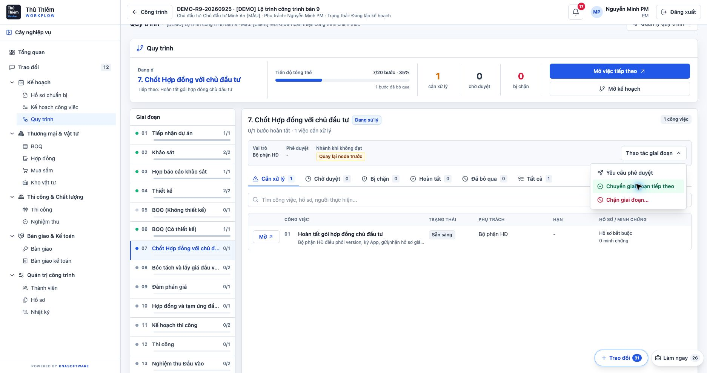

*Rev9 ở Giai đoạn 07 sau khi BOQ đạt 7/20 Gói công việc; Gói Hợp đồng còn 0/1.*

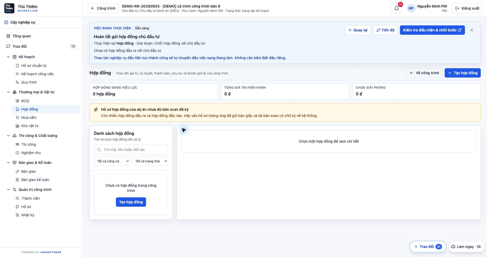

*Thời điểm mới mở Giai đoạn 07, sổ Hợp đồng của chính công trình mới chưa có bản nào. Các ảnh tiếp theo ghi lại lúc PM tạo bản nháp.*

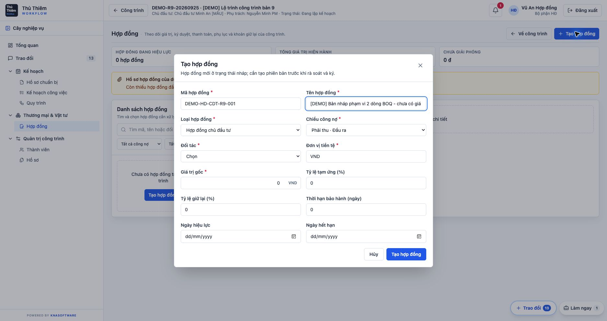

*Vũ An Hợp đồng mở biểu mẫu bản nháp với mã/tên [DEMO], nhưng danh sách Đối tác không hiển thị Chủ đầu tư Minh An [MẪU]; không bấm Tạo hợp đồng.*

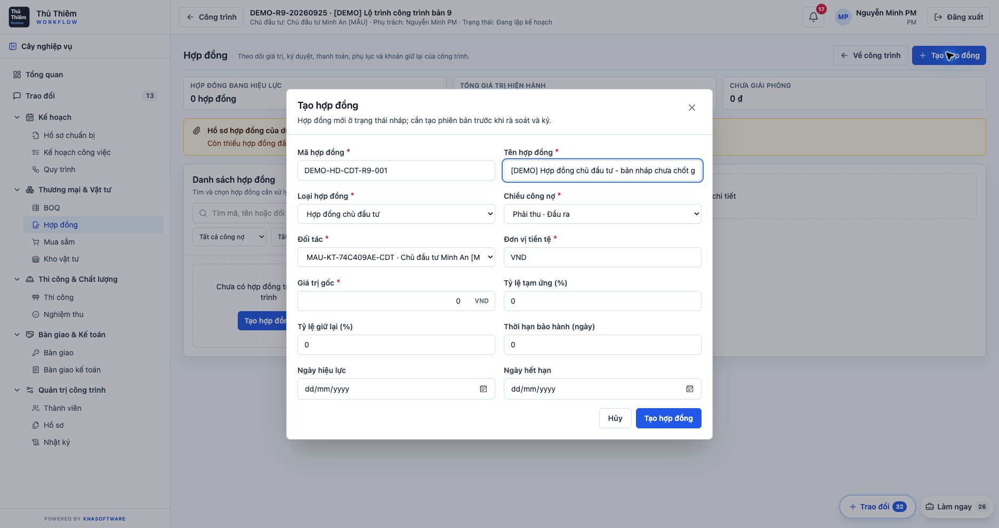

*Cùng biểu mẫu dưới tài khoản PM có Chủ đầu tư Minh An [MẪU]; PM tạo hồ sơ [DEMO] với giá trị 0 đồng vì giá hợp đồng chưa chốt.*

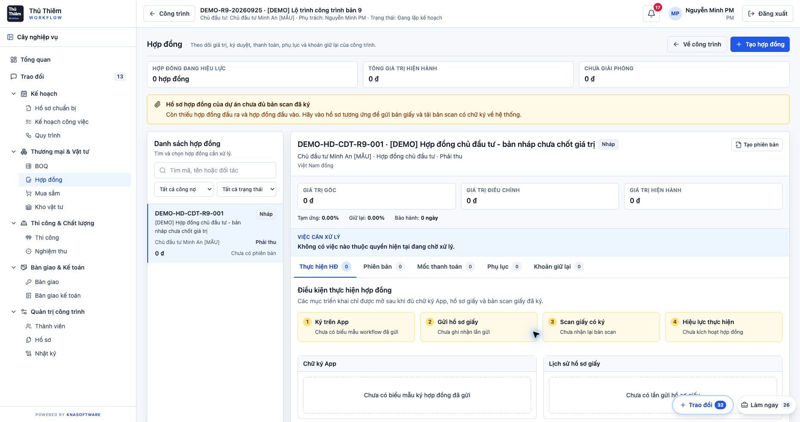

*`DEMO-HD-CDT-R9-001` ở trạng thái Nháp, chưa có phiên bản, chưa hiệu lực. Đây là hồ sơ của chính công trình Rev9.*

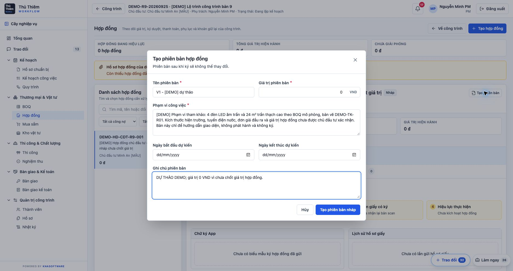

*PM ghi phạm vi theo hai dòng BOQ mô phỏng, nêu rõ thiếu số đo và xác nhận chủ đầu tư; giá trị phiên bản bằng 0 đồng.*

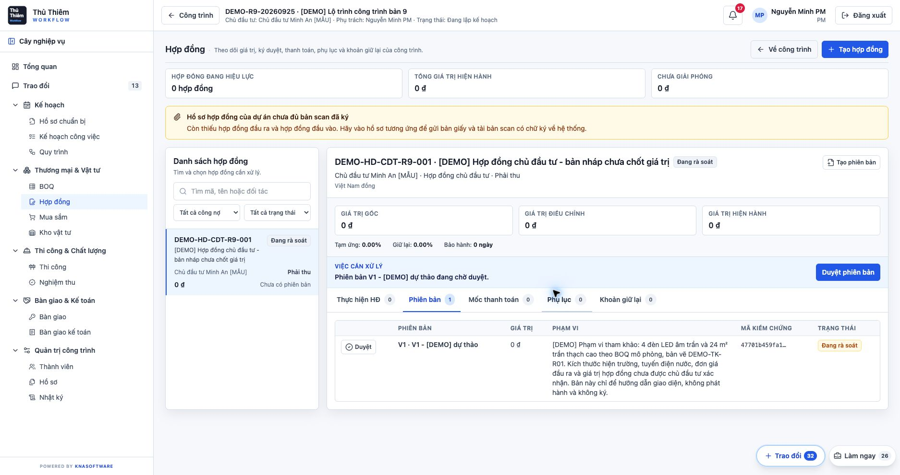

*V1 **Đang rà soát**; nút Duyệt chỉ xuất hiện theo quyền PM. Không bấm duyệt khi bản dự thảo chưa đủ căn cứ.*

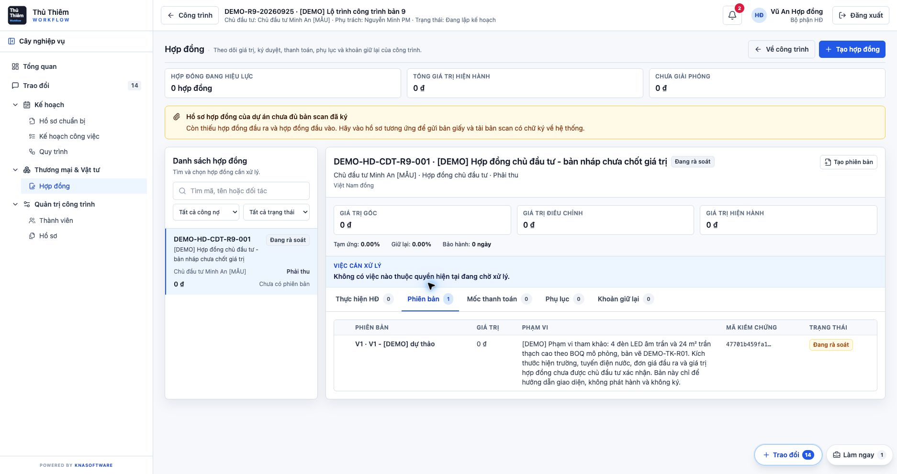

*Bộ phận HĐ thấy V1 Đang rà soát và giá trị 0 đồng, nhưng cột Thao tác trống theo tài khoản này. Ý kiến bổ sung đã được gửi trong Trao đổi, chưa đổi trạng thái hợp đồng.*

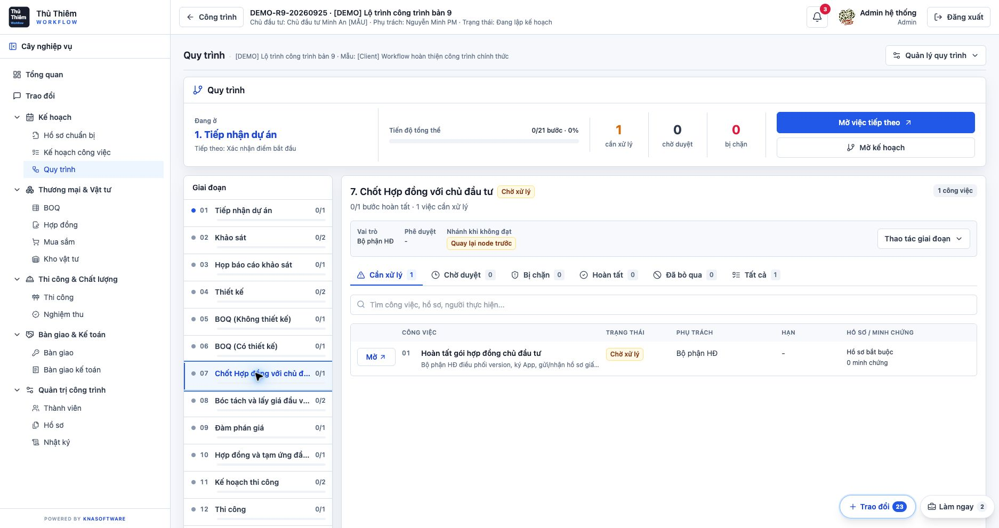

*Ảnh 10 · Giai đoạn 07 của chính công trình Rev9 mới: Bộ phận HĐ phụ trách, gói hợp đồng còn chờ xử lý.*

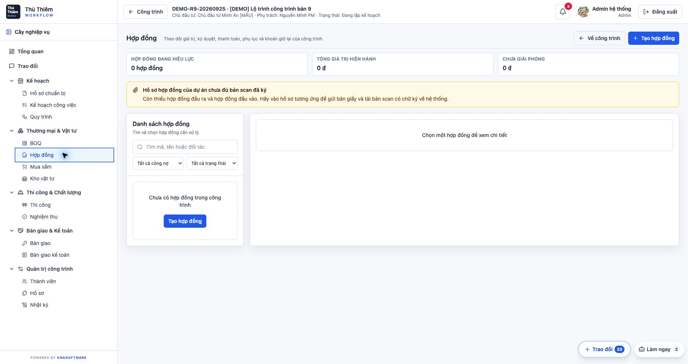

*Ảnh 11 · Ảnh ở thời điểm ban đầu, công trình mới chưa có hợp đồng; giá trị dự kiến trong Thông tin công trình chưa tạo thành hợp đồng nguồn.*

*Ảnh 12 · Công trình mẫu GOLDEN-REAL-001: hợp đồng chủ đầu tư (phải thu), phiên bản/phụ lục/mốc thanh toán và bốn điều kiện thực hiện. Cảnh báo thiếu bản chụp hợp đồng đã ký vẫn còn trên hồ sơ mẫu lịch sử.*

*Ảnh 13 · Cùng công trình mẫu: hợp đồng nhà cung cấp Dulux là đầu vào (phải trả), tách biệt hợp đồng chủ đầu tư và yêu cầu mua.*

### 6.4. Mua sắm: từ BOQ, báo giá tới hàng đã nhận

**Mục đích:** biết mua vật tư nào, từ nhà cung cấp nào, bằng đơn hàng nào, đã được duyệt và nhận đến đâu. Trên công trình Rev9, **PM** đã dùng quyền của mình duyệt BOQ, ghi báo giá giả lập và xử lý một yêu cầu mua; lịch sử ghi đúng PM là người thao tác. Trách nhiệm vận hành ở Giai đoạn 08–10 vẫn thuộc **QS** và **Mua hàng** theo từng Gói công việc. Mở **BOQ** để xem căn cứ khối lượng/giá và **Mua sắm** để theo dõi yêu cầu mua.

| Mốc | Người làm và chức năng | Điều cần chỉ ra trên màn hình | Điều kiện để đi tiếp |
|---|---|---|---|
| Chốt BOQ và giá mua | **QS** xác nhận khối lượng; **Mua hàng** tập hợp báo giá, đối chiếu nhà cung cấp | Dòng BOQ, bản giá cuối và báo giá được chọn; nếu chọn giá thủ công phải có lý do | BOQ đã duyệt, giá cuối đã khóa; không tự lấy giá từ tin trao đổi |
| Tạo yêu cầu mua | **Mua hàng** là vai trò nghiệp vụ thường làm; trong lượt Rev9 **PM** đã thao tác từ BOQ và kiểm tra kết quả trong sổ Mua sắm | Yêu cầu mua dẫn về BOQ/báo giá; một nhà cung cấp có thể có nhiều dòng hàng | Tạo yêu cầu **không** làm tăng tồn kho hay tự lập khoản chi |
| Gửi và duyệt yêu cầu mua | Người lập gửi; **người có quyền duyệt mua** xem căn cứ và kết luận | Trạng thái chờ duyệt/đã duyệt hoặc cần chỉnh sửa; ý kiến duyệt lưu với nguồn | Chỉ người có quyền trong công trình mới duyệt; người lập xử lý yêu cầu sửa rồi gửi lại |
| Đặt hàng | **Mua hàng** thường ghi nhà cung cấp, số đơn và ngày giao; trong lượt Rev9 **PM** ghi `DEMO-PO-R9-001` nội bộ | Yêu cầu mua chuyển sang theo dõi giao/nhận | Bản ghi PO [DEMO] **chưa được gửi nhà cung cấp**; không hiểu trạng thái “Đang giao / nghiệm thu” là hàng đã giao |
| Nghiệm thu đầu vào | **QA/QC** kết luận số lượng/chất lượng đạt; **Mua hàng** đối soát | “Yêu cầu”, “Đạt nghiệm thu” và “Chờ nhập kho” là ba số riêng | Hàng đạt nghiệm thu **chưa** tự nằm trong kho |
| Ghi phiếu nhập kho | **Thủ kho** chọn đúng chứng từ nghiệm thu, kho nhận, vật tư, lượng nhập | “Đã nhập kho” tăng theo phiếu kho đã ghi; từng dòng vẫn nối về nguồn | Không nhập vượt lượng đạt chưa nhập; phiếu kho là chứng từ tăng tồn riêng |

*Ảnh 14 · Màn xem trước Giai đoạn 08 của công trình Rev9: QS sẽ chốt bản BOQ dùng cho mua; Mua hàng sẽ hoàn tất lấy giá nhà cung cấp. Giai đoạn này **chưa mở** trên công trình tham chiếu.*

*Ảnh 15 · Màn xem trước Giai đoạn 10 của công trình Rev9: sẽ kiểm tra yêu cầu mua được duyệt và hợp đồng đầu vào đủ điều kiện; Giai đoạn này **chưa mở**.*

*Ảnh 16 · Ảnh chụp **trước** khi tạo BOQ và yêu cầu mua của công trình Rev9. Xem các ảnh ngay dưới để thấy yêu cầu đã phát sinh về sau.*

**Yêu cầu mua đã ghi trên công trình Rev9:** từ hai dòng BOQ đã duyệt và khóa giá, phần mềm ghi **một** yêu cầu `PR-95fd70ab-1790301536-01`, nhà cung cấp `[UAT] Nhà cung cấp giả lập`, hai mặt hàng, **7.400.000 đồng**. Màn hình lúc bấm **Tạo yêu cầu mua sắm** báo lỗi với mã tra cứu `6cdf0748-ea78-4146-ac03-cbc3d6ebc735`, nhưng sổ Mua sắm và Trao đổi đều cho thấy yêu cầu đã được lưu. Khi gặp tình huống tương tự, **mở lại sổ kiểm tra trước khi thử lại** để tránh tạo hai yêu cầu cho cùng BOQ. PM đã duyệt yêu cầu đó và ghi PO mẫu, ngày giao dự kiến 28/09/2026; **đạt nghiệm thu 0/28, đã nhập kho 0**.

*Hai dòng vật tư và liên kết về BOQ, báo giá nằm trong chính yêu cầu mua của công trình Rev9.*

*Yêu cầu chuyển Chờ đặt hàng; duyệt yêu cầu chưa tạo đơn hàng hoặc nhập kho.*

*PO `DEMO-PO-R9-001` và ngày giao dự kiến đã lưu trong phần mềm. Nhà cung cấp chưa nhận đơn, hàng chưa giao, chưa nghiệm thu hoặc nhập kho.*

*Ảnh 17 · Công trình mẫu GOLDEN-REAL-001, thẻ Tất cả: hai yêu cầu đã duyệt, đặt hàng, nghiệm thu và nhập kho; các nhãn NT/Kho là hai kết quả khác nhau.*

*Ảnh 18 · Một yêu cầu mua mẫu cho thấy nhà cung cấp, số đơn đặt hàng, hạn giao và bốn cột lượng: yêu cầu, đạt nghiệm thu, đã nhập kho, chờ nhập kho.*

### 6.5. Lấy vật tư: kiểm kho trước, mua phần còn thiếu

**Mục đích:** cấp đúng vật tư, đúng lượng và đúng công trình; một nhu cầu có thể tách thành **lấy từ kho** và **mua mới**. Tại **Kho vật tư › Tồn theo kho**, lọc kho nguồn, đối chiếu mã/đơn vị và lượng còn dùng được. Số tồn đang nhìn là tồn của kho; **chưa phải vật tư đã giao cho công trình**. Trong ảnh kho trung tâm, Sơn Dulux còn 80 thùng, Dây điện Cadivi còn 2.000 m; một số mã khác bằng 0.

| Tình huống nguồn | Người tham gia và việc làm | Chứng từ/quan hệ cần có | Kết quả được phép nói |
|---|---|---|---|
| Kho còn đủ vật tư dùng được | **PM/Giám sát** xác nhận nhu cầu; **Thủ kho** chọn **Tạo phiếu kho › Xuất công trình**, kho nguồn, vật tư và số lượng | Phiếu xuất đã ghi gắn công trình, vật tư, kho, người thực hiện và biến động kho | Vật tư đã xuất ra công trình theo phiếu; Mua sắm không phải bước bắt buộc của nguồn này |
| Kho chỉ đủ một phần | PM/Giám sát xác nhận phần dùng trước; Thủ kho xuất lượng có sẵn; **QS/Mua hàng** làm nguồn mua cho phần thiếu | Phiếu xuất kho cho phần có sẵn và yêu cầu mua riêng cho phần thiếu, tránh đếm hai lần | Chỉ lượng trên phiếu xuất được coi là đã cấp; phần mua vẫn chờ duyệt/giao/nhận |
| Kho hết hoặc cần mua mới | **QS** chốt BOQ/khối lượng; **Mua hàng** lấy giá, tạo yêu cầu, trình duyệt và đặt; **QA/QC** nghiệm thu; **Thủ kho** lập phiếu nhập rồi phiếu xuất | BOQ › báo giá/chọn nhà cung cấp › yêu cầu mua/đơn đặt hàng › nghiệm thu đầu vào › phiếu nhập › phiếu xuất công trình | “Đã đặt”, “đạt nghiệm thu”, “đã nhập kho” và “đã xuất công trình” là bốn mốc khác nhau |

**Lời giải thích gọn:** “Sơn có sẵn thì Thủ kho xuất thẳng cho công trình bằng phiếu xuất. Đèn đang hết tồn thì Mua hàng đi theo BOQ, báo giá và đơn hàng; QA/QC nghiệm thu đạt, Thủ kho ghi phiếu nhập, sau đó mới xuất cho công trình. Nếu chỉ đủ một phần, tách hai lượng và giữ hai bộ chứng từ.” Vật tư có mã đơn vị vật lý phải chọn đúng đơn vị còn dùng được ở kho nguồn; số tồn tổng không thay thế việc kiểm tra tình trạng từng đơn vị. **Trong công trình Rev9, nhánh mua mới hiện dừng ở PO mẫu và 0 lượng hàng nhận; nhánh xuất thẳng từ kho mới được mở biểu mẫu, chưa ghi phiếu xuất.**

*Ảnh 19 · Kho trung tâm Bình Tân có mã còn tồn và mã hết tồn; lọc trong trang công trình mới không có nghĩa số tồn đã dành riêng cho công trình mới.*

*Ảnh 20 · Màn hình chọn loại “Xuất công trình”, kho nguồn và Sơn Dulux trên công trình mới. Đây là **bản đang nhập để minh họa**, đã đóng bằng Hủy, chưa ghi phiếu hoặc trừ tồn.*

## 7. Rà soát lại và phê duyệt: nói đúng tầng quyết định

| Tầng quyết định | Mục đích | Ai gửi | Ai kết luận | Nếu chưa đạt |
|---|---|---|---|---|
| Rà soát Đầu việc/hồ sơ | Kiểm tra nội dung, ảnh, biên bản hoặc nguồn nghiệp vụ | Người phụ trách Gói công việc | Người có quyền rà soát/duyệt được phần mềm cho phép | Nêu rõ mục cần sửa; người làm bổ sung trên đúng hồ sơ rồi gửi lại |
| Duyệt hồ sơ nguồn | Quyết định của BOQ, hợp đồng, yêu cầu mua, biên bản nghiệm thu... | Người tạo/gửi hồ sơ nguồn | Vai trò có quyền quyết định ở màn hình nguồn | Hồ sơ nguồn quay lại trạng thái cần bổ sung; Đầu việc chưa tự hoàn tất |
| Duyệt Giai đoạn 02 | Xác nhận gói khảo sát và biên bản đã được xem xét trước cuộc họp chọn nhánh | PM gửi yêu cầu sau khi 2/2 gói hoàn tất | Giám sát Cao Nhất Hiệp đã duyệt trên công trình Rev9 | Ghi rõ số liệu/ảnh còn thiếu; PM và Giám sát sửa trên hồ sơ nguồn rồi gửi xét lại |
| Duyệt Giai đoạn 03 | Chốt nhánh sau họp khảo sát | Người yêu cầu duyệt Giai đoạn | Một người thuộc PM/QS/Giám sát, khác người gửi | Trả về để bổ sung biên bản hoặc căn cứ chọn nhánh |
| Duyệt Giai đoạn 15 | Xác nhận hoàn tất Bàn giao công trình và hồ sơ kế toán | Người yêu cầu duyệt Giai đoạn | Một người thuộc Kế toán/PM/Giám đốc, khác người gửi | Xử lý đúng hồ sơ Bàn giao hoặc hồ sơ kế toán còn thiếu |

Trên công trình Rev9, PM gửi yêu cầu duyệt Khảo sát, Giám sát Hiệp duyệt; PM gửi yêu cầu duyệt Họp báo cáo khảo sát, QS Trần Hà duyệt. Mỗi ý kiến có điều kiện phải đo lại kích thước và rà tuyến điện nước. Người gửi không tự duyệt yêu cầu của mình; nút **Yêu cầu chỉnh sửa** đưa hồ sơ về cho người làm bổ sung, còn **Từ chối** là kết luận không chấp nhận. Chỉ dùng nút duyệt khi công trình đã đến đúng Giai đoạn và người đăng nhập thực sự có quyền. “Hoàn tất Đầu việc”, “duyệt hồ sơ nguồn” và “chuyển Giai đoạn” là ba thao tác khác nhau. Ảnh 7g–7p cho thấy hai lần duyệt và chuyển Giai đoạn đã ghi nhận.

*Ảnh 21 · Vùng quyết định của một Đầu việc mẫu đang Chờ duyệt. Ảnh còn báo một điều kiện chưa hoàn tất: người được giao cần mở điều kiện này và bổ sung hồ sơ trước khi kết luận. Lựa chọn tại Giai đoạn hoặc hồ sơ nguồn phụ thuộc đúng quyền và tình trạng của hồ sơ đó.*

## 8. Thi công: Nhật ký › Kiểm tra › Cần xử lý

**Mục đích chính:** ghi thực tế hiện trường, so với tiêu chí kiểm tra, giao người khắc phục và xác nhận đã sửa. Vào **Thi công**. Khi chưa đến Giai đoạn Thi công, các hồ sơ cũ còn xem được nhưng tạo mới bị khóa.

| Mục | Nội dung và quan hệ | Người ghi/tạo | Người xem xét hoặc kết luận |
|---|---|---|---|
| Nhật ký | Ngày, việc đã làm/đang làm/sẽ làm, nhân lực, vật tư, tiến độ, ảnh; có thể mở Kiểm tra hoặc Cần xử lý gắn với nhật ký | Giám sát là vai trò chính của Gói công việc; Đội thi công hỗ trợ nội dung thực tế | Người nhận báo cáo được chọn khi gửi, thường PM; xác nhận đã đọc/yêu cầu bổ sung báo cáo **không phải** nghiệm thu chất lượng |
| Kiểm tra | Tiêu chí, vị trí, lịch, ảnh hiện trạng và ảnh kết quả; kết luận Đạt/Không đạt | Giám sát/QA/QC hoặc người được giao có quyền kiểm tra | Người có quyền ghi kết quả kiểm tra; nếu Không đạt, hệ thống tạo một việc cần xử lý liên kết |
| Cần xử lý | Việc khắc phục, người được giao, hạn, bằng chứng hoàn thành; nối về Kiểm tra hoặc Nhật ký nguồn | Giám sát/PM/QA/QC hoặc người có quyền giao việc | Đội thi công/Thầu phụ xử lý; PM/QA/QC hoặc người có quyền xác nhận kết quả. Không đạt thì mở lại, giữ lịch sử cũ |

**Ví dụ quan hệ giữa các hồ sơ:** Giám sát ghi Nhật ký ngày thi công trần. Kiểm tra cao độ không đạt. Hệ thống mở một việc khắc phục; tổ đội sửa và đính ảnh. Người kiểm tra xác nhận đạt rồi mới đưa hạng mục sang Nghiệm thu. Ảnh mẫu có lịch sử nhân sự cũ đã ngừng tài khoản; khi áp dụng cho công trình khác, cần giao người đang hoạt động.

*Ảnh 22 · Các ngày thi công cùng việc đã làm, tình hình và vấn đề phát sinh.*

*Ảnh 23 · Danh sách kiểm tra, kết quả và người được giao.*

*Ảnh 24 · Việc khắc phục liên kết ngược về Kiểm tra không đạt.*

## 9. Nghiệm thu: từ kết quả hiện trường đến biên bản

**Mục đích chính:** ghi tiêu chí, minh chứng và kết luận đạt/không đạt cho đúng hạng mục. Nhật ký thi công và Kiểm tra là căn cứ tham chiếu; **biên bản nghiệm thu** là hồ sơ kết luận riêng. Nghiệm thu vật tư đầu vào không tự nhập kho; Thủ kho phải lập phiếu nhập riêng theo lượng được chấp nhận.

| Hồ sơ/hành động | Ai tạo hoặc ghi | Ai kiểm tra/kết luận | Kết quả cần chỉ ra |
|---|---|---|---|
| Biên bản nghiệm thu và danh mục kiểm tra | QA/QC hoặc PM có quyền tạo; QA/QC chịu trách nhiệm chính ở Giai đoạn đầu ra | Người có quyền kết luận nghiệm thu (QA/QC/PM/Giám đốc theo phân quyền; nên khác người lập) | Từng tiêu chí, ảnh/hồ sơ nguồn, kết luận và thời điểm |
| Nghiệm thu vật tư đầu vào | QA/QC lập/kết luận hồ sơ chất lượng; Mua hàng/Thủ kho cung cấp chứng từ giao hàng | Người có quyền quyết định chất lượng | Lượng đạt tách khỏi lượng đã nhập kho; Thủ kho ghi phiếu nhập sau đó |
| Không đạt hoặc có điều kiện | Người kết luận ghi rõ tồn tại; giao việc sửa | Đội thi công/Thầu phụ sửa; QA/QC kiểm tra lại | Giữ biên bản cũ, việc sửa và lần nghiệm thu lại; không xóa lịch sử không đạt |
| Nhật ký hồ sơ | Hệ thống ghi từ thao tác lập, gửi, kết luận và sửa | PM/QA/QC tra lại khi đối chiếu | Ai làm, lúc nào, nội dung/trạng thái trước sau |

*Ảnh 25 · Biên bản mẫu đã đạt và minh chứng của từng tiêu chí. Trong công trình mới, trạng thái phụ thuộc hồ sơ thực tế.*

## 10. Bàn giao: xác nhận công trình đã đủ điều kiện

**Mục đích chính:** giao công trình và bộ hồ sơ cho chủ đầu tư trên căn cứ nghiệm thu cuối, hồ sơ hoàn công, bảo hành, tồn tại và vật tư dư. Vào **Bàn giao › Tạo hồ sơ** khi đã có nghiệm thu cuối phù hợp. Chọn đúng nghiệm thu nguồn; phần mềm khóa mối liên hệ này trong hồ sơ bàn giao.

| Hành động | Người làm | Người kiểm tra/quyết định | Quan hệ giữa hồ sơ |
|---|---|---|---|
| Lập hồ sơ bàn giao | PM hoặc người có quyền tạo | QA/QC đối chiếu nghiệm thu cuối | Hồ sơ Bàn giao dẫn về đúng biên bản nghiệm thu cuối, không tự tạo nghiệm thu mới |
| Kiểm tra danh mục hồ sơ | PM/QA/QC hoặc người có quyền xác minh | Người có quyền xác minh, căn cứ hồ sơ/ảnh đã chấp nhận | Mỗi mục phải có căn cứ; mục thiếu vẫn là điểm chặn |
| Gửi, kiểm tra điều kiện và hoàn tất | PM gửi; PM/Giám đốc hoặc người có quyền hoàn tất | Người có quyền quyết định trên trạng thái đủ điều kiện | Chỉ hoàn tất khi nghiệm thu cuối đạt, danh mục hồ sơ đủ, không còn tồn tại/vật tư dư/hồ sơ bắt buộc đang chặn |
| Nhật ký bàn giao | Hệ thống ghi từ từng thao tác trên hồ sơ | PM và người đối chiếu đọc lịch sử | Biết ai gửi, ai xác minh, ai hoàn tất; đại diện chủ đầu tư được ghi bằng hồ sơ/xác nhận, không dùng tài khoản phần mềm của chủ đầu tư |

Nếu màn hình chỉ **4/8 mục hồ sơ** hoặc còn “điểm chặn”, mở liên kết về hồ sơ nguồn, xử lý xong rồi quay lại **Kiểm tra lại**. Không đánh dấu đủ điều kiện bằng lời nói hoặc tin trao đổi.

*Ảnh 26 · Hồ sơ mẫu hiển thị 8/8 mục và trạng thái đã bàn giao; đây là lịch sử của công trình mẫu khác.*

## 11. Bàn giao kế toán: chuyển hồ sơ nguồn và xác nhận tiếp nhận

**Mục đích chính:** bàn giao đủ hồ sơ mua sắm và mốc thu từ hợp đồng để Kế toán tiếp nhận hoặc trả bổ sung. Đây là **cách làm của công trình mới dùng mẫu bản 9**. Ảnh minh họa bên dưới lấy từ một công trình mẫu đã có hồ sơ; công trình vừa tạo chưa đến chặng kế toán.

| Hồ sơ/hành động | Người làm | Người kiểm tra/tiếp nhận | Điều cần kiểm tra |
|---|---|---|---|
| Hồ sơ mua sắm đủ điều kiện | Mua hàng/PM hoàn tất nguồn mua và gửi bàn giao | Kế toán xem hồ sơ nguồn, nhà cung cấp, đơn đặt hàng và giá trị tham chiếu | Một hồ sơ bàn giao gắn một nguồn; không tự phát sinh thanh toán |
| Mốc thu theo hợp đồng chủ đầu tư | PM/Bộ phận HĐ chuẩn bị căn cứ hợp đồng và nghiệm thu nếu mốc yêu cầu | Kế toán kiểm tra và tiếp nhận | Chưa đủ nghiệm thu/căn cứ thì chưa coi là sẵn sàng |
| Tiếp nhận hoặc trả bổ sung | Kế toán quyết định trên hồ sơ đã gửi | PM/Mua hàng nhận lý do trả, bổ sung trên nguồn và gửi lại | Ghi lý do, người thao tác và thời điểm; lần gửi lại không xóa lịch sử cũ |
| Nhật ký hồ sơ kế toán | Hệ thống ghi gửi, trả, gửi lại, tiếp nhận | Kế toán/PM đối chiếu | “Đã tiếp nhận” là trạng thái bàn giao hồ sơ, **không phải** đã hạch toán, xuất hóa đơn hay thanh toán |

*Ảnh 27 · Công trình mẫu nghiệp vụ kế toán hiển thị hồ sơ mua, giá trị tham chiếu và trạng thái tiếp nhận. Phần mềm không thực hiện sổ sách, hóa đơn, thuế hoặc thanh toán thay MISA.*

## 12. Câu hỏi thường gặp

| Câu hỏi | Trả lời ngắn |
|---|---|
| “Ai làm tiếp?” | “Xem thẻ Bước tiếp theo trong Trao đổi hoặc việc ưu tiên trong Tổng quan; mở Đầu việc để thấy người phụ trách và hồ sơ cần hoàn thành.” |
| “Chat có thay cho duyệt không?” | “Không. Chat để hỏi, giao và làm rõ; quyết định được ghi tại đúng Đầu việc, Giai đoạn hoặc hồ sơ nghiệp vụ.” |
| “Vì sao chưa chuyển bước?” | “Mở điều kiện đang chặn; xử lý tại hồ sơ nguồn, rồi quay lại kiểm tra và hoàn tất.” |
| “Ai tạo nhật ký, ai phê duyệt?” | “Nhật ký thi công do người hiện trường lập. Lịch sử của Nghiệm thu, Bàn giao và Kế toán do hệ thống ghi từ người thao tác; người có quyền kết luận/tiếp nhận được nêu ngay trên từng hồ sơ.” |
| “Chủ đầu tư vào phần mềm để duyệt à?” | “Trong công trình tham chiếu, xác nhận của chủ đầu tư được lưu bằng hồ sơ và tài liệu liên quan; chưa có thao tác duyệt bằng tài khoản phần mềm của chủ đầu tư.” |
| “Đã bàn giao kế toán là đã chi tiền?” | “Chưa. Kế toán mới xác nhận nhận đủ hồ sơ; nghiệp vụ hạch toán, hóa đơn, thuế và thanh toán tiếp tục ở hệ thống kế toán.” |

**Điều kiện hoàn tất:** ở mỗi công trình, chỉ gọi một chặng là hoàn tất khi hồ sơ nguồn, quyết định đúng người và trạng thái Quy trình cùng khớp. Nếu thiếu vai trò, minh chứng hoặc điều kiện, để trạng thái chờ/bị chặn và ghi rõ ai sẽ xử lý tiếp.
